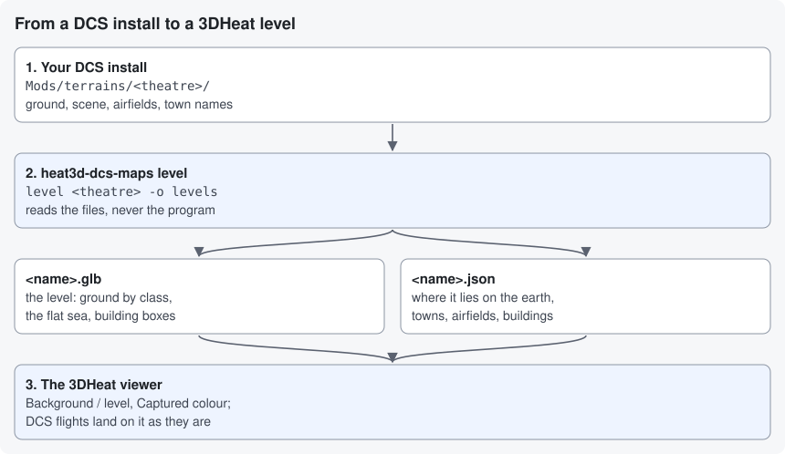

# 3DHeat DCS: DCS World maps as 3D levels

**What is it?** A theatre is DCS World's word for a map: a region of the
world you fly over. This tool turns the ground of one theatre, read from your
own DCS install, into a 3D model you can fly over in the
[3DHeat](https://github.com/Holdi601/3DHeat) viewer.

**Why would I use it?** To see your DCS flights over the game's own map -
its hills, coast, airfields, roads and towns - instead of today's earth.

**Example:** `heat3d-dcs-maps level <theatre> -o levels` -> `levels/<theatre>.glb`
(the 3D level) + `levels/<theatre>.json` (where it lies on the earth, its
towns and airfields).



**Documentation:** [holdi601.github.io/3DHeat-Ext-DCS](https://holdi601.github.io/3DHeat-Ext-DCS/), a page per
command with step-by-step use and example output. Part of
[3DHeat](https://github.com/Holdi601/3DHeat) ([documentation](https://holdi601.github.io/3DHeat/)).

This reader is kept outside the 3DHeat tools on purpose: it reads Eagle
Dynamics' terrain files, and their licence (below) is strict about that. If
it ever has to go, nothing else goes with it. The levels it writes stay on
your machine.

## Install

New to the command line? Read [Before you start](https://holdi601.github.io/3DHeat-Ext-DCS/before-you-start.html) first.

1. Install Python 3.10 or later, and DCS World.
2. `git clone https://github.com/Holdi601/3DHeat-Ext-DCS` (or download the
   ZIP) and open a terminal in that folder.
3. Install the command and list your theatres:

```bash
python -m pip install -e .        # installs the heat3d-dcs-maps command
heat3d-dcs-maps list              # the theatres installed, and whether each can be read
```

You should see one line per installed theatre: its name, its size, and `readable`.


## Commands

| Command | Does | Page |
|---|---|---|
| `list [--dcs FOLDER]` | the theatres installed, and whether each can be read | [list](https://holdi601.github.io/3DHeat-Ext-DCS/list.html) |
| `level <theatre> -o <folder>` | one theatre's ground, sea and buildings as a `.glb` level | [level](https://holdi601.github.io/3DHeat-Ext-DCS/level.html) |
| `towns <theatre>` | the theatre's place names, with DCS coordinates, as JSON | [towns](https://holdi601.github.io/3DHeat-Ext-DCS/towns.html) |
| `fit <recording>` | find a theatre's projection from a recording | [fit](https://holdi601.github.io/3DHeat-Ext-DCS/fit.html) |

```bash
heat3d-dcs-maps level <theatre> -o levels                                      # a whole (small) theatre
heat3d-dcs-maps level <theatre> --around <lat> <lon> 12 -o levels --name <name>  # 12 km either side of a point
heat3d-dcs-maps towns <theatre>                                                # its place names
```

`<theatre>` is the name `list` prints. The install is found from the
registry, the Steam libraries and the usual folders; `--dcs <folder>` (the
one holding `Mods\terrains`) or the `DCS_PATH` environment variable say
where it is otherwise. Exit status: 0 done; 1 failed (or too large, or for
`fit` a poor fit); 2 nothing found.

| `level` option | Does |
|---|---|
| `-o`, `--out FOLDER` | where `<name>.glb` and `<name>.json` go (required) |
| `--dcs FOLDER` | the DCS World folder (also for `list` and `towns`) |
| `--name NAME` | the level's name (default: the theatre's) |
| `--around LAT LON KM` / `--bounds X0 Z0 X1 Z1` | only a square around a point / a box in DCS metres |
| `--cell M` | thin the mesh to *M* metres (default 0: the game's own triangles) |
| `--seabed`, `--no-water`, `--no-buildings` | keep the sea floor; leave out the flat sea; leave out the buildings |
| `--force` | export a very large theatre whole at full detail |
| `--projection LON0 FE FN` | Transverse Mercator constants for a theatre this tool does not know (see `fit`) |

Every option, as the program prints it: [Command reference](https://holdi601.github.io/3DHeat-Ext-DCS/cli-reference.html).

## What comes out

`<out>/<name>.glb` (a glTF binary level) and `<name>.json` beside it. Levels
are not match files: the viewer's one-file-a-match container
([One file a match (.3dheat)](https://holdi601.github.io/3DHeat/container.html))
holds the telemetry you load on top.

| Part | What it is |
|---|---|
| `ground:<Level>` | the terrain's own triangles, coloured by what the game draws over each |
| `water:<Level>` | every triangle the game marks as under the sea, laid flat at sea level |
| `structure:<Level>` | the theatre's buildings as boxes, where the game places them |

The colours show with **Captured colour** in the viewer's level panel:

| Class | Colour | From the game's overlay |
|---|---|---|
| runway | near black | `Runway` - runways, taxiways and aprons |
| road | dark grey | `Road` |
| rail | brown | `Rail` |
| town | brick red | `Town`, `Building` |
| water | blue | `River`, `Lake` (inland water, drawn as ground) |
| beach | sand | `Beach` |
| rock | grey | `Rock` |
| field | light green | `Field`, `Grass` |
| forest | dark green | `Forest`, `Trees` |
| land | khaki | none of these |
| seabed | slate blue | only with `--seabed` |

**Coordinates** are DCS's own world metres: x north, y up, z east, the same
as the glTF axes. Telemetry in DCS metres - the 3DHeat Watcher's DCS hook
writes exactly that - lands on the level with no placement step.
`<name>.json` carries the theatre's projection, the level's corners in
latitude and longitude, and its towns, airfields and buildings: see
[The level files](https://holdi601.github.io/3DHeat-Ext-DCS/output.html).

## The 3DHeat tools

| Tool | What it does | Code | Docs |
|---|---|---|---|
| 3DHeat viewer | shows the data: heatmaps, race analysis, match review | [3DHeat](https://github.com/Holdi601/3DHeat) | [docs](https://holdi601.github.io/3DHeat/) |
| GameFiles | levels and courses from a game's own files | [3DHeat-GameFiles](https://github.com/Holdi601/3DHeat-GameFiles) | [docs](https://holdi601.github.io/3DHeat-GameFiles/) |
| GameCapture | lap telemetry, and levels rebuilt from gameplay video | [3DHeat-GameCapture](https://github.com/Holdi601/3DHeat-GameCapture) | [docs](https://holdi601.github.io/3DHeat-GameCapture/) |
| Unreal Exporter | an Unreal Editor plugin: a level as one `.glb` | [3DHeat-UnrealExporter](https://github.com/Holdi601/3DHeat-UnrealExporter) | [docs](https://holdi601.github.io/3DHeat-UnrealExporter/) |
| CS2 | Counter-Strike 2 demos and maps | [3DHeat-CS2](https://github.com/Holdi601/3DHeat-CS2) | [docs](https://holdi601.github.io/3DHeat-CS2/) |
| Watcher | records what games publish while you play | [3DHeat-Watcher](https://github.com/Holdi601/3DHeat-Watcher) | [docs](https://holdi601.github.io/3DHeat-Watcher/) |
| Ext-WarThunder | War Thunder replays | [3DHeat-Ext-WarThunder](https://github.com/Holdi601/3DHeat-Ext-WarThunder) | [docs](https://holdi601.github.io/3DHeat-Ext-WarThunder/) |
| Ext-WoT | World of Tanks replays | [3DHeat-Ext-WoT](https://github.com/Holdi601/3DHeat-Ext-WoT) | [docs](https://holdi601.github.io/3DHeat-Ext-WoT/) |
| Ext-WoWs | World of Warships replays | [3DHeat-Ext-WoWs](https://github.com/Holdi601/3DHeat-Ext-WoWs) | [docs](https://holdi601.github.io/3DHeat-Ext-WoWs/) |
| Ext-Squad | Squad server demos | [3DHeat-Ext-Squad](https://github.com/Holdi601/3DHeat-Ext-Squad) | [docs](https://holdi601.github.io/3DHeat-Ext-Squad/) |
| Ext-DCS | DCS World maps as 3D levels | [3DHeat-Ext-DCS](https://github.com/Holdi601/3DHeat-Ext-DCS) | [docs](https://holdi601.github.io/3DHeat-Ext-DCS/) |
| Ext-IL2 | IL-2 Sturmovik maps as 3D levels | [3DHeat-Ext-IL2](https://github.com/Holdi601/3DHeat-Ext-IL2) | [docs](https://holdi601.github.io/3DHeat-Ext-IL2/) |

## Eagle Dynamics' terms

Read on 2026-11-07 from `Doc/license_en.txt` of the install (DCS World
End-User Licence Agreement, The Fighter Collection Ltd). The licensed
"Program" includes "THE DATA SUPPLIED WITH IT". Clause 3.1:

> Except as expressly set out in this Licence or in clauses 4.1 and 4.2
> below, or as permitted by any local law, you undertake to use the Program
> for your own personal use, and you shall not: [...]
>
> (c) not to disassemble, decompile, reverse engineer or create derivative
> works based on the whole, or any part, of the Program nor attempt to do any
> such things except to the extent that (by virtue of section 296A of the
> Copyright, Designs and Patents Act 1988) such actions cannot be prohibited
> because they are essential for the purpose of achieving inter-operability
> of the Program with another software program, and provided that the
> information obtained by you during such activities: (i) is used only for
> the purpose of achieving inter-operability of the Program with another
> software program; and (ii) is not unnecessarily disclosed or communicated
> to any third party without the TFC's prior written consent; and (iii) is
> not used to create any software which is substantially similar to the
> Program.

Clause 3.1 (a) forbids to "sell, trade, rent, lease, sub-license, merge,
adapt, vary, modify the Program" without consent, and (e) to "exploit this
Program or any of its parts commercially".

What this reader does: it reads data files on your own machine, after you
installed them, outside the game. It changes nothing in the game, breaks no
encryption (the one enciphered file in a terrain folder is left alone) and
talks to no server. Working out the layout of a data file is reverse
engineering in the sense of 3.1 (c), and a level built from the game's
terrain is arguably a derivative work. Using the reader is your decision,
for your own use; the levels it writes are yours to view, not to share or
publish. That is why it is a separate package.

The sanctioned alternative, which reads no file: the sim's own mission
scripting can sample the ground (`land.getHeight`, `land.getSurfaceType`)
and list airbases (`world.getAirbases`) while a mission runs. It needs DCS
running for hours per theatre and gives a coarser grid; it was not built,
because the files proved readable.

## Licence and sources

MIT ([`LICENSE`](LICENSE)). Needs numpy (BSD-3-Clause); `fit` on a
`.parquet` needs pyarrow (Apache-2.0). Written for this project. The
projection constants are facts published by pydcs
(github.com/pydcs/dcs, `dcs/terrain/*/projection.py`); only the numbers were
taken. The projection is Krüger's series as C. F. F. Karney gives it
("Transverse Mercator with an accuracy of a few nanometers", Journal of
Geodesy 85, 2011). No code was taken from any other project.
