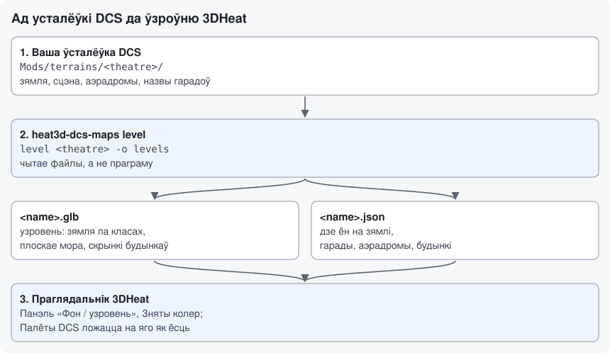

# 3DHeat DCS {#dheat-dcs}

**Што гэта?** Тэатр — гэта слова DCS World для карты: рэгіён
свету, над якім вы лятаеце. Гэты інструмент ператварае зямлю аднаго тэатра, прачытаную з
**вашай уласнай усталёўкі**, у 3D-узровень — мадэль, над якой можна лятаць, — для
праглядальніка [3DHeat](https://github.com/Holdi601/3DHeat)
([дакументацыя](https://holdi601.github.io/3DHeat/)).

**Навошта гэта мне?** Каб бачыць свае палёты DCS над уласнай картай гульні: яе
пагоркамі, узбярэжжам, аэрадромамі, дарогамі, чыгункамі, гарадамі і будынкамі.

**Прыклад:** `heat3d-dcs-maps level <theatre> -o levels` ->
`levels/<theatre>.glb` (узровень) + `levels/<theatre>.json` (дзе ён ляжыць на
зямлі, яго гарады і аэрадромы).

Для чаго гэта карысна:

- **Палёты на ўласнай карце гульні.** Фон свету 3DHeat малюе сённяшнюю
  зямлю па адкрытых даных; тут тэатр маляваны так, як яго малюе DCS.
- **Без этапу размяшчэння.** Узровень ва ўласных метрах свету DCS, таму тэлеметрыя
  ў метрах DCS (менавіта яе піша DCS-хук 3DHeat Watcher) ложыцца на
  яго з наладамі праглядальніка па змаўчанні.
- **Шырата і даўгата.** Кожны ўзровень нясе сваю праекцыю, свае вуглы
  і свае гарады ў абедзвюх сістэмах.



## Хуткі старт {#quick-start}

Упершыню ў камандным радку? Спачатку прачытайце [Перад пачаткам](before-you-start.md).
Выконвайце гэта ў папцы, якую вы атрымалі праз `git clone` або распакавалі:

```bash
python -m pip install -e .                         # installs the heat3d-dcs-maps command
heat3d-dcs-maps list                               # the theatres installed, and whether each can be read
heat3d-dcs-maps level <theatre> -o levels          # a whole (small) theatre
heat3d-dcs-maps level <theatre> --around <lat> <lon> 12 -o levels --name <name>   # 12 km either side of a point
```

З `list` вы ўбачыце па радку на кожны тэатр, што заканчваецца на `readable`.
Потым загрузіце `levels/<name>.glb` на панэлі «Фон / узровень» праглядальніка
([Узроўні](https://holdi601.github.io/3DHeat/levels.html)).

Узроўні, якія ён піша, пабудаваны з даных гульні: яны застаюцца **на вашым
кампутары**, каб глядзець, а не каб дзяліцца або публікаваць ([Умовы](terms.md)).

Кожны чытальнік гульні — асобны невялікі праект з уласным файлам ліцэнзіі, уласнымі рэлізамі і ўласным трэкерам задач, таму яго можна ўсталёўваць, абнаўляць, падтрымліваць - або адклікаць на просьбу праваўладальніка - асобна, не закранаючы праглядальнік і іншыя інструменты.

## Старонкі {#pages}

| Старонка | Пра што яна |
|---|---|
| [Перад пачаткам](before-you-start.md) | Python, тэрмінал, першы запуск |
| [Пошук тэатраў: list](list.md) | дзе знаходзіцца ўсталёўка, што друкуе `list` |
| [Пабудова ўзроўню: level](level.md) | кожная опцыя, рэгіёны, памер, крок за крокам |
| [Файлы ўзроўню](output.md) | часткі `.glb`, класы зямлі і іх колеры, `.json`, каардынаты |
| [Назвы месцаў: towns](towns.md) | гарады тэатра з каардынатамі DCS |
| [Праекцыі: fit](fit.md) | пошук праекцыі тэатра па запісе |
| [Як чытаюцца файлы](reading.md) | фарматы, што было правілена, што не чытаецца |
| [Умовы і ліцэнзія](terms.md) | што чытаецца, што не пастаўляецца, ліцэнзія |
| [Даведнік каманд](../cli-reference.md) | кожная опцыя, створаная з кода |
| [Падтрымка гэтай дакументацыі](maintaining.md) | спіс для выпуску |

## Звязанае {#related}

- Праглядальнік 3DHeat: [github.com/Holdi601/3DHeat](https://github.com/Holdi601/3DHeat),
  дакументацыя на [holdi601.github.io/3DHeat](https://holdi601.github.io/3DHeat/).
- Тэлеметрыя для гэтых узроўняў: [3DHeat Watcher](https://holdi601.github.io/3DHeat-Watcher/)
  запісвае палёты DCS; фарматы файлаў праглядальніка, у тым ліку яго
  кантэйнер «адзін файл на матч», апісаны ў
  [Адзін файл на матч (.3dheat)](https://holdi601.github.io/3DHeat/container.html).

## Інструменты 3DHeat {#the-3dheat-tools}

| Інструмент | Што ён робіць | Код | Дакументацыя |
|---|---|---|---|
| Праглядальнік 3DHeat | паказвае даныя: цеплавыя карты, аналіз гонак, разбор матчаў | [3DHeat](https://github.com/Holdi601/3DHeat) | [дакументацыя](https://holdi601.github.io/3DHeat/) |
| GameFiles | узроўні і трасы з уласных файлаў гульні | [3DHeat-GameFiles](https://github.com/Holdi601/3DHeat-GameFiles) | [дакументацыя](https://holdi601.github.io/3DHeat-GameFiles/) |
| GameCapture | тэлеметрыя кругоў і ўзроўні, узноўленыя з відэа гульні | [3DHeat-GameCapture](https://github.com/Holdi601/3DHeat-GameCapture) | [дакументацыя](https://holdi601.github.io/3DHeat-GameCapture/) |
| Unreal Exporter | убудова Unreal Editor: узровень як адзін `.glb` | [3DHeat-UnrealExporter](https://github.com/Holdi601/3DHeat-UnrealExporter) | [дакументацыя](https://holdi601.github.io/3DHeat-UnrealExporter/) |
| CS2 | дэма і карты Counter-Strike 2 | [3DHeat-CS2](https://github.com/Holdi601/3DHeat-CS2) | [дакументацыя](https://holdi601.github.io/3DHeat-CS2/) |
| Watcher | запісвае тое, што гульні публікуюць, пакуль вы гуляеце | [3DHeat-Watcher](https://github.com/Holdi601/3DHeat-Watcher) | [дакументацыя](https://holdi601.github.io/3DHeat-Watcher/) |
| Ext-WarThunder | рэплеі War Thunder | [3DHeat-Ext-WarThunder](https://github.com/Holdi601/3DHeat-Ext-WarThunder) | [дакументацыя](https://holdi601.github.io/3DHeat-Ext-WarThunder/) |
| Ext-WoT | рэплеі World of Tanks | [3DHeat-Ext-WoT](https://github.com/Holdi601/3DHeat-Ext-WoT) | [дакументацыя](https://holdi601.github.io/3DHeat-Ext-WoT/) |
| Ext-WoWs | рэплеі World of Warships | [3DHeat-Ext-WoWs](https://github.com/Holdi601/3DHeat-Ext-WoWs) | [дакументацыя](https://holdi601.github.io/3DHeat-Ext-WoWs/) |
| Ext-Squad | дэма сервераў Squad | [3DHeat-Ext-Squad](https://github.com/Holdi601/3DHeat-Ext-Squad) | [дакументацыя](https://holdi601.github.io/3DHeat-Ext-Squad/) |
| Ext-DCS | карты DCS World як 3D-узроўні | [3DHeat-Ext-DCS](https://github.com/Holdi601/3DHeat-Ext-DCS) | [дакументацыя](https://holdi601.github.io/3DHeat-Ext-DCS/) |
| Ext-IL2 | карты IL-2 Sturmovik як 3D-узроўні | [3DHeat-Ext-IL2](https://github.com/Holdi601/3DHeat-Ext-IL2) | [дакументацыя](https://holdi601.github.io/3DHeat-Ext-IL2/) |
