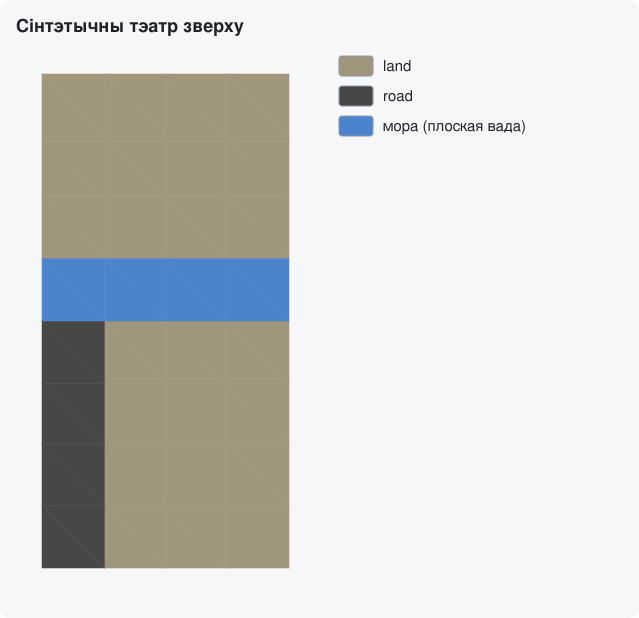
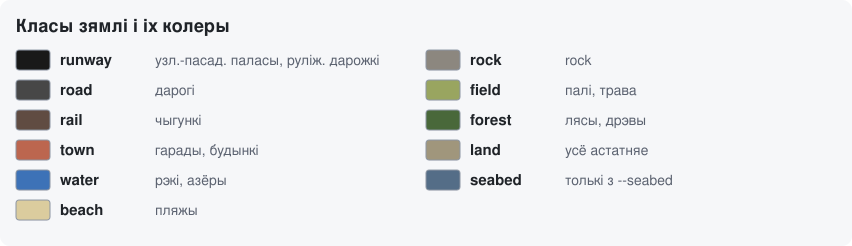

# Файлы ўзроўню {#the-level-files}

Узровень — гэта 3D-мадэль зямлі; тэатр — слова DCS World для карты.

`<out>/<name>.glb` і побач з ім `<name>.json`.

| Частка | Што гэта |
|---|---|
| `ground:<Level>` | уласныя трохвугольнікі рэльефу, афарбаваныя тым, што гульня малюе над кожным |
| `water:<Level>` | кожны трохвугольнік, які гульня адзначае як пад морам, пакладзены плоска на ўзроўні мора |
| `structure:<Level>` | будынкі тэатра як скрынкі, там, дзе гульня іх размяшчае (ніжэй) |

Колеры — гэта класы ніжэй:

Колеры бачныя пры ўключаным **Зняты колер** на панэлі ўзроўню праглядальніка. Кожны
трохвугольнік зямлі прымае клас накладкі, якой гульня яго малюе:

| Клас | Колер | З накладкі гульні |
|---|---|---|
| runway | амаль чорны | `Runway` - узлётна-пасадачныя паласы, руліжныя дарожкі і пероны |
| road | цёмна-шэры | `Road` |
| rail | карычневы | `Rail` |
| town | цаглянавы чырвоны | `Town`, `Building` |
| water | сіні | `River`, `Lake` (унутраная вада, малюецца як зямля) |
| beach | пясочны | `Beach` |
| rock | шэры | `Rock` |
| field | светла-зялёны | `Field`, `Grass` |
| forest | цёмна-зялёны | `Forest`, `Trees` |
| land | хакі | нічога з гэтага |
| seabed | шыферна-сіні | толькі з `--seabed` |

Калі некалькі накладак малююць адзін трохвугольнік, вырашае парадак табліцы
(дарога праз лес — гэта дарога). Кожны трохвугольнік накладкі — адзін з уласных
трохвугольнікаў зямлі - праверана на кожным класе ўсіх спробаваных тэатраў, кожны супаў - таму
класы дакладныя, а не вылічаны па бліжэйшых кропках.

**Каардынаты** — гэта ўласныя метры свету DCS: x на поўнач, y уверх, z на ўсход, і
восі glTF тыя ж (X = x, Y = y, Z = z). Тэлеметрыя ў метрах DCS - менавіта яе піша
DCS-хук 3DHeat Watcher - ложыцца на ўзровень з наладамі праглядальніка
па змаўчанні (Y уверх, маштаб 1) і без этапу размяшчэння.

**Шырата і даўгата:** кожны тэатр — гэта праекцыя Transverse Mercator
са сваімі канстантамі; `<name>.json` нясе іх, вуглы ўзроўню ў
шыраце і даўгаце і кожны горад з яго шыратой/даўгатой і
яго x/z DCS. Калі канстанты тэатра не апублікаваны, яны падганяюцца
па маяках, якія яго ўласны `beacons.lua` дае ў абедзвюх сістэмах (некалькі см сярэднеквадратычнай
памылкі; тая ж падгонка вяртае апублікаваныя канстанты іншых тэатраў з дакладнасцю да
міліметра).
Для тэатра без канстант [`fit`](fit.md) знаходзіць іх з любога
запісу, дзе ёсць абедзве, напрыклад з сесіі Watcher аднаго палёту.

**Марское дно** не ўключаецца (цеплавой карце палётаў не патрэбна марское
дно); `--seabed` пакідае яго як зямлю. `--no-water` не ўключае
плоскае мора.

**Памер.** Гл. [Пабудова ўзроўню: Памер](level.md#size).

**Аэрадромы.** Кожны `AirfieldsTaxiways/<name>.rn4` змяшчае сетку руліжных дарожак
аднаго аэрадрома, названы па ім; яго кропкі — гэта (x, y, z) double у метрах DCS. `.json`
узроўню пералічвае кожны аэрадром у рэгіёне з яго назвай (з
файла), сярэдзінай скрынкі яго кропак, самой скрынкай і зямлёй там. На разгледжаным
тэатры кожны файл аэрадрома прачытаўся, і кожны стаяў на сваім полі
(у межах некалькіх соцень метраў ад вымеранай апорнай кропкі аэрапорта: сярэдзіна
руліжных дарожак, а не палосы).

**Будынкі.** `Scenes/<theatre>.scn5` размяшчае кожны аб'ект тэатра
(мільёны: дрэвы, ліхтары, платы, правады, дамы). Тыя,
што па імені і памеры з'яўляюцца будынкамі (дамы, кватэрныя дамы, хлявы, ангары,
фабрыкі, вежы, тэрміналы: невялікая частка мадэляў, сотні
тысяч размяшчэнняў), малююцца як скрынкі: уласная абмежавальная скрынка кожнай мадэлі з
файла, павернутая да яе курсу і стаячая там, дзе яе ставіць гульня, ад
3 м ніжэй за яе пачатак (яе аснова на схіле) да вяршыні. Дрэвы, кусты,
святло, слупы, правады, платы, сцены, знакі, транспарт, вагоны, лодкі, краны,
мачты, пілоны і масты не ўключаюцца. Ніводная форма мадэлі і тэкстура
гульні не капіруюцца: скрынка на будынак, афарбаваная па віду (дом, жылы
корпус, прамысловы, аэрадром, вежа, іншае). `<name>.json` пералічвае іх таксама
(`buildings.rows`: x, z, аснова, вышыня, паловы даўжынь, курс, від) для
гібрыднага фону праглядальніка, які малюе іх у гарадах гульні замест
нанесеных на карту будынкаў. `--no-buildings` не ўключае іх.

`<name>.json` таксама запісвае зыходны файл, яго памер і дату, прачытаныя
пліткі, колькасць трохвугольнікаў на клас і колькі гарадоў тэатра трапляе
на зямлю - праверка праекцыі, і павінна быць «N з N».

Узровень — гэта двайковы glTF з імянованымі часткамі, як і кожны ўзровень 3DHeat; старонка праглядальніка
[Узроўні](https://holdi601.github.io/3DHeat/levels.html) кажа, як ён іх загружае.
