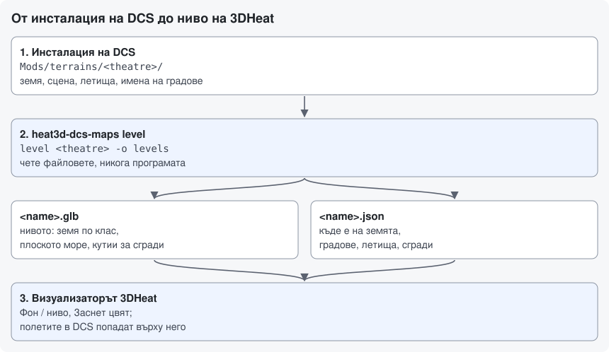

# 3DHeat DCS {#dheat-dcs}

**Какво е?** Театър е думата на DCS World за карта: област от света, над която летите. Този инструмент превръща земята на един театър, прочетена от **вашата собствена инсталация**, в 3D ниво - модел, над който може да летите - за визуализатора [3DHeat](https://github.com/Holdi601/3DHeat) ([документация](https://holdi601.github.io/3DHeat/)).

**Защо да го използвам?** За да видите полетите си в DCS върху самата карта на играта: нейните хълмове, брягът, летищата, пътищата, железниците, градовете и сградите.

**Пример:** `heat3d-dcs-maps level <theatre> -o levels` ->
`levels/<theatre>.glb` (нивото) + `levels/<theatre>.json` (къде лежи на земята, градовете и летищата му).

За какво е полезен:

- **Полети върху собствената карта на играта.** Фонът на света в 3DHeat рисува днешната Земя от отворени данни; това рисува театъра така, както го рисува DCS.
- **Без стъпка за поставяне.** Нивото е в собствените метри на света на DCS, така че телеметрията в метри на DCS (куката на 3DHeat Watcher за DCS записва точно това) попада върху него с настройките по подразбиране на визуализатора.
- **Географска ширина и дължина.** Всяко ниво носи своята проекция, ъглите си и градовете си в двете координатни системи.



## Бърз старт {#quick-start}

Нов ли сте в командния ред? Първо прочетете [Преди да започнете](before-you-start.md).
Пуснете тези команди в папката, в която сте клонирали или разархивирали инструмента:

```bash
python -m pip install -e .                         # инсталира командата heat3d-dcs-maps
heat3d-dcs-maps list                               # инсталираните театри и дали всеки може да се чете
heat3d-dcs-maps level <theatre> -o levels          # цял (малък) театър
heat3d-dcs-maps level <theatre> --around <lat> <lon> 12 -o levels --name <name>   # 12 km във всяка посока от една точка
```

От `list` трябва да видите по един ред за всеки театър, завършващ с `readable`.
После заредете `levels/<name>.glb` в панела Фон / ниво на визуализатора
([Нива](https://holdi601.github.io/3DHeat/levels.html)).

Нивата, които се записват, са изградени от данните на играта и остават **на вашата машина**,
за преглед, не за споделяне или публикуване ([Условия](terms.md)).

Всеки четец на игра е отделен малък проект със собствен файл с лиценз, собствени издания и собствена система за проблеми, така че може да бъде инсталиран, обновяван, поддържан - или оттеглен по искане на носител на права - самостоятелно, без да засяга визуализатора или другите инструменти.

## Страници {#pages}

| Страница | Какво съдържа |
|---|---|
| [Преди да започнете](before-you-start.md) | Python, терминал, първо пускане |
| [Намиране на театрите: list](list.md) | къде се намира инсталацията, какво извежда `list` |
| [Изграждане на ниво: level](level.md) | всяка опция, региони, размер, стъпка по стъпка |
| [Файловете на нивото](output.md) | частите `.glb`, класовете на земята и техните цветове, `.json`, координатите |
| [Имена на места: towns](towns.md) | градовете на театър с координати на DCS |
| [Проекции: fit](fit.md) | намиране на проекцията на театър от запис |
| [Как се четат файловете](reading.md) | форматите, какво е проверено, какво не се чете |
| [Условия и лиценз](terms.md) | какво се чете, какво не се доставя, лицензът |
| [Справка за командите](../cli-reference.md) | всяка опция, генерирана от кода |
| [Поддръжка на тези документи](maintaining.md) | списъкът за издаване |

## Свързано {#related}

- Визуализаторът 3DHeat: [github.com/Holdi601/3DHeat](https://github.com/Holdi601/3DHeat),
  документацията е на [holdi601.github.io/3DHeat](https://holdi601.github.io/3DHeat/).
- Телеметрия за тези нива: [3DHeat Watcher](https://holdi601.github.io/3DHeat-Watcher/)
  записва полетите в DCS; файловите формати на визуализатора, включително контейнера с един файл на мач,
  са описани в [Един файл на мач (.3dheat)](https://holdi601.github.io/3DHeat/container.html).

## Инструментите на 3DHeat {#the-3dheat-tools}

| Инструмент | Какво прави | Код | Документация |
|---|---|---|---|
| визуализатор 3DHeat | показва данните: топлинни карти, анализ на състезания, преглед на мача | [3DHeat](https://github.com/Holdi601/3DHeat) | [документация](https://holdi601.github.io/3DHeat/) |
| GameFiles | нива и трасета от собствените файлове на играта | [3DHeat-GameFiles](https://github.com/Holdi601/3DHeat-GameFiles) | [документация](https://holdi601.github.io/3DHeat-GameFiles/) |
| GameCapture | телеметрия от обиколки и нива, възстановени от видеозаписи на игра | [3DHeat-GameCapture](https://github.com/Holdi601/3DHeat-GameCapture) | [документация](https://holdi601.github.io/3DHeat-GameCapture/) |
| Unreal Exporter | приставка за Unreal Editor: ниво като един `.glb` | [3DHeat-UnrealExporter](https://github.com/Holdi601/3DHeat-UnrealExporter) | [документация](https://holdi601.github.io/3DHeat-UnrealExporter/) |
| CS2 | демота и карти на Counter-Strike 2 | [3DHeat-CS2](https://github.com/Holdi601/3DHeat-CS2) | [документация](https://holdi601.github.io/3DHeat-CS2/) |
| Watcher | записва какво публикуват игрите, докато играете | [3DHeat-Watcher](https://github.com/Holdi601/3DHeat-Watcher) | [документация](https://holdi601.github.io/3DHeat-Watcher/) |
| Ext-WarThunder | повторения на War Thunder | [3DHeat-Ext-WarThunder](https://github.com/Holdi601/3DHeat-Ext-WarThunder) | [документация](https://holdi601.github.io/3DHeat-Ext-WarThunder/) |
| Ext-WoT | повторения на World of Tanks | [3DHeat-Ext-WoT](https://github.com/Holdi601/3DHeat-Ext-WoT) | [документация](https://holdi601.github.io/3DHeat-Ext-WoT/) |
| Ext-WoWs | повторения на World of Warships | [3DHeat-Ext-WoWs](https://github.com/Holdi601/3DHeat-Ext-WoWs) | [документация](https://holdi601.github.io/3DHeat-Ext-WoWs/) |
| Ext-Squad | демота от сървъри на Squad | [3DHeat-Ext-Squad](https://github.com/Holdi601/3DHeat-Ext-Squad) | [документация](https://holdi601.github.io/3DHeat-Ext-Squad/) |
| Ext-DCS | карти на DCS World като 3D нива | [3DHeat-Ext-DCS](https://github.com/Holdi601/3DHeat-Ext-DCS) | [документация](https://holdi601.github.io/3DHeat-Ext-DCS/) |
| Ext-IL2 | карти на IL-2 Sturmovik като 3D нива | [3DHeat-Ext-IL2](https://github.com/Holdi601/3DHeat-Ext-IL2) | [документация](https://holdi601.github.io/3DHeat-Ext-IL2/) |
