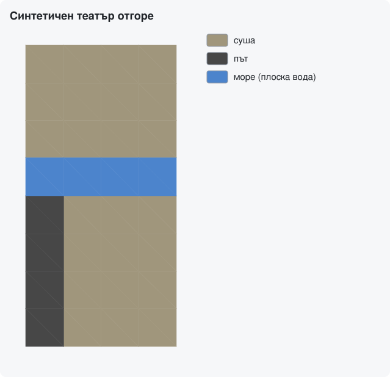
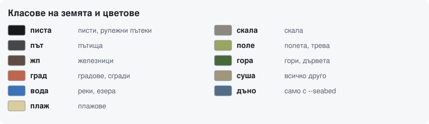

# Файловете на нивото {#the-level-files}

Ниво е триизмерен модел на земята; театър е думата на DCS World за карта.

`<out>/<name>.glb` и `<name>.json` до него.

| Част | Какво е |
|---|---|
| `ground:<Level>` | собствените триъгълници на терена, оцветени според това, което играта рисува върху всеки |
| `water:<Level>` | всеки триъгълник, който играта отбелязва като под морето, положен плоско на морското ниво |
| `structure:<Level>` | сградите на театъра като кутии, там където играта ги поставя (по-долу) |

Цветовете са класовете по-долу:

Цветовете се показват с **Заснет цвят** в панела Фон / ниво на визуализатора. Всеки триъгълник на земята
приема класа на припокриването, с което играта го рисува:

| Клас | Цвят | От припокриването на играта |
|---|---|---|
| runway | почти черно | `Runway` - писти, рулежни пътеки и платформи |
| road | тъмносиво | `Road` |
| rail | кафяво | `Rail` |
| town | тухлено червено | `Town`, `Building` |
| water | синьо | `River`, `Lake` (вътрешни води, рисувани като земя) |
| beach | пясъчно | `Beach` |
| rock | сиво | `Rock` |
| field | светлозелено | `Field`, `Grass` |
| forest | тъмнозелено | `Forest`, `Trees` |
| land | каки | нито едно от тези |
| seabed | сини шисти | само с `--seabed` |

Когато няколко припокривания рисуват един и същи триъгълник, решава редът в таблицата
(път през гора е път). Всеки триъгълник на припокриване е един от собствените триъгълници на терена -
проверено при всеки клас на театрите, които са пробвани, всеки е съвпаднал - така че класовете са точни, а не отгатнати от близките точки.

**Координатите** са собствените метри на света на DCS: x на север, y нагоре, z на изток, а осите на glTF са същите (X = x, Y = y, Z = z). Телеметрията в метри на DCS - куката на 3DHeat Watcher за DCS записва точно това - попада върху нивото с настройките по подразбиране на визуализатора (Y нагоре, мащаб 1) и без стъпка за поставяне.

**Географска ширина и дължина:** всеки театър е проекция Transverse Mercator със собствени константи; `<name>.json` ги съдържа, ъглите на нивото в географска ширина и дължина и всеки град с неговата географска ширина и дължина и своите DCS x/z. Когато константите на театър не са публикувани, те се нагаждат към маяците, които дава собственият му `beacons.lua` в двете координатни системи (средноквадратична грешка от няколко cm; същото нагаждане дава обратно публикуваните константи на други театри с точност до милиметър). За театър без константи [`fit`](fit.md) ги намира от всеки запис, който съдържа и двете, например сесия на Watcher от един полет.

**Морското дъно** се пропуска (тепловата карта за симулатор на полети не се нуждае от морското дъно); `--seabed` го запазва като земя. `--no-water` пропуска плоското море.

**Размер.** Вижте [Изграждане на ниво: Размер](level.md#size).

**Летища.** Всеки `AirfieldsTaxiways/<name>.rn4` съдържа мрежата за рулиране на едно летище, наречена по него; точките ѝ са (x, y, z) числа с двойна точност в метри на DCS. `.json` на нивото изброява всяко летище в региона с неговото име (това на файла), средата на кутията на точките му, самата кутия и земята там. При пробвания театър всеки файл на летище е прочетен и се поставя върху полето си (в рамките на няколко стотин метра от официалната референтна точка на летището: средата на рулежните пътеки, а не на пистата).

**Сгради.** `Scenes/<theatre>.scn5` поставя всеки обект на театъра (милиони - дървета, лампи, огради, жици, къщи). Тези, които по име и размер са сгради (къщи, апартаменти, плевни, хангари, фабрики, кули, терминали: част от моделите, стотици хиляди поставяния), се рисуват като кутии: ограничителната кутия на всеки модел от файла, завъртяна по посоката му и поставена там, където играта я слага, от до 3 m под началото му (основата му по склон) до върха му. Дървета, храсти, светлини, стълбове, жици, огради, стени, табели, превозни средства, вагони, лодки, кранове, мачти, стълбове на електропроводи и мостове се пропускат. Не се копира нито форма, нито текстура на модел от играта: кутия за всяка сграда, оцветена според вида (къща, блок, индустриална, летищна, кула, друга). `<name>.json` ги изброява също (`buildings.rows`: x, z, основа, височина, полудължини, посока, вид) за хибридния фон на визуализатора, който ги рисува в градовете на играта вместо картографираните сгради. `--no-buildings` ги пропуска.

`<name>.json` записва също изходния файл, размера и датата му, прочетените мрежи, броя триъгълници на клас и колко от градовете на театъра попадат на земята - проверка на проекцията, която трябва да покаже „N of N“.

Нивото е двоичен glTF с именувани части, както всяко ниво на 3DHeat; страницата [Нива](https://holdi601.github.io/3DHeat/levels.html) на визуализатора казва как се зареждат.
