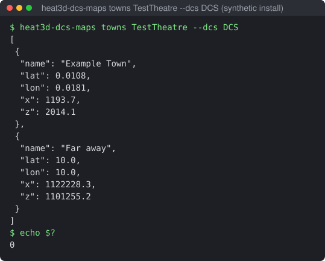

# Имена на места: `towns` {#place-names-towns}

```text
heat3d-dcs-maps towns <theatre> [--dcs FOLDER]
```

Извежда имената на местата на театъра от неговия `map/towns.lua` (прочетен като текст,
никога не се изпълнява), като JSON: името на всеки град, географската му ширина и дължина и
неговите `x` (север) и `z` (изток) в метри на DCS, през проекцията на театъра.

1. Намерете името на папката на театъра с [`list`](list.md).
2. Стартирайте `heat3d-dcs-maps towns <theatre> > towns.json`.
3. Използвайте `x`/`z`, за да етикетирате ниво или да проверите позициите от запис.



| Опция | Какво прави |
|---|---|
| `theatre` | името на папката под `Mods\terrains` |
| `--dcs FOLDER` | папката на DCS World |

Градовете в региона на нивото са и в неговия `<name>.json`, с височината на земята под всеки от тях ([Файловете на нивото](output.md)).
