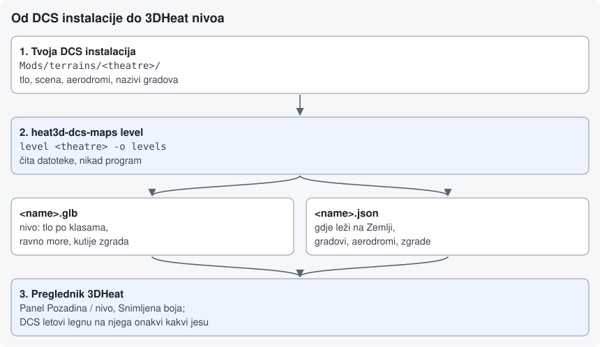

# 3DHeat DCS {#dheat-dcs}

**Šta je to?** Teatar je riječ iz DCS Worlda za mapu: područje svijeta iznad
kojeg letiš. Ovaj alat pretvara tlo jednog teatra, pročitano iz
**tvoje vlastite instalacije**, u 3D nivo - model iznad kojeg možeš letjeti - za
preglednik [3DHeat](https://github.com/Holdi601/3DHeat)
([dokumentacija](https://holdi601.github.io/3DHeat/)).

**Zašto bih ga koristio?** Da vidiš svoje DCS letove nad vlastitom mapom igre:
njenim brdima, obalom, aerodromima, cestama, željeznicama, gradovima i zgradama.

**Primjer:** `heat3d-dcs-maps level <theatre> -o levels` ->
`levels/<theatre>.glb` (nivo) + `levels/<theatre>.json` (gdje leži na
Zemlji, njegovi gradovi i aerodromi).

Za šta je koristan:

- **Letovi na vlastitoj mapi igre.** Pozadina svijeta u 3DHeat danas crta
  Zemlju iz otvorenih podataka; ovo crta teatar onako kako ga crta DCS.
- **Bez koraka postavljanja.** Nivo je u vlastitim svjetskim metrima DCS-a, pa telemetrija
  u DCS metrima (upravo to piše DCS hook alata 3DHeat Watcher) na njega
  legne sa zadanim postavkama preglednika.
- **Geografska širina i dužina.** Svaki nivo nosi svoju projekciju, svoje uglove
  i svoje gradove u oba okvira.



## Brzi početak {#quick-start}

Komandna linija ti je nova? Prvo pročitaj [Prije nego počneš](before-you-start.md).
Ovo pokreni u folderu koji si klonirao ili raspakovao:

```bash
python -m pip install -e .                         # installs the heat3d-dcs-maps command
heat3d-dcs-maps list                               # the theatres installed, and whether each can be read
heat3d-dcs-maps level <theatre> -o levels          # a whole (small) theatre
heat3d-dcs-maps level <theatre> --around <lat> <lon> 12 -o levels --name <name>   # 12 km either side of a point
```

Trebao bi vidjeti jedan red po teatru iz `list`, koji završava s `readable`.
Zatim učitaj `levels/<name>.glb` u panelu Pozadina / nivo preglednika
([Nivoi](https://holdi601.github.io/3DHeat/levels.html)).

Nivoi koje piše izgrađeni su od podataka igre: ostaju **na tvom
računaru**, za gledanje, ne za dijeljenje ni objavljivanje ([Uvjeti](terms.md)).

## Stranice {#pages}

| Stranica | Šta pokriva |
|---|---|
| [Prije nego počneš](before-you-start.md) | Python, terminal, prvo pokretanje |
| [Pronalaženje teatara: list](list.md) | gdje se instalacija nalazi, šta `list` ispisuje |
| [Gradnja nivoa: level](level.md) | sve opcije, regije, veličina, korak po korak |
| [Datoteke nivoa](output.md) | dijelovi `.glb`, klase tla i njihove boje, `.json`, koordinate |
| [Nazivi mjesta: towns](towns.md) | gradovi teatra s DCS koordinatama |
| [Projekcije: fit](fit.md) | pronalaženje projekcije teatra iz snimka |
| [Kako se datoteke čitaju](reading.md) | formati, šta je provjereno, šta se ne čita |
| [Uvjeti i licenca](terms.md) | licenca kompanije Eagle Dynamics i zašto je ovo poseban paket |
| [Referenca naredbi](../cli-reference.md) | sve opcije, generirane iz koda |
| [Održavanje ove dokumentacije](maintaining.md) | lista za provjeru pri izdanju |

## Povezano {#related}

- Preglednik 3DHeat: [github.com/Holdi601/3DHeat](https://github.com/Holdi601/3DHeat),
  dokumentacija na [holdi601.github.io/3DHeat](https://holdi601.github.io/3DHeat/).
- Telemetrija za ove nivoe: [3DHeat Watcher](https://holdi601.github.io/3DHeat-Watcher/)
  bilježi DCS letove; formati datoteka preglednika, uključujući njegov
  spremnik s jednom datotekom po meču, opisani su u
  [Jedna datoteka po meču (.3dheat)](https://holdi601.github.io/3DHeat/container.html).

## 3DHeat alati {#the-3dheat-tools}

| Alat | Šta radi | Kod | Dokumentacija |
|---|---|---|---|
| 3DHeat preglednik | prikazuje podatke: toplotne mape, analizu utrka, pregled mečeva | [3DHeat](https://github.com/Holdi601/3DHeat) | [dokumentacija](https://holdi601.github.io/3DHeat/) |
| GameFiles | nivoi i staze iz vlastitih datoteka igre | [3DHeat-GameFiles](https://github.com/Holdi601/3DHeat-GameFiles) | [dokumentacija](https://holdi601.github.io/3DHeat-GameFiles/) |
| GameCapture | telemetrija krugova i nivoi rekonstruirani iz video snimka igranja | [3DHeat-GameCapture](https://github.com/Holdi601/3DHeat-GameCapture) | [dokumentacija](https://holdi601.github.io/3DHeat-GameCapture/) |
| Unreal Exporter | dodatak za Unreal Editor: nivo kao jedan `.glb` | [3DHeat-UnrealExporter](https://github.com/Holdi601/3DHeat-UnrealExporter) | [dokumentacija](https://holdi601.github.io/3DHeat-UnrealExporter/) |
| CS2 | Counter-Strike 2 demoi i mape | [3DHeat-CS2](https://github.com/Holdi601/3DHeat-CS2) | [dokumentacija](https://holdi601.github.io/3DHeat-CS2/) |
| Watcher | bilježi ono što igre objavljuju dok igraš | [3DHeat-Watcher](https://github.com/Holdi601/3DHeat-Watcher) | [dokumentacija](https://holdi601.github.io/3DHeat-Watcher/) |
| Ext-WarThunder | War Thunder snimci | [3DHeat-Ext-WarThunder](https://github.com/Holdi601/3DHeat-Ext-WarThunder) | [dokumentacija](https://holdi601.github.io/3DHeat-Ext-WarThunder/) |
| Ext-WoT | World of Tanks snimci | [3DHeat-Ext-WoT](https://github.com/Holdi601/3DHeat-Ext-WoT) | [dokumentacija](https://holdi601.github.io/3DHeat-Ext-WoT/) |
| Ext-WoWs | World of Warships snimci | [3DHeat-Ext-WoWs](https://github.com/Holdi601/3DHeat-Ext-WoWs) | [dokumentacija](https://holdi601.github.io/3DHeat-Ext-WoWs/) |
| Ext-Squad | Squad serverski demoi | [3DHeat-Ext-Squad](https://github.com/Holdi601/3DHeat-Ext-Squad) | [dokumentacija](https://holdi601.github.io/3DHeat-Ext-Squad/) |
| Ext-DCS | DCS World mape kao 3D nivoi | [3DHeat-Ext-DCS](https://github.com/Holdi601/3DHeat-Ext-DCS) | [dokumentacija](https://holdi601.github.io/3DHeat-Ext-DCS/) |
| Ext-IL2 | IL-2 Sturmovik mape kao 3D nivoi | [3DHeat-Ext-IL2](https://github.com/Holdi601/3DHeat-Ext-IL2) | [dokumentacija](https://holdi601.github.io/3DHeat-Ext-IL2/) |
