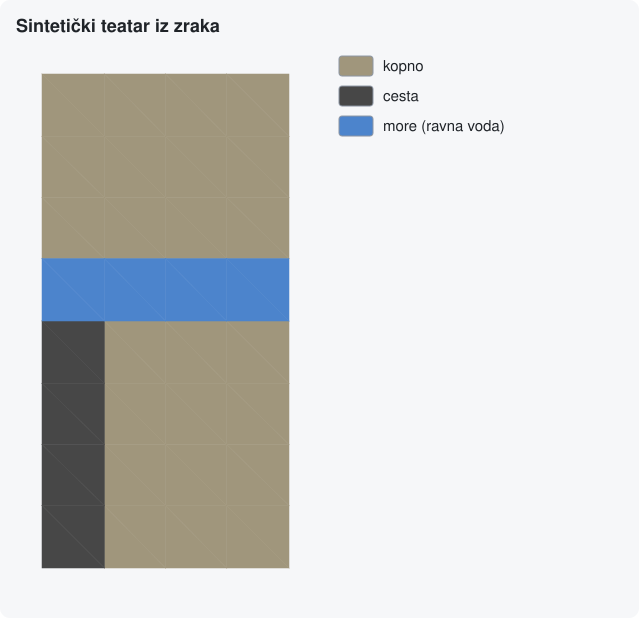
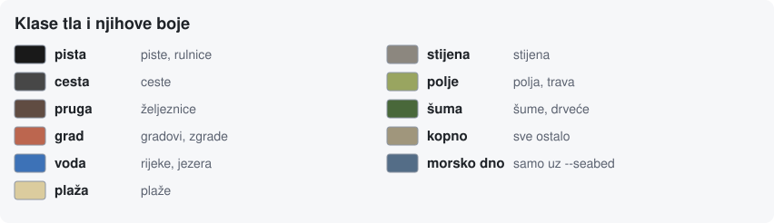

# Datoteke nivoa {#the-level-files}

Nivo je 3D model tla; teatar je riječ iz DCS Worlda za mapu.

`<out>/<name>.glb` i `<name>.json` pored njega.

| Dio | Šta je to |
|---|---|
| `ground:<Level>` | vlastiti trouglovi terena, obojeni prema onome što igra crta preko svakog |
| `water:<Level>` | svaki trougao koji igra označava kao pod morem, položen ravno na nivo mora |
| `structure:<Level>` | zgrade teatra kao kutije, gdje ih igra postavlja (dolje) |

Boje su klase ispod:

Boje se prikazuju pomoću **Snimljena boja** u panelu Pozadina / nivo preglednika. Svaki
trougao tla preuzima klasu preklopa kojim ga igra crta:

| Klasa | Boja | Iz preklopa igre |
|---|---|---|
| runway | skoro crna | `Runway` - piste, rulnice i platforme |
| road | tamno siva | `Road` |
| rail | smeđa | `Rail` |
| town | cigla crvena | `Town`, `Building` |
| water | plava | `River`, `Lake` (unutrašnje vode, crtane kao tlo) |
| beach | pijesak | `Beach` |
| rock | siva | `Rock` |
| field | svijetlozelena | `Field`, `Grass` |
| forest | tamnozelena | `Forest`, `Trees` |
| land | kaki | ništa od ovoga |
| seabed | tamna plavosiva | samo uz `--seabed` |

Gdje više preklopa crta isti trougao, odlučuje redoslijed tabele
(cesta kroz šumu je cesta). Svaki trougao preklopa je jedan od
vlastitih trouglova tla - provjereno na svakoj klasi isprobanih teatara, svaki se poklopio - pa
su klase tačne, a ne pogođene iz obližnjih tačaka.

**Koordinate** su vlastiti svjetski metri DCS-a: x sjever, y gore, z istok, a
glTF osi su iste (X = x, Y = y, Z = z). Telemetrija u DCS metrima - upravo to piše
DCS hook alata 3DHeat Watcher - legne na nivo sa zadanim postavkama
preglednika (Y gore, skala 1) i bez koraka postavljanja.

**Geografska širina i dužina:** svaki teatar je Transverse Mercator projekcija
s vlastitim konstantama; `<name>.json` ih nosi, uglove nivoa u
geografskoj širini i dužini, te svaki grad i s njegovom širinom/dužinom i
njegovim DCS x/z. Gdje konstante teatra nisu objavljene, prilagođavaju se
signalima (beacons) koje njegov vlastiti `beacons.lua` daje u oba okvira (nekoliko cm korijena srednje
kvadratne greške; isto prilagođavanje vraća objavljene konstante drugih teatara
do milimetra).
Za teatar bez konstanti, [`fit`](fit.md) ih nalazi iz bilo kojeg
snimka koji drži oboje, kao što je Watcher sesija jednog leta.

**Morsko dno** se izostavlja (toplotna mapa za simulator leta ne treba morsko
dno); `--seabed` ga zadržava kao tlo. `--no-water` izostavlja
ravno more.

**Veličina.** Vidi [Gradnja nivoa: Veličina](level.md#size).

**Aerodromi.** Svaki `AirfieldsTaxiways/<name>.rn4` drži mrežu rulnica jednog aerodroma,
imenovanu po njemu; njegove tačke su (x, y, z) doubleovi u DCS metrima. `.json`
nivoa navodi svaki aerodrom unutar regije s njegovim imenom (datotečnim),
sredinom okvira njegovih tačaka, okvirom i tlom tamo. Na isprobanom teatru je svaka datoteka aerodroma pročitana, svaka postavljena na svoje polje
(unutar nekoliko stotina metara od premjerene referentne tačke aerodroma: sredina
rulnica, ne piste).

**Zgrade.** `Scenes/<theatre>.scn5` postavlja svaki objekat teatra
(milione njih - drveće, svjetiljke, ograde, žice, kuće). One
koje su zgrade po imenu i veličini (kuće, stanovi, šupe, hangari,
tvornice, tornjevi, terminali: djelić modela, stotine
hiljada postavljanja) crtaju se kao kutije: vlastiti granični okvir svakog modela iz
datoteke, okrenut prema svom smjeru i postavljen gdje ga igra stavlja, od najviše
3 m ispod njegovog ishodišta (njegovo podnožje na padini) do vrha. Drveće, grmlje,
svjetla, stubovi, žice, ograde, zidovi, znakovi, vozila, vagoni, brodovi, dizalice,
jarboli, pilonovi i mostovi se izostavljaju. Nikakav oblik modela ni tekstura
igre nije kopirana: kutija po zgradi, obojena prema vrsti (kuća, blok,
industrijska, aerodrom, toranj, ostalo). `<name>.json` ih također navodi
(`buildings.rows`: x, z, base, height, half lengths, heading, kind) za
hibridnu pozadinu preglednika, koja ih crta u gradovima igre umjesto
mapiranih zgrada. `--no-buildings` ih izostavlja.

`<name>.json` također bilježi izvornu datoteku, njenu veličinu i datum, pročitane
pločice, broj trouglova po klasi i koliko gradova teatra pada
na tlo - provjeru projekcije koja bi trebala glasiti "N of N".

Nivo je glTF binarna datoteka s imenovanim dijelovima, kao i svaki 3DHeat nivo; stranica preglednika
[Nivoi](https://holdi601.github.io/3DHeat/levels.html) kaže kako ih učitava.
