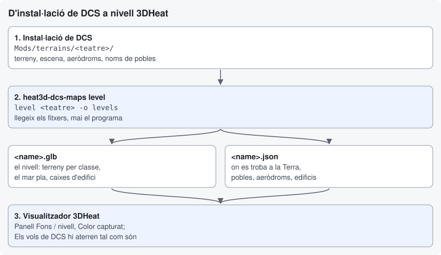

# 3DHeat DCS {#dheat-dcs}

**Què és?** Un teatre és la paraula de DCS World per a un mapa: una regió del
món sobre la qual vols volar. Aquesta eina converteix el terreny d'un teatre, llegit de la
**teva pròpia instal·lació**, en un nivell 3D (un model sobre el qual es pot volar) per al
visualitzador [3DHeat](https://github.com/Holdi601/3DHeat)
([documentació](https://holdi601.github.io/3DHeat/)).

**Per a què la faria servir?** Per veure els teus vols de DCS sobre el mapa propi del joc:
els seus turons, la costa, els aeròdroms, les carreteres, les vies fèrries, els pobles i els edificis.

**Exemple:** `heat3d-dcs-maps level <teatre> -o levels` ->
`levels/<teatre>.glb` (el nivell) + `levels/<teatre>.json` (on es troba a
la Terra, els seus pobles i aeròdroms).

Per a què serveix:

- **Vols sobre el mapa propi del joc.** El fons del món de 3DHeat dibuixa la Terra d'avui
  a partir de dades obertes; això dibuixa el teatre tal com el dibuixa DCS.
- **Cap pas de col·locació.** El nivell està en els metres del propi món de DCS, de manera que la
  telemetria en metres de DCS (el connector de DCS del Watcher de 3DHeat escriu exactament això)
  hi cau amb els valors per defecte del visualitzador.
- **Latitud i longitud.** Cada nivell porta la seva projecció, les seves cantonades i els seus
  pobles en els dos sistemes.



## Inici ràpid {#quick-start}

Si ets nou amb la línia d'ordres, llegeix primer [Abans de començar](before-you-start.md).
Executa això a la carpeta on has clonat o descomprimit l'eina:

```bash
python -m pip install -e .                         # instal·la l'ordre heat3d-dcs-maps
heat3d-dcs-maps list                               # els teatres instal·lats, i si es pot llegir cadascun
heat3d-dcs-maps level <teatre> -o levels          # un teatre complet (petit)
heat3d-dcs-maps level <teatre> --around <lat> <lon> 12 -o levels --name <nom>   # 12 km a cada costat d'un punt
```

Hauries de veure una línia per teatre des de `list`, que acaba amb `readable`.
Després carrega `levels/<nom>.glb` al panell Fons / nivell del visualitzador
([Nivells](https://holdi601.github.io/3DHeat/levels.html)).

Els nivells que escrius estan construïts a partir de les dades del joc: es queden a la **teva
màquina**, per veure'ls, no per compartir-los ni publicar-los ([Condicions](terms.md)).

## Pàgines {#pages}

| Pàgina | Què cobreix |
|---|---|
| [Abans de començar](before-you-start.md) | Python, una terminal, una primera execució |
| [Trobar teatres: list](list.md) | on es troba la instal·lació, què imprimeix `list` |
| [Construir un nivell: level](level.md) | cada opció, regions, mida, pas a pas |
| [Els fitxers del nivell](output.md) | les parts `.glb`, les classes de terreny i els seus colors, el `.json`, les coordenades |
| [Noms de llocs: towns](towns.md) | els pobles d'un teatre amb les coordenades de DCS |
| [Projeccions: fit](fit.md) | trobar la projecció d'un teatre a partir d'una gravació |
| [Com es llegeixen els fitxers](reading.md) | els formats, què s'ha verificat, què no es llegeix |
| [Condicions i llicència](terms.md) | la llicència d'Eagle Dynamics, i per què és un paquet separat |
| [Referència de l'ordre](../cli-reference.md) | cada opció, generada a partir del codi |
| [Mantenir aquesta documentació](maintaining.md) | la llista de comprovació de publicació |

## Relacionat {#related}

- El visualitzador de 3DHeat: [github.com/Holdi601/3DHeat](https://github.com/Holdi601/3DHeat),
  documentació a [holdi601.github.io/3DHeat](https://holdi601.github.io/3DHeat/).
- Telemetria per a aquests nivells: el [3DHeat Watcher](https://holdi601.github.io/3DHeat-Watcher/)
  grava els vols de DCS; els formats de fitxer del visualitzador, inclòs el seu
  contenidor d'un fitxer per partida, es descriuen a
  [Un fitxer per partida (.3dheat)](https://holdi601.github.io/3DHeat/container.html).

## Les eines de 3DHeat {#the-3dheat-tools}

| Eina | Què fa | Codi | Documentació |
|---|---|---|---|
| Visualitzador 3DHeat | mostra les dades: mapes de calor, anàlisi de curses, revisió de partides | [3DHeat](https://github.com/Holdi601/3DHeat) | [documentació](https://holdi601.github.io/3DHeat/) |
| GameFiles | nivells i circuits dels fitxers propis d'un joc | [3DHeat-GameFiles](https://github.com/Holdi601/3DHeat-GameFiles) | [documentació](https://holdi601.github.io/3DHeat-GameFiles/) |
| GameCapture | telemetria de voltes, i nivells reconstruïts a partir de vídeo de joc | [3DHeat-GameCapture](https://github.com/Holdi601/3DHeat-GameCapture) | [documentació](https://holdi601.github.io/3DHeat-GameCapture/) |
| Unreal Exporter | un connector per a l'editor d'Unreal: un nivell com un sol `.glb` | [3DHeat-UnrealExporter](https://github.com/Holdi601/3DHeat-UnrealExporter) | [documentació](https://holdi601.github.io/3DHeat-UnrealExporter/) |
| CS2 | demos i mapes de Counter-Strike 2 | [3DHeat-CS2](https://github.com/Holdi601/3DHeat-CS2) | [documentació](https://holdi601.github.io/3DHeat-CS2/) |
| Watcher | registra el que publiquen els jocs mentre hi jugues | [3DHeat-Watcher](https://github.com/Holdi601/3DHeat-Watcher) | [documentació](https://holdi601.github.io/3DHeat-Watcher/) |
| Ext-WarThunder | repeticions de War Thunder | [3DHeat-Ext-WarThunder](https://github.com/Holdi601/3DHeat-Ext-WarThunder) | [documentació](https://holdi601.github.io/3DHeat-Ext-WarThunder/) |
| Ext-WoT | repeticions de World of Tanks | [3DHeat-Ext-WoT](https://github.com/Holdi601/3DHeat-Ext-WoT) | [documentació](https://holdi601.github.io/3DHeat-Ext-WoT/) |
| Ext-WoWs | repeticions de World of Warships | [3DHeat-Ext-WoWs](https://github.com/Holdi601/3DHeat-Ext-WoWs) | [documentació](https://holdi601.github.io/3DHeat-Ext-WoWs/) |
| Ext-Squad | demos de servidors de Squad | [3DHeat-Ext-Squad](https://github.com/Holdi601/3DHeat-Ext-Squad) | [documentació](https://holdi601.github.io/3DHeat-Ext-Squad/) |
| Ext-DCS | mapes de DCS World com a nivells 3D | [3DHeat-Ext-DCS](https://github.com/Holdi601/3DHeat-Ext-DCS) | [documentació](https://holdi601.github.io/3DHeat-Ext-DCS/) |
| Ext-IL2 | mapes d'IL-2 Sturmovik com a nivells 3D | [3DHeat-Ext-IL2](https://github.com/Holdi601/3DHeat-Ext-IL2) | [documentació](https://holdi601.github.io/3DHeat-Ext-IL2/) |
