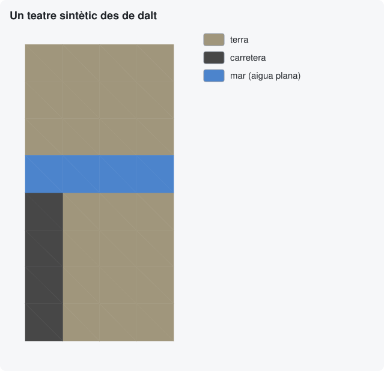
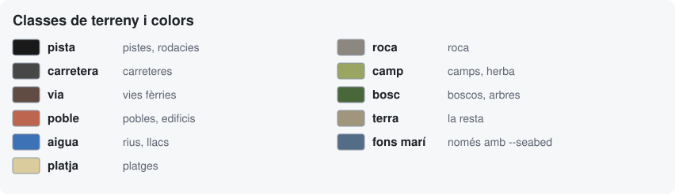

# Els fitxers del nivell {#the-level-files}

Un nivell és un model 3D del terreny; un teatre és la paraula de DCS World per a un mapa.

Els fitxers són `<sortida>/<nom>.glb` i `<nom>.json`, un al costat de l'altre.

| Part | Què és |
|---|---|
| `ground:<Nivell>` | els triangles propis del terreny, acolorits segons el que hi dibuixa el joc per sobre |
| `water:<Nivell>` | cada triangle que el joc marca com a sota del mar, estès pla al nivell del mar |
| `structure:<Nivell>` | els edificis del teatre com a caixes, allà on els col·loca el joc (a continuació) |

Els colors són les classes següents:

Els colors es mostren amb **Color capturat** al panell Fons / nivell del visualitzador. Cada
triangle de terreny pren la classe de la capa que el joc hi dibuixa:

| Classe | Color | De la capa del joc |
|---|---|---|
| runway | gairebé negre | `Runway`: pistes, rodacies i plataformes |
| road | gris fosc | `Road` |
| rail | marró | `Rail` |
| town | vermell maó | `Town`, `Building` |
| water | blau | `River`, `Lake` (aigua interior, dibuixada com a terreny) |
| beach | sorra | `Beach` |
| rock | gris | `Rock` |
| field | verd clar | `Field`, `Grass` |
| forest | verd fosc | `Forest`, `Trees` |
| land | caqui | cap d'aquestes |
| seabed | blau pissarra | només amb `--seabed` |

Quan diverses capes dibuixen el mateix triangle, decideix l'ordre de la taula
(una carretera dins d'un bosc és carretera). Cada triangle de capa és un dels
propis del terreny —comprovat a totes les classes dels teatres provats, i tots hi coincideixen—,
de manera que les classes són exactes, no endevinades a partir de punts propers.

**Coordenades** són els metres propis del món de DCS: x nord, y amunt, z est, i els
eixos de glTF són els mateixos (X = x, Y = y, Z = z). La telemetria en metres de DCS —el connector
de DCS del Watcher de 3DHeat escriu exactament això— cau sobre el nivell amb els valors per defecte
del visualitzador (Y amunt, escala 1) i sense cap pas de col·locació.

**Latitud i longitud:** cada teatre és una projecció Transverse Mercator amb les seves
pròpies constants; `<nom>.json` les porta, les cantonades del nivell en latitud i longitud, i
cada poble amb la seva latitud/longitud i les seves x/z de DCS. Quan les constants d'un teatre
no estan publicades, s'ajusten als senyals que dona el seu propi `beacons.lua` en els dos
sistemes (un error quadràtic mitjà arrel de pocs cm; el mateix ajust retorna les constants
publicades d'altres teatres fins al mil·límetre).
Per a un teatre sense constants, [`fit`](fit.md) les troba a partir de qualsevol
gravació que tingui les dues, com una sessió del Watcher d'un vol.

**El fons del mar** es deixa fora (un mapa de calor per a un simulador de vol no necessita
el fons del mar); `--seabed` el conserva com a terreny. `--no-water` deixa fora el
mar pla.

**Mida.** Mira [Construir un nivell: Mida](level.md#size).

**Aeròdroms.** Cada `AirfieldsTaxiways/<nom>.rn4` conté la xarxa de rodatge d'un aeròdrom,
amb el seu nom; els seus punts són dobles (x, y, z) en metres de DCS. El `.json` del
nivell enumera cada aeròdrom dins de la regió amb el seu nom (el del fitxer), el
centre de la caixa dels seus punts, la caixa, i el terreny que hi ha. Al teatre provat, cada
fitxer d'aeròdrom es va llegir, col·locat cada un sobre el seu camp (a menys de pocs centenars de
metres del punt de referència de l'aeroport topografiat: el centre de les rodacies, no el de la pista).

**Edificis.** `Scenes/<teatre>.scn5` col·loca cada objecte del teatre
(milions —arbres, fanals, tanques, cables, cases). Els que són edificis pel seu nom i la seva
mida (cases, pisos, cobertes, hangars, fàbriques, torres, terminals: una fracció dels models,
centenars de milers de col·locacions) es dibuixen com a caixes: la caixa envolupant pròpia de cada
model, del fitxer, girada segons el seu rumb i situada on la posa el joc, des de 3 m per sota del seu origen (el seu peu en un pendent) fins al seu capdamunt. Queden fora els arbres,
arbustos, llums, pals, cables, tanques, murs, senyals, vehicles, vagons, vaixells, grues,
mastos, pilones i ponts. No es copia cap forma ni textura de model del joc: una caixa per edifici,
acolorida segons el tipus (casa, bloc, industrial, aeròdrom, torre, altre). `<nom>.json` també
els enumera (`buildings.rows`: x, z, base, altura, mitjes llargades, rumb, tipus) per al fons
híbrid del visualitzador, que els dibuixa als pobles del joc en lloc dels edificis cartografiats.
`--no-buildings` els deixa fora.

`<nom>.json` també registra el fitxer d'origen, la seva mida i data, els mosaics llegits, el
recompte de triangles per classe, i quants dels pobles del teatre cauen sobre el
terreny: una comprovació de la projecció que hauria de dir «N de N».

El nivell és un glTF binari amb parts amb nom, com ho és tot nivell de 3DHeat; la pàgina
[Nivells](https://holdi601.github.io/3DHeat/levels.html) del visualitzador explica com els carrega.
