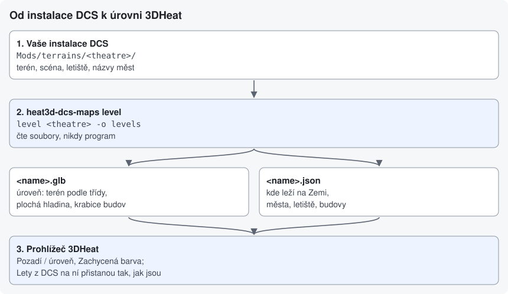

# 3DHeat DCS {#dheat-dcs}

**Co to je?** Území (theatre) je v DCS World označení pro mapu: oblast světa, nad kterou
létáte. Tento nástroj promění terén jednoho území, načtený z **vaší vlastní instalace**,
na 3D úroveň, model, nad kterým můžete létat, pro prohlížeč
[3DHeat](https://github.com/Holdi601/3DHeat)
([dokumentace](https://holdi601.github.io/3DHeat/)).

**Proč ho používat?** Abyste viděli své lety v DCS nad mapou samotné hry: její kopce,
pobřeží, letiště, silnice, železnice, města a budovy.

**Příklad:** `heat3d-dcs-maps level <theatre> -o levels` ->
`levels/<theatre>.glb` (úroveň) + `levels/<theatre>.json` (kde leží na zemi, její města
a letiště).

K čemu se to hodí:

- **Lety nad mapou samotné hry.** Pozadí světa 3DHeat kreslí dnešní Zemi z otevřených dat;
  tohle kreslí území tak, jak ho kreslí DCS.
- **Žádný krok umísťování.** Úroveň je v metrech světa DCS, takže telemetrie v metrech DCS
  (háček DCS nástroje 3DHeat Watcher zapisuje přesně tyto hodnoty) na ni dopadne s výchozím
  nastavením prohlížeče.
- **Zeměpisná šířka a délka.** Každá úroveň nese svou projekci, své rohy a svá města v obou
  soustavách.



## Rychlý start {#quick-start}

Nikdy jste nepracovali s příkazovým řádkem? Nejdřív si přečtěte [Než začnete](before-you-start.md).
Spusťte tyto příkazy ve složce, do které jste nástroj naklonovali nebo rozbalili:

```bash
python -m pip install -e .                         # installs the heat3d-dcs-maps command
heat3d-dcs-maps list                               # the theatres installed, and whether each can be read
heat3d-dcs-maps level <theatre> -o levels          # a whole (small) theatre
heat3d-dcs-maps level <theatre> --around <lat> <lon> 12 -o levels --name <name>   # 12 km either side of a point
```

Z `list` uvidíte jeden řádek na území, na konci se `readable`.
Potom načtěte `levels/<name>.glb` do panelu Pozadí / úroveň v prohlížeči
([Úrovně](https://holdi601.github.io/3DHeat/levels.html)).

Úrovně, které nástroj zapisuje, jsou postaveny z dat hry, takže zůstávají **na vašem počítači**,
abyste si je mohli prohlédnout, ne sdílet nebo zveřejňovat ([Podmínky](terms.md)).

Každá čtečka hry je samostatný malý projekt s vlastním licenčním souborem, vlastními vydáními a vlastním systémem hlášení, takže ji lze instalovat, aktualizovat, udržovat - nebo na žádost držitele práv stáhnout - samostatně, aniž by to ovlivnilo prohlížeč nebo ostatní nástroje.

## Stránky {#pages}

| Stránka | Co obsahuje |
|---|---|
| [Než začnete](before-you-start.md) | Python, terminál, první spuštění |
| [Hledání území: list](list.md) | kde se instalace hledá, co `list` vypisuje |
| [Sestavení úrovně: level](level.md) | každá možnost, oblasti, velikost, krok za krokem |
| [Soubory úrovně](output.md) | části `.glb`, třídy terénu a jejich barvy, `.json`, souřadnice |
| [Názvy míst: towns](towns.md) | města území se souřadnicemi DCS |
| [Projekce: fit](fit.md) | nalezení projekce území ze záznamu |
| [Jak se soubory čtou](reading.md) | formáty, co bylo ověřeno, co se nečte |
| [Podmínky a licence](terms.md) | co se čte, co se nedodává, licence |
| [Přehled příkazů](../cli-reference.md) | každá možnost, vygenerováno z kódu |
| [Údržba těchto dokumentů](maintaining.md) | kontrolní seznam pro vydání |

## Související {#related}

- Prohlížeč 3DHeat: [github.com/Holdi601/3DHeat](https://github.com/Holdi601/3DHeat),
  dokumentace na [holdi601.github.io/3DHeat](https://holdi601.github.io/3DHeat/).
- Telemetrie pro tyto úrovně: [3DHeat Watcher](https://holdi601.github.io/3DHeat-Watcher/)
  zaznamenává lety v DCS; formáty souborů prohlížeče, včetně jeho kontejneru
  jednoho souboru na zápas, jsou popsány na stránce
  [Jeden soubor na zápas (.3dheat)](https://holdi601.github.io/3DHeat/container.html).

## Nástroje 3DHeat {#the-3dheat-tools}

| Nástroj | Co dělá | Kód | Dokumentace |
|---|---|---|---|
| prohlížeč 3DHeat | zobrazuje data: teplotní mapy, analýzu závodů, přehled zápasu | [3DHeat](https://github.com/Holdi601/3DHeat) | [dokumentace](https://holdi601.github.io/3DHeat/) |
| GameFiles | úrovně a tratě ze souborů samotné hry | [3DHeat-GameFiles](https://github.com/Holdi601/3DHeat-GameFiles) | [dokumentace](https://holdi601.github.io/3DHeat-GameFiles/) |
| GameCapture | telemetrie kol a úrovně postavené z videa hry | [3DHeat-GameCapture](https://github.com/Holdi601/3DHeat-GameCapture) | [dokumentace](https://holdi601.github.io/3DHeat-GameCapture/) |
| Unreal Exporter | zásuvný modul pro Unreal Editor: úroveň jako jeden `.glb` | [3DHeat-UnrealExporter](https://github.com/Holdi601/3DHeat-UnrealExporter) | [dokumentace](https://holdi601.github.io/3DHeat-UnrealExporter/) |
| CS2 | dema a mapy Counter-Strike 2 | [3DHeat-CS2](https://github.com/Holdi601/3DHeat-CS2) | [dokumentace](https://holdi601.github.io/3DHeat-CS2/) |
| Watcher | zaznamenává, co hry zveřejňují, když hrajete | [3DHeat-Watcher](https://github.com/Holdi601/3DHeat-Watcher) | [dokumentace](https://holdi601.github.io/3DHeat-Watcher/) |
| Ext-WarThunder | replaye War Thunder | [3DHeat-Ext-WarThunder](https://github.com/Holdi601/3DHeat-Ext-WarThunder) | [dokumentace](https://holdi601.github.io/3DHeat-Ext-WarThunder/) |
| Ext-WoT | replaye World of Tanks | [3DHeat-Ext-WoT](https://github.com/Holdi601/3DHeat-Ext-WoT) | [dokumentace](https://holdi601.github.io/3DHeat-Ext-WoT/) |
| Ext-WoWs | replaye World of Warships | [3DHeat-Ext-WoWs](https://github.com/Holdi601/3DHeat-Ext-WoWs) | [dokumentace](https://holdi601.github.io/3DHeat-Ext-WoWs/) |
| Ext-Squad | dema serverů Squad | [3DHeat-Ext-Squad](https://github.com/Holdi601/3DHeat-Ext-Squad) | [dokumentace](https://holdi601.github.io/3DHeat-Ext-Squad/) |
| Ext-DCS | mapy DCS World jako 3D úrovně | [3DHeat-Ext-DCS](https://github.com/Holdi601/3DHeat-Ext-DCS) | [dokumentace](https://holdi601.github.io/3DHeat-Ext-DCS/) |
| Ext-IL2 | mapy IL-2 Sturmovik jako 3D úrovně | [3DHeat-Ext-IL2](https://github.com/Holdi601/3DHeat-Ext-IL2) | [dokumentace](https://holdi601.github.io/3DHeat-Ext-IL2/) |
