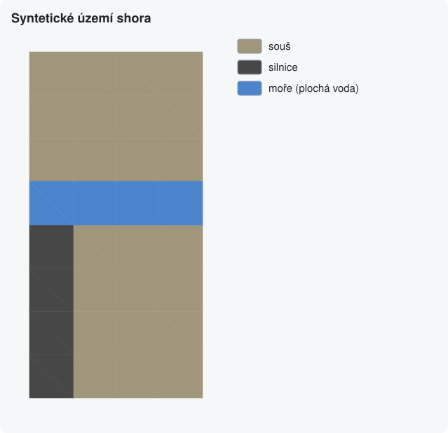
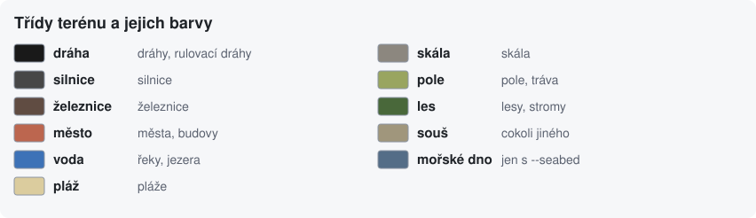

# Soubory úrovně {#the-level-files}

Úroveň je 3D model terénu; území je označení pro mapu v DCS World.

`<out>/<name>.glb` a vedle něj `<name>.json`.

| Část | Co je to |
|---|---|
| `ground:<Level>` | vlastní trojúhelníky terénu, obarvené podle toho, co hra kreslí přes každý z nich |
| `water:<Level>` | každý trojúhelník, který hra označuje jako pod mořem, položený naplocho na úroveň moře |
| `structure:<Level>` | budovy území jako krabice, tam, kde je hra umisťuje (níže) |

Barvy odpovídají třídám níže:

Barvy se zobrazí při **Zachycená barva** v panelu Pozadí / úroveň prohlížeče. Každý trojúhelník terénu
dostane třídu překryvu, kterým ho hra kreslí:

| Třída | Barva | Z překryvu hry |
|---|---|---|
| runway | téměř černá | `Runway` – dráhy, rulovací dráhy a odstavné plochy |
| road | tmavě šedá | `Road` |
| rail | hnědá | `Rail` |
| town | cihlově červená | `Town`, `Building` |
| water | modrá | `River`, `Lake` (vnitrozemská voda, kreslená jako terén) |
| beach | písková | `Beach` |
| rock | šedá | `Rock` |
| field | světle zelená | `Field`, `Grass` |
| forest | tmavě zelená | `Forest`, `Trees` |
| land | khaki | žádný z těchto |
| seabed | břidlicově modrá | jen s `--seabed` |

Pokud stejný trojúhelník kreslí více překryvů, rozhoduje pořadí v tabulce
(silnice přes les je silnice). Každý trojúhelník překryvu je jedním z vlastních trojúhelníků
terénu – ověřeno u každé třídy navštívených území, každý se shodl – takže třídy jsou přesné,
ne odhadnuté z okolních bodů.

**Souřadnice** jsou vlastní světové metry DCS: x na sever, y nahoru, z na východ, a osy glTF
jsou stejné (X = x, Y = y, Z = z). Telemetrie v metrech DCS – háček DCS nástroje
3DHeat Watcher zapisuje přesně tyto hodnoty – dopadne na úroveň s výchozím nastavením
prohlížeče (Y nahoru, měřítko 1) a bez kroku umísťování.

**Zeměpisná šířka a délka:** každé území je projekce Transverse Mercator s vlastními konstantami;
soubor `<name>.json` je obsahuje, rohy úrovně ve zeměpisné šířce a délce a každé město
v obou souřadnicích: zeměpisné šířce a délce i x/z v DCS. Kde nejsou konstanty území
zveřejněny, jsou přizpůsobeny majákům, které dává jeho vlastní `beacons.lua`, v obou soustavách
(střední kvadratická chyba několik cm; stejné přizpůsobení vrátí zveřejněné konstanty
jiných území na milimetr přesně).
Pro území bez konstant najde [`fit`](fit.md) konstanty z libovolného záznamu, který obsahuje obojí,
například relace Watcheru jednoho letu.

**Mořské dno** se vynechá (simulátorová teplotní mapa mořské dno nepotřebuje);
`--seabed` ho zachová jako zemi. `--no-water` vynechá rovnou hladinu moře.

**Velikost.** Viz [Sestavení úrovně: Velikost](level.md#size).

**Letiště.** Každý soubor `AirfieldsTaxiways/<name>.rn4` obsahuje rulovací síť jednoho letiště
pojmenovanou podle něj; jeho body jsou dvojice (x, y, z) v metrech DCS. Soubor `.json` úrovně
vypisuje každé letiště uvnitř oblasti s jeho jménem (z souboru), středem krabice jeho bodů,
krabicí a terénem tam. Na navštíveném území se přečetl každý soubor letiště a každé leželo
na své ploše (do několika set metrů od zaměřeného referenčního bodu letiště: středu rulovacích
drah, ne dráhy).

**Budovy.** `Scenes/<theatre>.scn5` umisťuje každý objekt území
(miliony – stromy, lampy, ploty, dráty, domy). Ty, které jsou budovami podle jména a velikosti
(domy, byty, kůlny, hangáry, továrny, věže, terminály: zlomek modelů, stovky tisíc umístění),
se kreslí jako krabice: ohraničující kvádr každého modelu ze souboru, otočený do jeho
směru a postavený tam, kam ho hra klade, od 3 m pod jeho počátkem (jeho podklad na svahu)
až po vrchol. Stromy, keře, světla, sloupy, dráty, ploty, zdi, značky, vozidla, vagóny, lodě,
jeřáby, stožáry, pylony a mosty se vynechají. Žádný tvar modelu ani textura hry se nekopíruje:
jedna krabice na budovu, obarvená podle druhu (dům, blok, průmysl, letiště, věž, ostatní).
Soubor `<name>.json` je také vypisuje (`buildings.rows`: x, z, základna, výška, poloviční
délky, směr, druh) pro hybridní pozadí prohlížeče, které je kreslí v městech hry místo
namapovaných budov. `--no-buildings` je vynechá.

`<name>.json` také zaznamenává zdrojový soubor, jeho velikost a datum, přečtené dlaždice,
počet trojúhelníků na třídu a kolik měst území leží na zemi – kontrolu projekce, která by měla
ukázat „N z N“.

Úroveň je binární glTF s pojmenovanými částmi, jako každá úroveň 3DHeat; stránka prohlížeče
[Úrovně](https://holdi601.github.io/3DHeat/levels.html) popisuje, jak je načítá.
