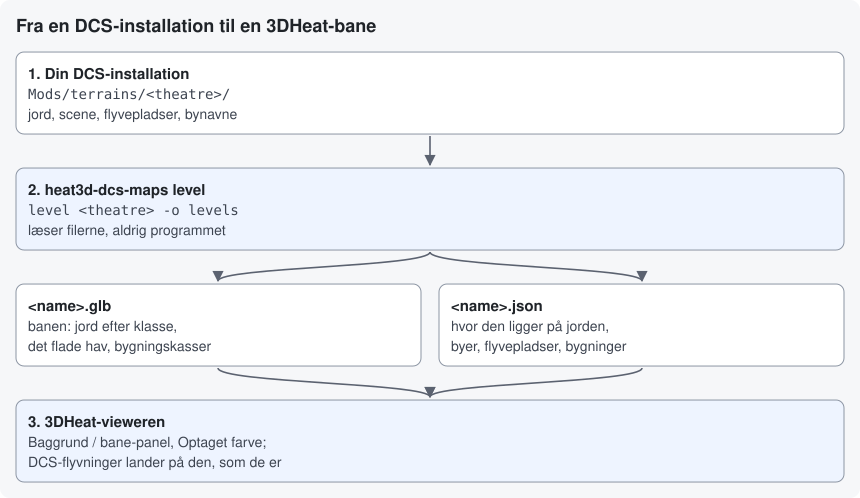

# 3DHeat DCS {#dheat-dcs}

**Hvad er det?** Et teater er DCS World's ord for et kort: en region af verden, du flyver over. Dette værktøj laver jorden i ét teater, læst fra **din egen installation**, om til en 3D-bane - en model, du kan flyve over - til [3DHeat](https://github.com/Holdi601/3DHeat)-vieweren
([dokumentation](https://holdi601.github.io/3DHeat/)).

**Hvorfor skulle jeg bruge det?** For at se dine DCS-flyvninger over spillets eget kort: dets bakker, kyst, flyvepladser, veje, jernbaner, byer og bygninger.

**Eksempel:** `heat3d-dcs-maps level <theatre> -o levels` ->
`levels/<theatre>.glb` (banen) + `levels/<theatre>.json` (hvor den ligger på
jorden, dens byer og flyvepladser).

Det er nyttigt til:

- **Flyvninger på spillets eget kort.** 3DHeat-verdenens baggrund tegner i dag jorden
  ud fra åbne data; dette tegner teatret, sådan som DCS tegner det.
- **Ingen placeringstrin.** Banen ligger i DCS' egne verdensmeter, så telemetri
  i DCS-meter (3DHeat Watcherens DCS-hook skriver netop det) lander på
  den med viewerens standarder.
- **Breddegrad og længdegrad.** Hver bane har sin projektion, sine hjørner
  og sine byer i begge koordinatsystemer.



## Hurtig start {#quick-start}

Ny til kommandolinjen? Læs [Før du går i gang](before-you-start.md) først.
Kør disse i den mappe, du klonede eller pakkede ud i:

```bash
python -m pip install -e .                         # installs the heat3d-dcs-maps command
heat3d-dcs-maps list                               # the theatres installed, and whether each can be read
heat3d-dcs-maps level <theatre> -o levels          # a whole (small) theatre
heat3d-dcs-maps level <theatre> --around <lat> <lon> 12 -o levels --name <name>   # 12 km either side of a point
```

Du bør se én linje pr. teater fra `list`, der slutter med `readable`.
Indlæs derefter `levels/<name>.glb` i viewerens Baggrund / bane-panel
([Baner](https://holdi601.github.io/3DHeat/levels.html)).

De baner, den skriver, er bygget af spillets data: de bliver **på din maskine**,
til visning, ikke til deling eller publicering ([Vilkår](terms.md)).

## Sider {#pages}

| Side | Hvad den dækker |
|---|---|
| [Før du går i gang](before-you-start.md) | Python, en terminal, en første kørsel |
| [Find teatre: list](list.md) | hvor installationen findes, hvad `list` udskriver |
| [Byg en bane: level](level.md) | alle valgmuligheder, områder, størrelse, trin for trin |
| [Banefilerne](output.md) | `.glb`-delene, jordklasserne og deres farver, `.json`, koordinaterne |
| [Stednavne: towns](towns.md) | et teaters byer med DCS-koordinater |
| [Projektioner: fit](fit.md) | at finde et teaters projektion ud fra en optagelse |
| [Sådan læses filerne](reading.md) | formaterne, hvad der blev verificeret, hvad der ikke læses |
| [Vilkår og licens](terms.md) | Eagle Dynamics' licens, og hvorfor dette er en separat pakke |
| [Kommandoreference](../cli-reference.md) | alle valgmuligheder, genereret ud fra koden |
| [Vedligeholdelse af disse dokumenter](maintaining.md) | tjeklisten til udgivelser |

## Relateret {#related}

- 3DHeat-vieweren: [github.com/Holdi601/3DHeat](https://github.com/Holdi601/3DHeat),
  dokumentation på [holdi601.github.io/3DHeat](https://holdi601.github.io/3DHeat/).
- Telemetri til disse baner: [3DHeat Watcher](https://holdi601.github.io/3DHeat-Watcher/)
  optager DCS-flyvninger; viewerens filformater, inklusive dens
  container med én fil pr. kamp, beskrives i
  [Én fil pr. kamp (.3dheat)](https://holdi601.github.io/3DHeat/container.html).

## 3DHeat-værktøjerne {#the-3dheat-tools}

| Værktøj | Hvad det gør | Kode | Dokumentation |
|---|---|---|---|
| 3DHeat-viewer | viser data: varmekort, løbsanalyse, kampgennemgang | [3DHeat](https://github.com/Holdi601/3DHeat) | [dokumentation](https://holdi601.github.io/3DHeat/) |
| GameFiles | baner og løb fra et spils egne filer | [3DHeat-GameFiles](https://github.com/Holdi601/3DHeat-GameFiles) | [dokumentation](https://holdi601.github.io/3DHeat-GameFiles/) |
| GameCapture | telemetri fra omgange, og baner genskabt ud fra spilvideo | [3DHeat-GameCapture](https://github.com/Holdi601/3DHeat-GameCapture) | [dokumentation](https://holdi601.github.io/3DHeat-GameCapture/) |
| Unreal Exporter | et plugin til Unreal Editor: en bane som én `.glb` | [3DHeat-UnrealExporter](https://github.com/Holdi601/3DHeat-UnrealExporter) | [dokumentation](https://holdi601.github.io/3DHeat-UnrealExporter/) |
| CS2 | Counter-Strike 2-demoer og baner | [3DHeat-CS2](https://github.com/Holdi601/3DHeat-CS2) | [dokumentation](https://holdi601.github.io/3DHeat-CS2/) |
| Watcher | optager det, spil udgiver, mens du spiller | [3DHeat-Watcher](https://github.com/Holdi601/3DHeat-Watcher) | [dokumentation](https://holdi601.github.io/3DHeat-Watcher/) |
| Ext-WarThunder | War Thunder-replays | [3DHeat-Ext-WarThunder](https://github.com/Holdi601/3DHeat-Ext-WarThunder) | [dokumentation](https://holdi601.github.io/3DHeat-Ext-WarThunder/) |
| Ext-WoT | World of Tanks-replays | [3DHeat-Ext-WoT](https://github.com/Holdi601/3DHeat-Ext-WoT) | [dokumentation](https://holdi601.github.io/3DHeat-Ext-WoT/) |
| Ext-WoWs | World of Warships-replays | [3DHeat-Ext-WoWs](https://github.com/Holdi601/3DHeat-Ext-WoWs) | [dokumentation](https://holdi601.github.io/3DHeat-Ext-WoWs/) |
| Ext-Squad | Squad-serverdemoer | [3DHeat-Ext-Squad](https://github.com/Holdi601/3DHeat-Ext-Squad) | [dokumentation](https://holdi601.github.io/3DHeat-Ext-Squad/) |
| Ext-DCS | DCS World-kort som 3D-baner | [3DHeat-Ext-DCS](https://github.com/Holdi601/3DHeat-Ext-DCS) | [dokumentation](https://holdi601.github.io/3DHeat-Ext-DCS/) |
| Ext-IL2 | IL-2 Sturmovik-kort som 3D-baner | [3DHeat-Ext-IL2](https://github.com/Holdi601/3DHeat-Ext-IL2) | [dokumentation](https://holdi601.github.io/3DHeat-Ext-IL2/) |
