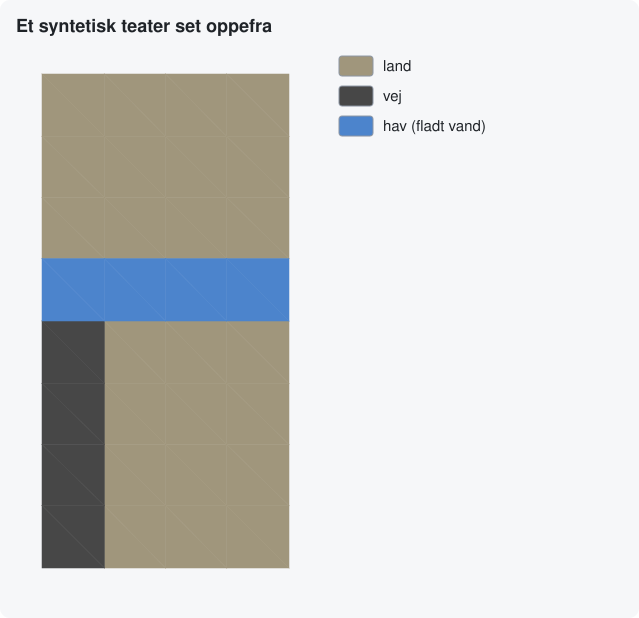
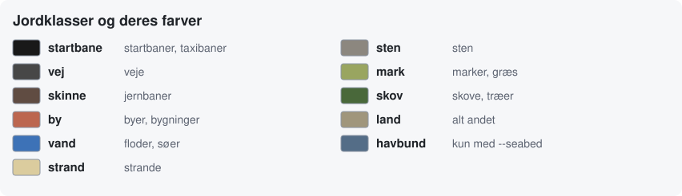

# Banefilerne {#the-level-files}

En bane er en 3D-model af jorden; et teater er DCS World's ord for et kort.

`<out>/<name>.glb` og `<name>.json` ved siden af.

| Del | Hvad det er |
|---|---|
| `ground:<Level>` | terrænets egne trekanter, farvet efter hvad spillet tegner over hver |
| `water:<Level>` | hver trekant, spillet markerer som under havet, lagt fladt i havniveau |
| `structure:<Level>` | teatrets bygninger som kasser, der hvor spillet placerer dem (nedenfor) |

Farverne er klasserne nedenfor:

Farverne vises med **Optaget farve** i viewerens baggrund / bane-panel. Hver jordtrekant
får klassen af det overlay, spillet tegner den med:

| Klasse | Farve | Fra spillets overlay |
|---|---|---|
| runway | næsten sort | `Runway` - start- og landingsbaner, taxibaner og pladser |
| road | mørkegrå | `Road` |
| rail | brun | `Rail` |
| town | murstensrød | `Town`, `Building` |
| water | blå | `River`, `Lake` (indlandsvand, tegnet som jord) |
| beach | sand | `Beach` |
| rock | grå | `Rock` |
| field | lysegrøn | `Field`, `Grass` |
| forest | mørkegrøn | `Forest`, `Trees` |
| land | khaki | ingen af disse |
| seabed | skiferblå | kun med `--seabed` |

Hvor flere overlays tegner den samme trekant, afgør tabellens rækkefølge
(en vej gennem en skov er vej). Hver overlay-trekant er en af jordens egne -
kontrolleret for hver klasse i de testede teatre, og hver enkelt passede - så
klasserne er nøjagtige, ikke gættet ud fra nærliggende punkter.

**Koordinater** er DCS' egne verdensmeter: x nord, y op, z øst, og glTF-akserne er de samme
(X = x, Y = y, Z = z). Telemetri i DCS-meter - 3DHeat Watcherens DCS-hook skriver netop det -
lander på banen med viewerens standarder (Y op, skala 1) og uden et placeringstrin.

**Breddegrad og længdegrad:** hvert teater er en Transverse Mercator-projektion
med sine egne konstanter; `<name>.json` bærer dem, banens hjørner i
breddegrad og længdegrad, og hver by med både dens breddegrad/længdegrad og
dens DCS x/z. Hvor et teaters konstanter ikke er offentliggjort, tilpasses de
til de fyrtårne, dets egen `beacons.lua` giver i begge koordinatsystemer (en rodmiddelkvadratfejl
på få cm; den samme tilpasning giver de offentliggjorte konstanter for andre teatre tilbage
til millimeteren).
For et teater uden konstanter finder [`fit`](fit.md) dem ud fra enhver
optagelse, der indeholder begge, såsom en Watcher-session af én flyvning.

**Havbunden** udelades (et flysimulator-varmekort har ikke brug for havbunden); `--seabed` beholder
den som jord. `--no-water` udelader det flade hav.

**Størrelse.** Se [Byg en bane: Størrelse](level.md#size).

**Flyvepladser.** Hver `AirfieldsTaxiways/<name>.rn4` indeholder én flyvepladses taxinet,
navngivet efter den; dens punkter er (x, y, z) doubles i DCS-meter. Banens
`.json` lister hver flyveplads inden for området med dens navn (filens), midten af
dens punkters boks, boksen og jorden der. På det testede teater blev hver flyvepladsfil læst, hver
placeret på sin mark (inden for nogle få hundrede meter fra det opmålte lufthavnsreferencepunkt: midten
af taxibanerne, ikke start- og landingsbanen).

**Bygninger.** `Scenes/<theatre>.scn5` placerer hvert objekt i teatret
(millioner af dem - træer, lamper, hegn, ledninger, huse). De, der er bygninger efter navn og
størrelse (huse, lejligheder, skure, hangarer, fabrikker, tårne, terminaler: en brøkdel af
modellerne, hundredtusindvis af placeringer), tegnes som kasser: hver models egen
afgrænsningsboks fra filen, drejet til dens retning og stående der, spillet placerer den, fra op til
3 m under dens origo (dens fundament i en skråning) til toppen. Træer, buske,
lys, stolper, ledninger, hegn, mure, skilte, køretøjer, vogne, både, kraner,
master, pyloner og broer udelades. Ingen modelform eller tekstur fra
spillet kopieres: én kasse pr. bygning, farvet efter type (hus, blok,
industri, flyveplads, tårn, andet). `<name>.json` lister dem også
(`buildings.rows`: x, z, base, height, halve længder, retning, type) til
viewerens hybride baggrund, som tegner dem i spillets byer i stedet for
de kortlagte bygninger. `--no-buildings` udelader dem.

`<name>.json` noterer også kildefilen, dens størrelse og dato, de læste flager,
antallet af trekanter pr. klasse, og hvor mange af teatrets byer der lander
på jorden - en kontrol af projektionen, som bør stå "N af N".

Banen er en glTF-binærfil med navngivne dele, som alle 3DHeat-baner er; viewerens
side [Baner](https://holdi601.github.io/3DHeat/levels.html) forklarer, hvordan den indlæses.
