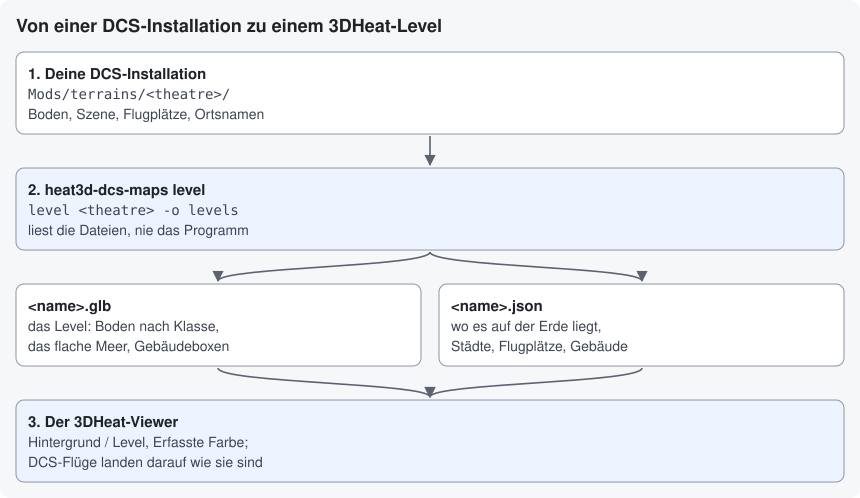

# 3DHeat DCS {#dheat-dcs}

**Was ist das?** Ein Schauplatz ist das Wort von DCS World für eine Karte: ein Stück Welt, über das du fliegst.
Dieses Werkzeug verwandelt den Boden eines Schauplatzes, gelesen aus **deiner eigenen Installation**, in ein
3D-Level - ein Modell, über das du fliegen kannst - für den [3DHeat](https://github.com/Holdi601/3DHeat)-Viewer
([Dokumentation](https://holdi601.github.io/3DHeat/)).

**Wozu brauche ich das?** Um deine DCS-Flüge über die eigene Karte des Spiels zu sehen: ihre Hügel, Küsten,
Flugplätze, Straßen, Bahnlinien, Städte und Gebäude.

**Beispiel:** `heat3d-dcs-maps level <theatre> -o levels` ->
`levels/<theatre>.glb` (das Level) + `levels/<theatre>.json` (wo es auf der Erde liegt, seine Städte und Flugplätze).

Wofür es nützlich ist:

- **Flüge auf der eigenen Karte des Spiels.** Der Welthintergrund des 3DHeat zeichnet die heutige Erde aus offenen Daten;
  dieses hier zeichnet den Schauplatz so, wie DCS ihn zeichnet.
- **Kein Platzierungsschritt.** Das Level liegt in den eigenen Weltmetern von DCS, also landet Telemetrie in DCS-Metern
  (genau das schreibt der DCS-Hook des 3DHeat Watcher) mit den Standardwerten des Viewers darauf.
- **Breiten- und Längengrad.** Jedes Level trägt seine Projektion, seine Ecken und seine Städte in beiden Bezugssystemen.



## Schnellstart {#quick-start}

Du brauchst Windows, Python 3.10 oder neuer (im Installer "Add python.exe to PATH"
ankreuzen), DCS World installiert (wird von selbst gefunden) und etwa 800 MB Platz für
den ganzen Kaukasus; Git ist nicht nötig. Neu in der Kommandozeile? Lies zuerst
[Bevor du anfängst](before-you-start.md).

```bash
python -m pip install https://github.com/Holdi601/3DHeat-Ext-DCS/archive/refs/tags/v0.2.0.zip
heat3d-dcs-maps list                               # die installierten Schauplätze, und ob jeder lesbar ist
heat3d-dcs-maps level Caucasus -o levels           # ein ganzer (kleiner) Schauplatz
heat3d-dcs-maps level <theatre> --around <lat> <lon> 12 -o levels --name <name>   # 12 km um einen Punkt
```

Du solltest von `list` pro Schauplatz eine Zeile sehen, die mit `readable` endet.
`level` schreibt `levels\Caucasus.glb` (das Level, etwa 710 MB) und daneben
`levels\Caucasus.json` (wo es auf der Erde liegt, seine Städte und Flugplätze); der ganze
Kaukasus dauert etwa 3 Minuten. Ein großer Schauplatz (über 30 Millionen Eckpunkte, wie
`list` zeigt) hält an und fragt nach einem Ausschnitt, etwa dem `--around`-Quadrat oben.
Wird der DCS-Ordner nicht gefunden, nenne ihn mit `--dcs "<DCS-World-Ordner>"` (den mit
`Mods\terrains`).

Dann öffne die `.glb` im [3DHeat-Viewer](https://github.com/Holdi601/3DHeat#quick-start):
herunterladen (**Code -> Download ZIP**, entpacken), `start.bat` doppelklicken (es bietet
an, Node.js zu installieren, wenn es fehlt, und öffnet `http://127.0.0.1:5273`), dann
**Hintergrund / Level -> 3D-Modell...** und die Datei wählen
([Levels](https://holdi601.github.io/3DHeat/levels.html)); **Erfasste Farbe** im selben
Panel zeigt die Bodenklassen. Das Level bleibt auf deinem Rechner.

Wenn ein neues Release erscheint, sagt das Werkzeug es beim Start und bietet an, sich
selbst zu aktualisieren.

Jeder Spiel-Leser ist ein eigenes kleines Projekt mit eigener Lizenzdatei, eigenen Releases und eigenem Issue-Tracker. So lässt er sich für sich allein installieren, aktualisieren, pflegen - oder auf Wunsch eines Rechteinhabers zurückziehen -, ohne den Viewer oder die anderen Werkzeuge zu berühren.

## Seiten {#pages}

| Seite | Was sie behandelt |
|---|---|
| [Bevor du anfängst](before-you-start.md) | Python, ein Terminal, ein erster Lauf |
| [Schauplätze finden: list](list.md) | wo die Installation gefunden wird, was `list` ausgibt |
| [Ein Level bauen: level](level.md) | jede Option, Regionen, Größe, Schritt für Schritt |
| [Die Level-Dateien](output.md) | die `.glb`-Teile, die Bodenklassen und ihre Farben, die `.json`, die Koordinaten |
| [Ortsnamen: towns](towns.md) | die Städte eines Schauplatzes mit DCS-Koordinaten |
| [Waffen- und Sensorreichweiten: ranges](ranges.md) | ein Katalog der Waffen- und Sensorreichweiten für die Match-Wiedergabe |
| [Projektionen: fit](fit.md) | die Projektion eines Schauplatzes aus einer Aufnahme finden |
| [Wie die Dateien gelesen werden](reading.md) | die Formate, was geprüft wurde, was nicht gelesen wird |
| [Bedingungen und Lizenz](terms.md) | was gelesen wird, was nicht mitgeliefert wird, die Lizenz |
| [Befehlsreferenz](../cli-reference.md) | jede Option, aus dem Code erzeugt |
| [Diese Doku pflegen](maintaining.md) | die Checkliste für Releases |

## Verwandtes {#related}

- Der 3DHeat-Viewer: [github.com/Holdi601/3DHeat](https://github.com/Holdi601/3DHeat),
  Dokumentation unter [holdi601.github.io/3DHeat](https://holdi601.github.io/3DHeat/).
- Telemetrie für diese Levels: Der [3DHeat Watcher](https://holdi601.github.io/3DHeat-Watcher/)
  nimmt DCS-Flüge auf; die Dateiformate des Viewers, einschließlich seines Ein-Datei-pro-Match-Containers,
  sind beschrieben unter
  [Eine Datei pro Match (.3dheat)](https://holdi601.github.io/3DHeat/container.html).

## Die 3DHeat-Werkzeuge {#the-3dheat-tools}

| Werkzeug | Was es tut | Code | Doku |
|---|---|---|---|
| 3DHeat-Viewer | zeigt die Daten: Heatmaps, Rennanalyse, Match-Auswertung | [3DHeat](https://github.com/Holdi601/3DHeat) | [Doku](https://holdi601.github.io/3DHeat/) |
| GameFiles | Levels und Strecken aus den eigenen Dateien eines Spiels | [3DHeat-GameFiles](https://github.com/Holdi601/3DHeat-GameFiles) | [Doku](https://holdi601.github.io/3DHeat-GameFiles/) |
| GameCapture | Rundentelemetrie, und Levels, die aus Spielvideos nachgebaut werden | [3DHeat-GameCapture](https://github.com/Holdi601/3DHeat-GameCapture) | [Doku](https://holdi601.github.io/3DHeat-GameCapture/) |
| Unreal Exporter | ein Plugin für den Unreal Editor: ein Level als eine `.glb` | [3DHeat-UnrealExporter](https://github.com/Holdi601/3DHeat-UnrealExporter) | [Doku](https://holdi601.github.io/3DHeat-UnrealExporter/) |
| CS2 | Counter-Strike-2-Demos und Karten | [3DHeat-CS2](https://github.com/Holdi601/3DHeat-CS2) | [Doku](https://holdi601.github.io/3DHeat-CS2/) |
| Watcher | nimmt auf, was Spiele veröffentlichen, während du spielst | [3DHeat-Watcher](https://github.com/Holdi601/3DHeat-Watcher) | [Doku](https://holdi601.github.io/3DHeat-Watcher/) |
| Ext-WarThunder | War-Thunder-Replays | [3DHeat-Ext-WarThunder](https://github.com/Holdi601/3DHeat-Ext-WarThunder) | [Doku](https://holdi601.github.io/3DHeat-Ext-WarThunder/) |
| Ext-WoT | World-of-Tanks-Replays | [3DHeat-Ext-WoT](https://github.com/Holdi601/3DHeat-Ext-WoT) | [Doku](https://holdi601.github.io/3DHeat-Ext-WoT/) |
| Ext-WoWs | World-of-Warships-Replays | [3DHeat-Ext-WoWs](https://github.com/Holdi601/3DHeat-Ext-WoWs) | [Doku](https://holdi601.github.io/3DHeat-Ext-WoWs/) |
| Ext-Squad | Squad-Server-Demos | [3DHeat-Ext-Squad](https://github.com/Holdi601/3DHeat-Ext-Squad) | [Doku](https://holdi601.github.io/3DHeat-Ext-Squad/) |
| Ext-DCS | DCS-World-Karten als 3D-Levels | [3DHeat-Ext-DCS](https://github.com/Holdi601/3DHeat-Ext-DCS) | [Doku](https://holdi601.github.io/3DHeat-Ext-DCS/) |
| Ext-IL2 | IL-2-Sturmovik-Karten als 3D-Levels | [3DHeat-Ext-IL2](https://github.com/Holdi601/3DHeat-Ext-IL2) | [Doku](https://holdi601.github.io/3DHeat-Ext-IL2/) |
| Ext-Dota | die Dota-2-Karte aus deiner eigenen Installation als 3D-Level | [3DHeat-Ext-Dota](https://github.com/Holdi601/3DHeat-Ext-Dota) | [Doku](https://holdi601.github.io/3DHeat-Ext-Dota/) |
| Ext-DotaReplay | Dota-2-Replays | [3DHeat-Ext-DotaReplay](https://github.com/Holdi601/3DHeat-Ext-DotaReplay) | [Doku](https://holdi601.github.io/3DHeat-Ext-DotaReplay/) |
| Ext-Riot | Replays von League of Legends und VALORANT (was sie unverschlüsselt enthalten) | [3DHeat-Ext-Riot](https://github.com/Holdi601/3DHeat-Ext-Riot) | [Doku](https://holdi601.github.io/3DHeat-Ext-Riot/) |
| Ext-Forza | Forza-Strecken, Rennen und Autos aus deiner eigenen Installation | [3DHeat-Ext-Forza](https://github.com/Holdi601/3DHeat-Ext-Forza) | [Doku](https://holdi601.github.io/3DHeat-Ext-Forza/) |
| Ext-Battlefield | Battlefield-Level (Frostbite) als 3D-Levels | [3DHeat-Ext-Battlefield](https://github.com/Holdi601/3DHeat-Ext-Battlefield) | [Doku](https://holdi601.github.io/3DHeat-Ext-Battlefield/) |
| Ext-BeamNG | Strecken von BeamNG.drive | [3DHeat-Ext-BeamNG](https://github.com/Holdi601/3DHeat-Ext-BeamNG) | [Doku](https://holdi601.github.io/3DHeat-Ext-BeamNG/) |
| Ext-ACRally | Etappen von Assetto Corsa Rally als Strecken | [3DHeat-Ext-ACRally](https://github.com/Holdi601/3DHeat-Ext-ACRally) | [Doku](https://holdi601.github.io/3DHeat-Ext-ACRally/) |
| Ext-Reforger | Welten von Arma Reforger (Enfusion) als 3D-Levels | [3DHeat-Ext-Reforger](https://github.com/Holdi601/3DHeat-Ext-Reforger) | [Doku](https://holdi601.github.io/3DHeat-Ext-Reforger/) |
| Ext-R6 | Replays von Rainbow Six Siege | [3DHeat-Ext-R6](https://github.com/Holdi601/3DHeat-Ext-R6) | [Doku](https://holdi601.github.io/3DHeat-Ext-R6/) |
