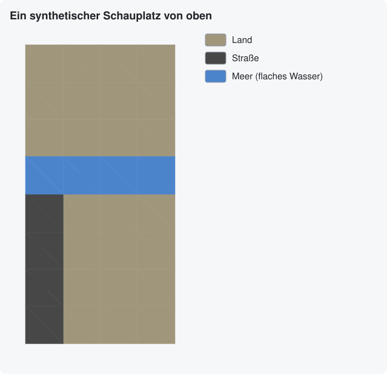
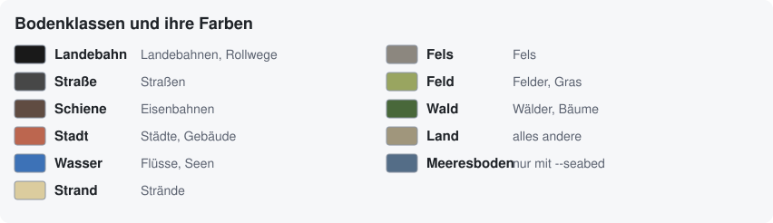

# Die Level-Dateien {#the-level-files}

Ein Level ist ein 3D-Modell des Bodens; ein Schauplatz ist das Wort von DCS World für eine Karte.

`<out>/<name>.glb` und `<name>.json` daneben.

| Teil | Was es ist |
|---|---|
| `ground:<Level>` | die eigenen Dreiecke des Geländes, gefärbt nach dem, was das Spiel darüber zeichnet |
| `water:<Level>` | jedes Dreieck, das das Spiel als unter dem Meer markiert, flach auf Meereshöhe gelegt |
| `structure:<Level>` | die Gebäude des Schauplatzes als Boxen, dort wo das Spiel sie platziert (unten) |

Die Farben sind die Klassen unten:

Die Farben schaltet man mit **Erfasste Farbe** im Panel „Hintergrund / Level“ des Viewers ein. Jedes Bodendreieck bekommt die Klasse
der Überlagerung, mit der das Spiel es zeichnet:

| Klasse | Farbe | Aus der Überlagerung des Spiels |
|---|---|---|
| runway | fast schwarz | `Runway` - Landebahnen, Rollwege und Vorfelder |
| road | dunkelgrau | `Road` |
| rail | braun | `Rail` |
| town | ziegelrot | `Town`, `Building` |
| water | blau | `River`, `Lake` (Binnengewässer, als Boden gezeichnet) |
| beach | sandfarben | `Beach` |
| rock | grau | `Rock` |
| field | hellgrün | `Field`, `Grass` |
| forest | dunkelgrün | `Forest`, `Trees` |
| land | khaki | keine davon |
| seabed | schiefer-blau | nur mit `--seabed` |

Wo mehrere Überlagerungen dasselbe Dreieck zeichnen, entscheidet die Reihenfolge der Tabelle
(eine Straße durch einen Wald ist Straße). Jedes Überlagerungsdreieck ist eines des Bodens selbst -
bei jeder Klasse der getesteten Schauplätze geprüft, jedes passte -, sodass die Klassen genau sind
und nicht aus benachbarten Punkten geraten.

**Koordinaten** sind die eigenen Weltmeter von DCS: x Nord, y oben, z Ost, und die glTF-Achsen sind dieselben
(X = x, Y = y, Z = z). Telemetrie in DCS-Metern - der DCS-Hook des 3DHeat Watcher schreibt genau das -
landet mit den Standardwerten des Viewers (Y oben, Maßstab 1) und ohne Platzierungsschritt auf dem Level.

**Breiten- und Längengrad:** Jeder Schauplatz ist eine Transversale-Mercator-Projektion mit eigenen Konstanten;
`<name>.json` enthält sie, die Ecken des Levels in Breiten- und Längengrad und jede Stadt mit ihrem Breiten-/Längengrad
und ihren DCS-x/z-Werten. Wo die Konstanten eines Schauplatzes nicht veröffentlicht sind, werden sie an die
Baken angepasst, die seine eigene `beacons.lua` in beiden Bezugssystemen angibt (ein Fehler von wenigen cm
im quadratischen Mittel; dieselbe Anpassung gibt die veröffentlichten Konstanten anderer Schauplätze bis auf den
Millimeter zurück). Für einen Schauplatz ohne Konstanten findet [`fit`](fit.md) sie aus jeder Aufnahme,
die beides enthält, etwa einer Watcher-Sitzung eines Flugs.

**Der Meeresboden** wird weggelassen (eine Heatmap für Flugsimulatoren braucht ihn nicht); `--seabed` behält ihn als Boden. `--no-water` lässt das flache Meer weg.

**Größe.** Siehe [Ein Level bauen: Größe](level.md#size).

**Flugplätze.** Jede `AirfieldsTaxiways/<name>.rn4` enthält das Rollwegnetz eines Flugplatzes, nach ihm benannt; seine
Punkte sind (x, y, z)-Doubles in DCS-Metern. Die `.json` des Levels listet jeden Flugplatz in der Region mit seinem Namen
(dem der Datei), der Mitte der Box seiner Punkte, der Box und dem Boden dort. Auf dem getesteten Schauplatz wurde jede
Flugplatz-Datei gelesen und jede auf ihrem Feld platziert (innerhalb weniger hundert Meter vom vermessenen
Flughafen-Bezugspunkt: der Mitte der Rollwege, nicht der Landebahn).

**Gebäude.** `Scenes/<theatre>.scn5` platziert jedes Objekt des Schauplatzes
(Millionen - Bäume, Lampen, Zäune, Leitungen, Häuser). Die, die nach Name und Größe Gebäude sind (Häuser, Wohnungen,
Schuppen, Hangars, Fabriken, Türme, Terminals: ein Bruchteil der Modelle, Hunderttausende Platzierungen), werden als
Boxen gezeichnet: die eigene Begrenzungsbox jedes Modells aus der Datei, auf seine Richtung gedreht und dort
stehend, wo das Spiel es platziert, von bis zu 3 m unter seinem Ursprung (sein Fundament am Hang) bis zu seiner Oberkante.
Bäume, Büsche, Lichter, Masten, Leitungen, Zäune, Mauern, Schilder, Fahrzeuge, Waggons, Boote, Kräne, Türme,
Strommasten und Brücken werden weggelassen. Keine Modellform und keine Textur des Spiels wird kopiert:
eine Box pro Gebäude, nach Art gefärbt (Haus, Block, Industrie, Flugplatz, Turm, sonstiges). `<name>.json` listet sie
ebenfalls (`buildings.rows`: x, z, base, height, halbe Längen, Richtung, Art) für den hybriden Hintergrund des Viewers,
der sie in den Städten des Spiels statt der abgebildeten Gebäude zeichnet. `--no-buildings` lässt sie weg.

`<name>.json` hält außerdem die Quelldatei, ihre Größe und ihr Datum, die gelesenen Kacheln, die Dreieckszahl je
Klasse und wie viele Städte des Schauplatzes auf dem Boden landen - eine Prüfung der Projektion, die "N von N" anzeigen sollte.

Das Level ist eine glTF-Binärdatei mit benannten Teilen, wie jedes 3DHeat-Level; die Seite
[Levels](https://holdi601.github.io/3DHeat/levels.html) des Viewers sagt, wie er sie lädt.
