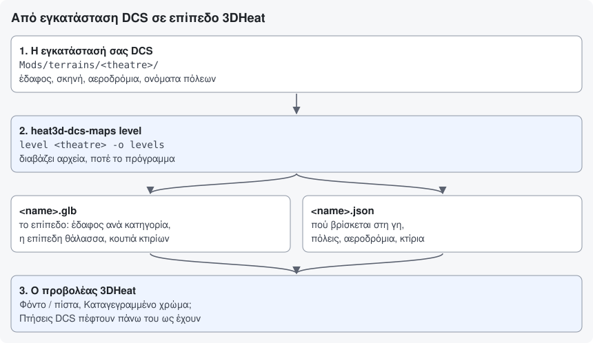

# 3DHeat DCS {#dheat-dcs}

**Τι είναι;** Το «θέατρο» (theatre) είναι ο όρος του DCS World για έναν χάρτη: μια περιοχή του κόσμου πάνω
από την οποία πετάτε. Αυτό το εργαλείο μετατρέπει το έδαφος ενός θεάτρου, διαβασμένο από **τη δική σας
εγκατάσταση**, σε ένα τρισδιάστατο επίπεδο (ένα μοντέλο πάνω από το οποίο μπορείτε να πετάξετε) για τον
προβολέα [3DHeat](https://github.com/Holdi601/3DHeat)
([τεκμηρίωση](https://holdi601.github.io/3DHeat/)).

**Γιατί να το χρησιμοποιήσω;** Για να δείτε τις πτήσεις σας στο DCS πάνω στον ίδιο τον χάρτη του παιχνιδιού:
τους λόφους του, την ακτή, τα αεροδρόμια, τους δρόμους, τις σιδηροδρομικές γραμμές, τις πόλεις και τα κτίρια.

**Παράδειγμα:** `heat3d-dcs-maps level <theatre> -o levels` ->
`levels/<theatre>.glb` (το επίπεδο) + `levels/<theatre>.json` (πού βρίσκεται στη γη,
οι πόλεις και τα αεροδρόμιά του).

Σε τι είναι χρήσιμο:

- **Πτήσεις στον ίδιο τον χάρτη του παιχνιδιού.** Το υπόβαθρο του κόσμου του 3DHeat σχεδιάζει σήμερα τη γη
  από ανοιχτά δεδομένα· αυτό σχεδιάζει το θέατρο όπως το σχεδιάζει το DCS.
- **Κανένα βήμα τοποθέτησης.** Το επίπεδο είναι στα δικά του μέτρα του κόσμου του DCS, άρα η τηλεμετρία
  σε μέτρα DCS (το hook DCS του 3DHeat Watcher γράφει ακριβώς αυτά) πέφτει πάνω του με τις προεπιλογές του προβολέα.
- **Γεωγραφικό πλάτος και μήκος.** Κάθε επίπεδο φέρει την προβολή του, τις γωνίες του και τις πόλεις του και στα δύο συστήματα.



## Γρήγορη εκκίνηση {#quick-start}

Δεν έχετε ξαναδουλέψει με τη γραμμή εντολών; Διαβάστε πρώτα το [Πριν ξεκινήσετε](before-you-start.md).
Τρέξτε αυτές τις εντολές μέσα στον φάκελο που κλωνοποιήσατε ή αποσυμπιέσατε:

```bash
python -m pip install -e .                         # installs the heat3d-dcs-maps command
heat3d-dcs-maps list                               # the theatres installed, and whether each can be read
heat3d-dcs-maps level <theatre> -o levels          # a whole (small) theatre
heat3d-dcs-maps level <theatre> --around <lat> <lon> 12 -o levels --name <name>   # 12 km either side of a point
```

Θα δείτε μία γραμμή για κάθε θέατρο από το `list`, που τελειώνει σε `readable`.
Μετά φορτώστε το `levels/<name>.glb` στο πάνελ «Φόντο / πίστα» του προβολέα
([Επίπεδα](https://holdi601.github.io/3DHeat/levels.html)).

Τα επίπεδα που γράφει είναι χτισμένα από τα δεδομένα του παιχνιδιού, και γι' αυτό μένουν **στον υπολογιστή σας**,
για προβολή, όχι για κοινοποίηση ή δημοσίευση ([Όροι](terms.md)).

Κάθε αναγνώστης παιχνιδιού είναι ένα δικό του μικρό έργο, με δικό του αρχείο άδειας, δικές του εκδόσεις και δικό του σύστημα αναφορών, ώστε να μπορεί να εγκατασταθεί, να ενημερωθεί, να συντηρηθεί - ή να αποσυρθεί κατόπιν αιτήματος δικαιούχου - μόνος του, χωρίς να επηρεάζει το πρόγραμμα προβολής ή τα άλλα εργαλεία.

## Σελίδες {#pages}

| Σελίδα | Τι καλύπτει |
|---|---|
| [Πριν ξεκινήσετε](before-you-start.md) | η Python, ένα τερματικό, μια πρώτη εκτέλεση |
| [Εύρεση θεάτρων: list](list.md) | πού βρίσκεται η εγκατάσταση, τι τυπώνει το `list` |
| [Δημιουργία επιπέδου: level](level.md) | κάθε επιλογή, περιοχές, μέγεθος, βήμα προς βήμα |
| [Τα αρχεία επιπέδου](output.md) | τα μέρη `.glb`, οι κατηγορίες εδάφους και τα χρώματά τους, το `.json`, οι συντεταγμένες |
| [Ονόματα τόπων: towns](towns.md) | οι τόποι ενός θεάτρου με συντεταγμένες DCS |
| [Προβολές: fit](fit.md) | εύρεση της προβολής ενός θεάτρου από μια εγγραφή |
| [Πώς διαβάζονται τα αρχεία](reading.md) | οι μορφές, τι ελέγχθηκε, τι δεν διαβάζεται |
| [Όροι και άδεια](terms.md) | τι διαβάζεται, τι δεν συνοδεύει το εργαλείο, η άδεια |
| [Αναφορά εντολών](../cli-reference.md) | κάθε επιλογή, παραγόμενη από τον κώδικα |
| [Συντήρηση αυτών των σελίδων](maintaining.md) | η λίστα ελέγχου κυκλοφορίας |

## Σχετικά {#related}

- Ο προβολέας 3DHeat: [github.com/Holdi601/3DHeat](https://github.com/Holdi601/3DHeat),
  τεκμηρίωση στο [holdi601.github.io/3DHeat](https://holdi601.github.io/3DHeat/).
- Τηλεμετρία για αυτά τα επίπεδα: ο [3DHeat Watcher](https://holdi601.github.io/3DHeat-Watcher/)
  καταγράφει πτήσεις του DCS· τα αρχεία του προβολέα, μαζί με το κοντέινερ ενός αγώνα σε ένα αρχείο,
  περιγράφονται στο [Ένα αρχείο ανά αγώνα (.3dheat)](https://holdi601.github.io/3DHeat/container.html).

## Τα εργαλεία του 3DHeat {#the-3dheat-tools}

| Εργαλείο | Τι κάνει | Κώδικας | Τεκμηρίωση |
|---|---|---|---|
| προβολέας 3DHeat | δείχνει τα δεδομένα: θερμικούς χάρτες, ανάλυση αγώνα, επισκόπηση αγώνα | [3DHeat](https://github.com/Holdi601/3DHeat) | [τεκμηρίωση](https://holdi601.github.io/3DHeat/) |
| GameFiles | πίστες και διαδρομές από τα αρχεία ενός παιχνιδιού | [3DHeat-GameFiles](https://github.com/Holdi601/3DHeat-GameFiles) | [τεκμηρίωση](https://holdi601.github.io/3DHeat-GameFiles/) |
| GameCapture | τηλεμετρία γύρων, και πίστες ανακατασκευασμένες από βίντεο παιχνιδιού | [3DHeat-GameCapture](https://github.com/Holdi601/3DHeat-GameCapture) | [τεκμηρίωση](https://holdi601.github.io/3DHeat-GameCapture/) |
| Unreal Exporter | ένα πρόσθετο για το Unreal Editor: ένα επίπεδο ως ένα `.glb` | [3DHeat-UnrealExporter](https://github.com/Holdi601/3DHeat-UnrealExporter) | [τεκμηρίωση](https://holdi601.github.io/3DHeat-UnrealExporter/) |
| CS2 | demo και χάρτες του Counter-Strike 2 | [3DHeat-CS2](https://github.com/Holdi601/3DHeat-CS2) | [τεκμηρίωση](https://holdi601.github.io/3DHeat-CS2/) |
| Watcher | καταγράφει όσα δημοσιεύουν τα παιχνίδια όσο παίζετε | [3DHeat-Watcher](https://github.com/Holdi601/3DHeat-Watcher) | [τεκμηρίωση](https://holdi601.github.io/3DHeat-Watcher/) |
| Ext-WarThunder | replay του War Thunder | [3DHeat-Ext-WarThunder](https://github.com/Holdi601/3DHeat-Ext-WarThunder) | [τεκμηρίωση](https://holdi601.github.io/3DHeat-Ext-WarThunder/) |
| Ext-WoT | replay του World of Tanks | [3DHeat-Ext-WoT](https://github.com/Holdi601/3DHeat-Ext-WoT) | [τεκμηρίωση](https://holdi601.github.io/3DHeat-Ext-WoT/) |
| Ext-WoWs | replay του World of Warships | [3DHeat-Ext-WoWs](https://github.com/Holdi601/3DHeat-Ext-WoWs) | [τεκμηρίωση](https://holdi601.github.io/3DHeat-Ext-WoWs/) |
| Ext-Squad | demo από servers του Squad | [3DHeat-Ext-Squad](https://github.com/Holdi601/3DHeat-Ext-Squad) | [τεκμηρίωση](https://holdi601.github.io/3DHeat-Ext-Squad/) |
| Ext-DCS | χάρτες του DCS World ως τρισδιάστατα επίπεδα | [3DHeat-Ext-DCS](https://github.com/Holdi601/3DHeat-Ext-DCS) | [τεκμηρίωση](https://holdi601.github.io/3DHeat-Ext-DCS/) |
| Ext-IL2 | χάρτες του IL-2 Sturmovik ως τρισδιάστατα επίπεδα | [3DHeat-Ext-IL2](https://github.com/Holdi601/3DHeat-Ext-IL2) | [τεκμηρίωση](https://holdi601.github.io/3DHeat-Ext-IL2/) |
