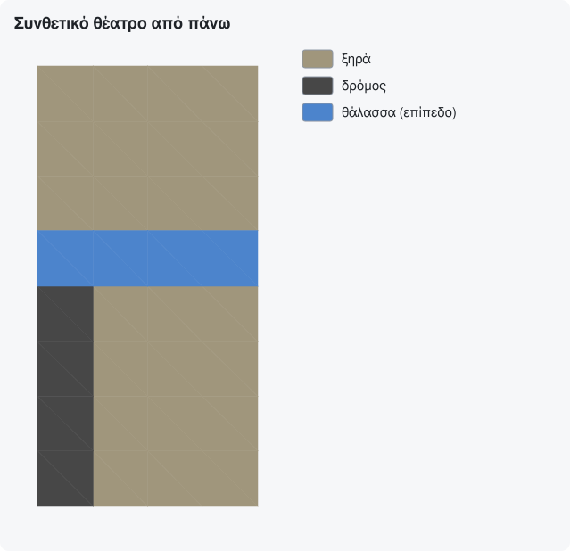
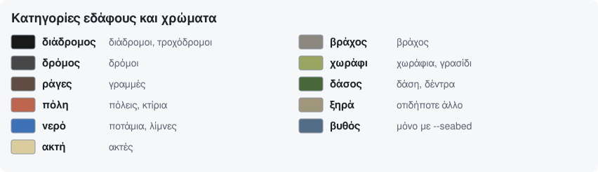

# Τα αρχεία επιπέδου {#the-level-files}

Ένα επίπεδο είναι ένα τρισδιάστατο μοντέλο του εδάφους· ένα θέατρο είναι ο όρος του DCS World για έναν χάρτη.

`<out>/<name>.glb` και δίπλα του το `<name>.json`.

| Μέρος | Τι είναι |
|---|---|
| `ground:<Level>` | τα ίδια τρίγωνα του εδάφους, χρωματισμένα ανάλογα με ό,τι σχεδιάζει το παιχνίδι από πάνω τους |
| `water:<Level>` | κάθε τρίγωνο που σημειώνει το παιχνίδι ως κάτω από τη θάλασσα, πλάι στο επίπεδο της θάλασσας |
| `structure:<Level>` | τα κτίρια του θεάτρου ως κουτιά, εκεί όπου τα τοποθετεί το παιχνίδι (παρακάτω) |

Τα χρώματα είναι οι κατηγορίες που ακολουθούν:

Τα χρώματα φαίνονται με το **Καταγεγραμμένο χρώμα** στο πάνελ «Φόντο / πίστα» του προβολέα. Κάθε τρίγωνο εδάφους παίρνει
την κατηγορία της επικάλυψης με την οποία το σχεδιάζει το παιχνίδι:

| Κατηγορία | Χρώμα | Από την επικάλυψη του παιχνιδιού |
|---|---|---|
| διάδρομος | σχεδόν μαύρο | `Runway` - διάδρομοι, τροχόδρομοι και πλατείες σταθμεύσεως |
| δρόμος | σκούρο γκρι | `Road` |
| ράγες | καφέ | `Rail` |
| πόλη | τούβλο | `Town`, `Building` |
| νερό | μπλε | `River`, `Lake` (εσωτερικά νερά, σχεδιασμένα ως έδαφος) |
| ακτή | άμμος | `Beach` |
| βράχος | γκρι | `Rock` |
| χωράφι | ανοιχτό πράσινο | `Field`, `Grass` |
| δάσος | σκούρο πράσινο | `Forest`, `Trees` |
| ξηρά | χακί | καμία από αυτές |
| βυθός | γαλαζοπράσινο-γκρι | μόνο με `--seabed` |

Όπου πολλές επικαλύψεις σχεδιάζουν το ίδιο τρίγωνο, η σειρά του πίνακα αποφασίζει
(ένας δρόμος μέσα σε δάσος είναι δρόμος). Κάθε τρίγωνο επικάλυψης είναι ένα από τα ίδια τα τρίγωνα του εδάφους
— ελέγχθηκε σε κάθε κατηγορία των θεάτρων που δοκιμάστηκαν, και ταίριαξε κάθε ένα — άρα οι κατηγορίες είναι ακριβείς,
δεν μαντεύονται από γειτονικά σημεία.

**Συντεταγμένες:** τα μέτρα του κόσμου του ίδιου του DCS: x βόρεια, y πάνω, z ανατολικά, και οι άξονες του glTF είναι
οι ίδιοι (X = x, Y = y, Z = z). Η τηλεμετρία σε μέτρα DCS — το hook DCS του 3DHeat Watcher γράφει ακριβώς αυτά — πέφτει
πάνω στο επίπεδο με τις προεπιλογές του προβολέα (Y προς τα πάνω, κλίμακα 1) και χωρίς βήμα τοποθέτησης.

**Γεωγραφικό πλάτος και μήκος:** κάθε θέατρο είναι μια προβολή Transverse Mercator με δικές του σταθερές·
το `<name>.json` τις κουβαλά, τις γωνίες του επιπέδου σε γεωγραφικό πλάτος και μήκος, και κάθε πόλη και με το
γεωγραφικό πλάτος/μήκος της και με το x/z της σε DCS. Όπου δεν δημοσιεύονται οι σταθερές ενός θεάτρου, προσαρμόζονται
στους φάρους που δίνει το δικό του `beacons.lua` και στα δύο συστήματα (μέσο τετραγωνικό σφάλμα λίγων cm· η ίδια
προσαρμογή δίνει πίσω τις δημοσιευμένες σταθερές άλλων θεάτρων με ακρίβεια χιλιοστού).
Για ένα θέατρο χωρίς σταθερές, το [`fit`](fit.md) τις βρίσκει από οποιαδήποτε εγγραφή που έχει και τα δύο,
όπως μια συνεδρία Watcher από μία πτήση.

**Ο βυθός της θάλασσας** μένει έξω (ένας heatmap για προσομοιωτή πτήσης δεν χρειάζεται τον βυθό)· το `--seabed` τον
κρατά ως έδαφος. Το `--no-water` αφήνει έξω την επίπεδη θάλασσα.

**Μέγεθος.** Δείτε [Δημιουργία επιπέδου: Μέγεθος](level.md#size).

**Αεροδρόμια.** Κάθε `AirfieldsTaxiways/<name>.rn4` περιέχει το δίκτυο τροχοδρόμων ενός αεροδρομίου, με το όνομά του·
τα σημεία του είναι (x, y, z) διπλής ακρίβειας σε μέτρα DCS. Το `.json` του επιπέδου απαριθμεί κάθε αεροδρόμιο
μέσα στην περιοχή με το όνομά του (του αρχείου), το μέσο του κουτιού των σημείων του, το κουτί, και το έδαφος εκεί.
Στο θέατρο που δοκιμάστηκε, διαβάστηκε κάθε αρχείο αεροδρομίου, και το καθένα τοποθετήθηκε στο πεδίο του
(μέσα σε λίγες εκατοντάδες μέτρα από το σημείο αναφοράς του αεροδρομίου όπως έχει χαρτογραφηθεί: το μέσο των τροχοδρόμων,
όχι του διαδρόμου).

**Κτίρια.** Το `Scenes/<theatre>.scn5` τοποθετεί κάθε αντικείμενο του θεάτρου (εκατομμύρια — δέντρα, φανοί, περιφράξεις,
καλώδια, σπίτια). Αυτά που είναι κτίρια από το όνομα και το μέγεθός τους (σπίτια, διαμερίσματα, παράγκες, υπόστεγα,
εργοστάσια, πύργοι, τερματικοί σταθμοί: ένα κλάσμα των μοντέλων, εκατοντάδες χιλιάδες τοποθετήσεις) σχεδιάζονται ως κουτιά:
το δικό κάθε μοντέλου κουτί περιβάλλοντος από το αρχείο, γυρισμένο στον προσανατολισμό του και σταθμευμένο εκεί που το
βάζει το παιχνίδι, από έως 3 m κάτω από την αρχή του (η βάση του σε πλαγιά) μέχρι την κορυφή του. Δέντρα, θάμνοι,
φανοί, στύλοι, καλώδια, περιφράξεις, τοίχοι, πινακίδες, οχήματα, βαγόνια, βάρκες, γερανοί, κεραίες, πυλώνες και γέφυρες
μένουν έξω. Δεν αντιγράφεται κανένα σχήμα μοντέλου ή υφή του παιχνιδιού: ένα κουτί ανά κτίριο, χρωματισμένο ανά είδος
(σπίτι, πολυκατοικία, βιομηχανικό, αεροδρόμιο, πύργος, άλλο). Το `<name>.json` τα απαριθμεί επίσης
(`buildings.rows`: x, z, base, height, μισά μήκη, heading, kind) για το υβριδικό υπόβαθρο του προβολέα, που τα σχεδιάζει
μέσα στις πόλεις του παιχνιδιού αντί για τα χαρτογραφημένα κτίρια. Το `--no-buildings` τα αφήνει έξω.

Το `<name>.json` καταγράφει επίσης το αρχείο προέλευσης, το μέγεθος και την ημερομηνία του, τα πλακίδια που
διαβάστηκαν, το πλήθος τριγώνων ανά κατηγορία, και πόσες από τις πόλεις του θεάτρου πέφτουν στο έδαφος — έλεγχος
της προβολής, που πρέπει να γράφει «N από N».

Το επίπεδο είναι ένα δυαδικό glTF με ονομασμένα μέρη, όπως κάθε επίπεδο του 3DHeat· η σελίδα
[Επίπεδα](https://holdi601.github.io/3DHeat/levels.html) του προβολέα λέει πώς τα φορτώνει.
