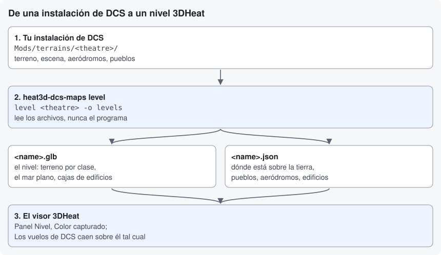

# 3DHeat DCS {#dheat-dcs}

**¿Qué es?** Un teatro es la palabra de DCS World para un mapa: una región del mundo sobre la que
vuelas. Esta herramienta convierte el terreno de un teatro, leído desde **tu propia instalación**,
en un nivel 3D (un modelo sobre el que puedes volar) para el visor
[3DHeat](https://github.com/Holdi601/3DHeat)
([documentación](https://holdi601.github.io/3DHeat/)).

**¿Para qué lo usaría?** Para ver tus vuelos de DCS sobre el propio mapa del juego: sus colinas,
su costa, sus aeródromos, carreteras, vías férreas, pueblos y edificios.

**Ejemplo:** `heat3d-dcs-maps level <theatre> -o levels` ->
`levels/<theatre>.glb` (el nivel) + `levels/<theatre>.json` (dónde está en la tierra, sus pueblos
y aeródromos).

Para qué sirve:

- **Vuelos sobre el mapa propio del juego.** El fondo del mundo de 3DHeat dibuja hoy la tierra
  a partir de datos abiertos; esto dibuja el teatro como lo dibuja DCS.
- **Sin paso de colocación.** El nivel está en los metros propios del mundo de DCS, así que la
  telemetría en metros de DCS (el gancho de DCS de 3DHeat Watcher escribe exactamente eso) cae
  sobre él con los valores por defecto del visor.
- **Latitud y longitud.** Cada nivel lleva su proyección, sus esquinas y sus pueblos en ambos
  sistemas.



## Inicio rápido {#quick-start}

¿Nuevo en la línea de comandos? Lee primero [Antes de empezar](before-you-start.md).
Ejecuta estos comandos en la carpeta que clonaste o descomprimiste:

```bash
python -m pip install -e .                         # instala el comando heat3d-dcs-maps
heat3d-dcs-maps list                               # los teatros instalados, y si se puede leer cada uno
heat3d-dcs-maps level <theatre> -o levels          # un teatro entero (pequeño)
heat3d-dcs-maps level <theatre> --around <lat> <lon> 12 -o levels --name <name>   # 12 km a cada lado de un punto
```

Verás una línea por teatro con `list`, que termina en `readable`.
Después carga `levels/<name>.glb` en el panel Fondo / nivel del visor
([Niveles](https://holdi601.github.io/3DHeat/levels.html)).

Los niveles que escribe se construyen con los datos del juego: se quedan **en tu equipo**, para
verlos, no para compartirlos ni publicarlos ([Condiciones](terms.md)).

## Páginas {#pages}

| Página | Qué cubre |
|---|---|
| [Antes de empezar](before-you-start.md) | Python, una terminal, una primera ejecución |
| [Buscar teatros: list](list.md) | dónde se encuentra la instalación, qué imprime `list` |
| [Construir un nivel: level](level.md) | cada opción, regiones, tamaño, paso a paso |
| [Los archivos del nivel](output.md) | las partes `.glb`, las clases de terreno y sus colores, el `.json`, las coordenadas |
| [Nombres de lugares: towns](towns.md) | los pueblos de un teatro con coordenadas de DCS |
| [Proyecciones: fit](fit.md) | encontrar la proyección de un teatro a partir de una grabación |
| [Cómo se leen los archivos](reading.md) | los formatos, lo verificado, lo que no se lee |
| [Condiciones y licencia](terms.md) | la licencia de Eagle Dynamics, y por qué esto es un paquete aparte |
| [Referencia de comandos](../cli-reference.md) | cada opción, generada desde el código |
| [Mantenimiento de estas páginas](maintaining.md) | la lista de comprobación de cada versión |

## Relacionado {#related}

- El visor 3DHeat: [github.com/Holdi601/3DHeat](https://github.com/Holdi601/3DHeat),
  documentación en [holdi601.github.io/3DHeat](https://holdi601.github.io/3DHeat/).
- Telemetría para estos niveles: [3DHeat Watcher](https://holdi601.github.io/3DHeat-Watcher/)
  registra los vuelos de DCS; los formatos de archivo del visor, incluido su contenedor de un
  archivo por partida, se describen en
  [Un archivo por partida (.3dheat)](https://holdi601.github.io/3DHeat/container.html).

## Las herramientas de 3DHeat {#the-3dheat-tools}

| Herramienta | Qué hace | Código | Documentación |
|---|---|---|---|
| Visor 3DHeat | muestra los datos: mapas de calor, análisis de carrera, revisión de partidas | [3DHeat](https://github.com/Holdi601/3DHeat) | [docs](https://holdi601.github.io/3DHeat/) |
| GameFiles | niveles y circuitos a partir de los archivos propios de un juego | [3DHeat-GameFiles](https://github.com/Holdi601/3DHeat-GameFiles) | [docs](https://holdi601.github.io/3DHeat-GameFiles/) |
| GameCapture | telemetría de vueltas, y niveles reconstruidos a partir de vídeo de juego | [3DHeat-GameCapture](https://github.com/Holdi601/3DHeat-GameCapture) | [docs](https://holdi601.github.io/3DHeat-GameCapture/) |
| Unreal Exporter | un plugin del editor de Unreal: un nivel como un solo `.glb` | [3DHeat-UnrealExporter](https://github.com/Holdi601/3DHeat-UnrealExporter) | [docs](https://holdi601.github.io/3DHeat-UnrealExporter/) |
| CS2 | demos y mapas de Counter-Strike 2 | [3DHeat-CS2](https://github.com/Holdi601/3DHeat-CS2) | [docs](https://holdi601.github.io/3DHeat-CS2/) |
| Watcher | registra lo que publican los juegos mientras juegas | [3DHeat-Watcher](https://github.com/Holdi601/3DHeat-Watcher) | [docs](https://holdi601.github.io/3DHeat-Watcher/) |
| Ext-WarThunder | repeticiones de War Thunder | [3DHeat-Ext-WarThunder](https://github.com/Holdi601/3DHeat-Ext-WarThunder) | [docs](https://holdi601.github.io/3DHeat-Ext-WarThunder/) |
| Ext-WoT | repeticiones de World of Tanks | [3DHeat-Ext-WoT](https://github.com/Holdi601/3DHeat-Ext-WoT) | [docs](https://holdi601.github.io/3DHeat-Ext-WoT/) |
| Ext-WoWs | repeticiones de World of Warships | [3DHeat-Ext-WoWs](https://github.com/Holdi601/3DHeat-Ext-WoWs) | [docs](https://holdi601.github.io/3DHeat-Ext-WoWs/) |
| Ext-Squad | demos de servidores de Squad | [3DHeat-Ext-Squad](https://github.com/Holdi601/3DHeat-Ext-Squad) | [docs](https://holdi601.github.io/3DHeat-Ext-Squad/) |
| Ext-DCS | mapas de DCS World como niveles 3D | [3DHeat-Ext-DCS](https://github.com/Holdi601/3DHeat-Ext-DCS) | [docs](https://holdi601.github.io/3DHeat-Ext-DCS/) |
| Ext-IL2 | mapas de IL-2 Sturmovik como niveles 3D | [3DHeat-Ext-IL2](https://github.com/Holdi601/3DHeat-Ext-IL2) | [docs](https://holdi601.github.io/3DHeat-Ext-IL2/) |
