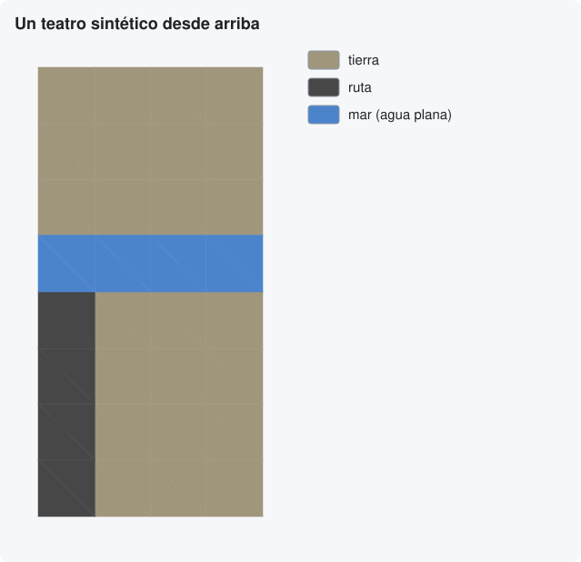
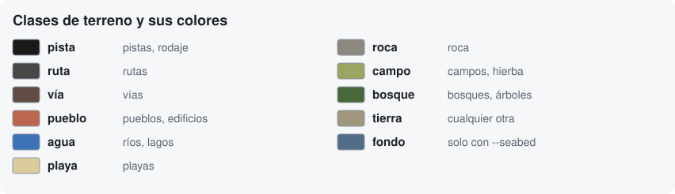

# Los archivos del nivel {#the-level-files}

Un nivel es un modelo 3D del terreno; un teatro es la palabra de DCS World para un mapa.

`<out>/<name>.glb` y `<name>.json` junto a él.

| Parte | Qué es |
|---|---|
| `ground:<Level>` | los triángulos propios del terreno, coloreados según lo que el juego dibuja sobre cada uno |
| `water:<Level>` | cada triángulo que el juego marca como bajo el mar, colocado plano al nivel del mar |
| `structure:<Level>` | los edificios del teatro como cajas, donde el juego los coloca (abajo) |

Los colores son las clases de abajo:

Los colores se ven con **Color capturado** en el panel Fondo / nivel del visor. Cada triángulo del
terreno toma la clase de la capa que el juego dibuja sobre él:

| Clase | Color | De la capa del juego |
|---|---|---|
| runway | negro casi puro | `Runway` - pistas, calles de rodaje y plataformas |
| road | gris oscuro | `Road` |
| rail | marrón | `Rail` |
| town | rojo ladrillo | `Town`, `Building` |
| water | azul | `River`, `Lake` (agua interior, dibujada como terreno) |
| beach | arena | `Beach` |
| rock | gris | `Rock` |
| field | verde claro | `Field`, `Grass` |
| forest | verde oscuro | `Forest`, `Trees` |
| land | caqui | ninguna de estas |
| seabed | azul pizarra | solo con `--seabed` |

Cuando varias capas dibujan el mismo triángulo, decide el orden de la tabla
(una carretera por un bosque es carretera). Cada triángulo de capa es uno del propio terreno -
comprobado en cada clase de los teatros probados, y todos coincidieron - así que las clases son
exactas, no adivinadas a partir de puntos cercanos.

**Las coordenadas** son los metros propios del mundo de DCS: x norte, y arriba, z este, y los ejes
de glTF son los mismos (X = x, Y = y, Z = z). La telemetría en metros de DCS - el gancho de DCS de
3DHeat Watcher escribe exactamente eso - cae sobre el nivel con los valores por defecto del visor
(Y arriba, escala 1) y sin paso de colocación.

**Latitud y longitud:** cada teatro es una proyección Transversal de Mercator con sus propias
constantes; `<name>.json` las lleva, junto con las esquinas del nivel en latitud y longitud, y cada
pueblo con su latitud/longitud y su x/z de DCS. Cuando las constantes de un teatro no están
publicadas, se ajustan a las balizas que da su propio `beacons.lua` en ambos sistemas (unos pocos cm
de la raíz del error cuadrático medio; el mismo ajuste devuelve las constantes publicadas de otros
teatros hasta el milímetro). Para un teatro sin constantes, [`fit`](fit.md) las encuentra a partir de
cualquier grabación que contenga ambas, como una sesión de Watcher de un vuelo.

**El fondo del mar** se deja fuera (un mapa de calor de simulador de vuelo no necesita el fondo del
mar); `--seabed` lo conserva como terreno. `--no-water` deja fuera el mar plano.

**Tamaño.** Ver [Construir un nivel: Tamaño](level.md#size).

**Aeródromos.** Cada `AirfieldsTaxiways/<name>.rn4` contiene la red de rodaje de un aeródromo,
con el nombre de este; sus puntos son números de doble precisión (x, y, z) en metros de DCS. El `.json` del nivel
enumera cada aeródromo dentro de la región con su nombre (el del archivo), el centro de la caja de
sus puntos, la caja, y el terreno allí. En el teatro probado, se leyó cada archivo de aeródromo, y
cada uno cayó sobre su campo (a unos pocos cientos de metros del punto de referencia del aeropuerto
medido: el centro de las calles de rodaje, no el de la pista).

**Edificios.** `Scenes/<theatre>.scn5` coloca cada objeto del teatro (millones - árboles, farolas,
vallas, cables, casas). Los que son edificios por su nombre y tamaño (casas, pisos, cobertizos,
hangares, fábricas, torres, terminales: una fracción de los modelos, cientos de miles de
colocaciones) se dibujan como cajas: la caja envolvente propia de cada modelo a partir del archivo,
girada según su rumbo y colocada donde la pone el juego, desde 3 m por debajo de su origen
(su base en una pendiente) hasta su cima. Árboles, arbustos, luces, postes, cables, vallas, muros,
señales, vehículos, vagones, barcos, grúas, mástiles, torres de tendido y puentes se dejan fuera. No
se copia ninguna forma ni textura de modelo del juego: una caja por edificio, coloreada por tipo
(casa, bloque, industrial, aeródromo, torre, otro). `<name>.json` también los lista
(`buildings.rows`: x, z, base, height, longitudes medias, rumbo, tipo) para el fondo híbrido del
visor, que los dibuja en los pueblos del juego en lugar de los edificios mapeados. `--no-buildings`
los deja fuera.

`<name>.json` también registra el archivo de origen, su tamaño y su fecha, las teselas leídas, el
número de triángulos por clase, y cuántos pueblos del teatro caen sobre el terreno: una comprobación
de la proyección que debe decir "N de N".

El nivel es un binario glTF con partes con nombre, como todo nivel de 3DHeat; la página
[Niveles](https://holdi601.github.io/3DHeat/levels.html) del visor explica cómo los carga.
