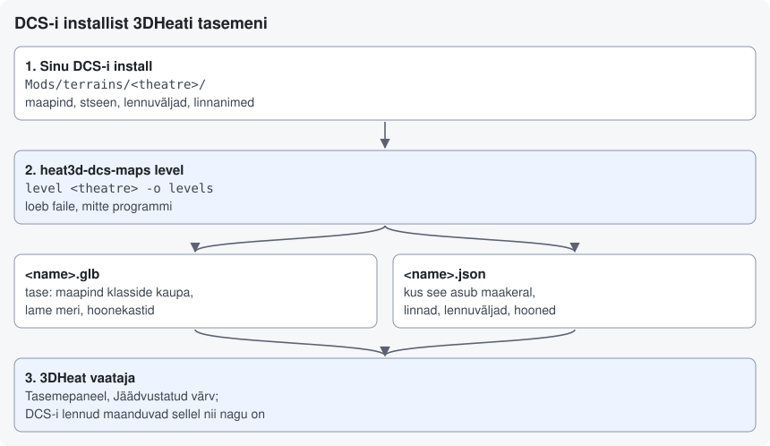

# 3DHeat DCS {#dheat-dcs}

**Mis see on?** Teater on DCS Worldi nimetus kaardile: piirkond maailmas, mille kohal lendad. See tööriist muudab ühe teatri maapinna, loetuna **sinu enda installist**, 3D-tasemeks — mudeliks, mille kohal saab lennata — [3DHeat](https://github.com/Holdi601/3DHeat) vaataja jaoks
([dokumentatsioon](https://holdi601.github.io/3DHeat/)).

**Miks ma seda kasutaksin?** Et näha oma DCS-i lende mängu enda kaardil: selle mägesid, rannajooni, lennuvälju, teid, raudteid, linnu ja hooneid.

**Näide:** `heat3d-dcs-maps level <theatre> -o levels` ->
`levels/<theatre>.glb` (tase) + `levels/<theatre>.json` (kus see asub maakeral,
selle linnad ja lennuväljad).

Milleks see kasulik on:

- **Lennud mängu enda kaardil.** 3DHeati maailma taustapilt joonistab tänase maa avatud andmete põhjal; see joonistab teatri nii, nagu DCS seda joonistab.
- **Pole paigutussammu.** Tase on DCS-i enda maailmameetrites, nii et telemeetria DCS-i meetrites (3DHeat Watcheri DCS-i haak kirjutab just seda) langeb sinna vaataja vaikeseadetega.
- **Laiuskraad ja pikkuskraad.** Igal tasemel on oma projektsioon, nurgad ja linnad mõlemas koordinaatsüsteemis.



## Kiire algus {#quick-start}

Pole sul käsurealt kogemust? Loe esmalt [Enne alustamist](before-you-start.md).
Käivita need kaustas, kuhu kloonisid või lahti pakkisid:

```bash
python -m pip install -e .                         # paigaldab käsu heat3d-dcs-maps
heat3d-dcs-maps list                               # paigaldatud teatrid ja see, kas igaüht saab lugeda
heat3d-dcs-maps level <theatre> -o levels          # terve (väike) teater
heat3d-dcs-maps level <theatre> --around <lat> <lon> 12 -o levels --name <name>   # 12 km punkti mõlemal pool
```

`list` näitab ühe rea teatri kohta ja lõpeb sõnaga `readable`.
Seejärel laadi `levels/<name>.glb` vaataja paneelis **Taust / tase**
([Tasemed](https://holdi601.github.io/3DHeat/levels.html)).

Tasemed, mida see kirjutab, on tehtud mängu andmetest, nii et need jäävad **sinu masinasse**,
vaatamiseks, mitte jagamiseks ega avaldamiseks ([Tingimused](terms.md)).

## Lehed {#pages}

| Leht | Mida see käsitleb |
|---|---|
| [Enne alustamist](before-you-start.md) | Python, terminal, esimene käivitus |
| [Teatrite leidmine: list](list.md) | kust install leitakse, mida `list` prindib |
| [Taseme ehitamine: level](level.md) | iga valik, piirkonnad, suurus, samm-sammult |
| [Tasemefailid](output.md) | `.glb` osad, maapinna klassid ja nende värvid, `.json`, koordinaadid |
| [Kohanimed: towns](towns.md) | teatri linnad DCS-i koordinaatidega |
| [Projektsioonid: fit](fit.md) | teatri projektsiooni leidmine salvestusest |
| [Kuidas faile loetakse](reading.md) | vormingud, mida kontrolliti, mida ei loeta |
| [Tingimused ja litsents](terms.md) | Eagle Dynamicsi litsents ja miks see on eraldi pakett |
| [Käsu viide](../cli-reference.md) | iga valik, koodist genereeritud |
| [Nende dokumentide hooldamine](maintaining.md) | väljalaske kontrollnimekiri |

## Seotud {#related}

- 3DHeat vaataja: [github.com/Holdi601/3DHeat](https://github.com/Holdi601/3DHeat),
  dokumentatsioon aadressil [holdi601.github.io/3DHeat](https://holdi601.github.io/3DHeat/).
- Telemeetria nendele tasemetele: [3DHeat Watcher](https://holdi601.github.io/3DHeat-Watcher/)
  salvestab DCS-i lende; vaataja failivormingud, sealhulgas tema üks-fail-mängu kohta mõeldud
  konteiner, on kirjeldatud lehel
  [Üks fail mängu kohta (.3dheat)](https://holdi601.github.io/3DHeat/container.html).

## 3DHeati tööriistad {#the-3dheat-tools}

| Tööriist | Mida see teeb | Kood | Dokumentatsioon |
|---|---|---|---|
| 3DHeat vaataja | näitab andmeid: soojuskaardid, võistlusanalüüs, mängu ülevaade | [3DHeat](https://github.com/Holdi601/3DHeat) | [dokumentatsioon](https://holdi601.github.io/3DHeat/) |
| GameFiles | tasemed ja rajad mängu enda failidest | [3DHeat-GameFiles](https://github.com/Holdi601/3DHeat-GameFiles) | [dokumentatsioon](https://holdi601.github.io/3DHeat-GameFiles/) |
| GameCapture | ringi telemeetria ja mängu videost taastatud tasemed | [3DHeat-GameCapture](https://github.com/Holdi601/3DHeat-GameCapture) | [dokumentatsioon](https://holdi601.github.io/3DHeat-GameCapture/) |
| Unreal Exporter | Unreal Editori plugin: tase ühe `.glb` failina | [3DHeat-UnrealExporter](https://github.com/Holdi601/3DHeat-UnrealExporter) | [dokumentatsioon](https://holdi601.github.io/3DHeat-UnrealExporter/) |
| CS2 | Counter-Strike 2 demod ja kaardid | [3DHeat-CS2](https://github.com/Holdi601/3DHeat-CS2) | [dokumentatsioon](https://holdi601.github.io/3DHeat-CS2/) |
| Watcher | salvestab, mida mängud avaldavad, kui sa mängid | [3DHeat-Watcher](https://github.com/Holdi601/3DHeat-Watcher) | [dokumentatsioon](https://holdi601.github.io/3DHeat-Watcher/) |
| Ext-WarThunder | War Thunderi kordused | [3DHeat-Ext-WarThunder](https://github.com/Holdi601/3DHeat-Ext-WarThunder) | [dokumentatsioon](https://holdi601.github.io/3DHeat-Ext-WarThunder/) |
| Ext-WoT | World of Tanksi kordused | [3DHeat-Ext-WoT](https://github.com/Holdi601/3DHeat-Ext-WoT) | [dokumentatsioon](https://holdi601.github.io/3DHeat-Ext-WoT/) |
| Ext-WoWs | World of Warshipsi kordused | [3DHeat-Ext-WoWs](https://github.com/Holdi601/3DHeat-Ext-WoWs) | [dokumentatsioon](https://holdi601.github.io/3DHeat-Ext-WoWs/) |
| Ext-Squad | Squadi serverdemod | [3DHeat-Ext-Squad](https://github.com/Holdi601/3DHeat-Ext-Squad) | [dokumentatsioon](https://holdi601.github.io/3DHeat-Ext-Squad/) |
| Ext-DCS | DCS World'i kaardid 3D-tasemetena | [3DHeat-Ext-DCS](https://github.com/Holdi601/3DHeat-Ext-DCS) | [dokumentatsioon](https://holdi601.github.io/3DHeat-Ext-DCS/) |
| Ext-IL2 | IL-2 Sturmovik'i kaardid 3D-tasemetena | [3DHeat-Ext-IL2](https://github.com/Holdi601/3DHeat-Ext-IL2) | [dokumentatsioon](https://holdi601.github.io/3DHeat-Ext-IL2/) |
