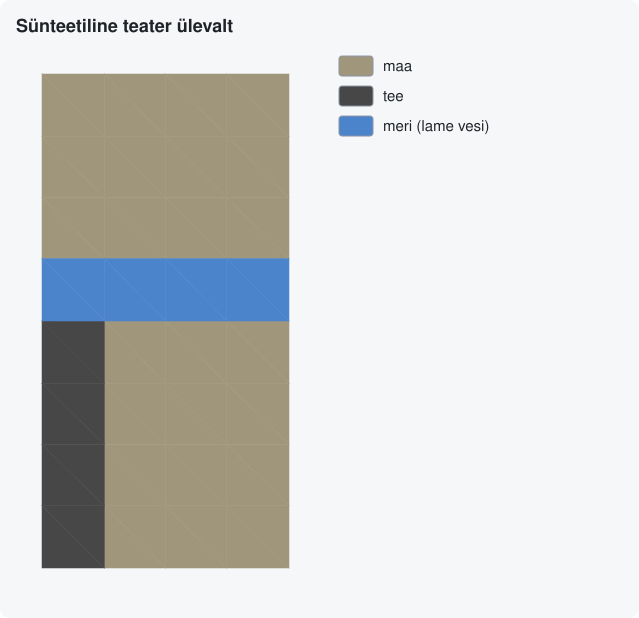
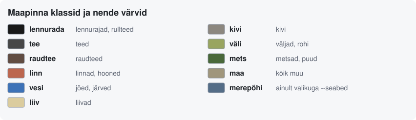

# Tasemefailid {#the-level-files}

Tase on maapinna 3D-mudel; teater on DCS Worldi nimetus kaardile.

`<out>/<name>.glb` ja selle kõrval `<name>.json`.

| Osa | Mis see on |
|---|---|
| `ground:<Level>` | maastiku enda kolmnurgad, värvitud selle järgi, mida mäng nende peale joonistab |
| `water:<Level>` | iga kolmnurk, mille mäng märgib mere all olevaks, lamedalt merepinnal |
| `structure:<Level>` | teatri hooned kastidena, kus mäng need paigutab (allpool) |

Värvid on allpool olevad klassid:

Värvid näed vaataja paneelil **Taust / tase** valikuga **Jäädvustatud värv**. Iga maapinna
kolmnurk saab klassi selle kattekihi järgi, millega mäng ta joonistab:

| Klass | Värv | Mängu kattekihist |
|---|---|---|
| runway | peaaegu must | `Runway` - lennurajad, rullteed ja platsid |
| road | tumehall | `Road` |
| rail | pruun | `Rail` |
| town | tellisepunane | `Town`, `Building` |
| water | sinine | `River`, `Lake` (siseveed, joonistatud maana) |
| beach | liiv | `Beach` |
| rock | hall | `Rock` |
| field | helerohelin | `Field`, `Grass` |
| forest | tumeroheline | `Forest`, `Trees` |
| land | khaki | ei ühtegi neist |
| seabed | kivisinine | ainult valikuga `--seabed` |

Kui mitu kattekihti joonistavad sama kolmnurga, otsustab tabeli järjekord
(tee metsa läbi on tee). Iga kattekihi kolmnurk on maapinna enda oma — kontrollitud
iga proovitud teatri iga klassi peal, iga kolmnurk klappis — nii et klassid on
täpsed, mitte pakutud läheduses olevatest punktidest.

**Koordinaadid** on DCS-i enda maailmameetrid: x põhja, y üles, z ida, ja glTF-telgede
suunad on samad (X = x, Y = y, Z = z). Telemeetria DCS-i meetrites — 3DHeat Watcheri DCS-i
haak kirjutab just seda — langeb tasemele vaataja vaikeseadetega (Y üles, mõõt 1) ja
paigutussammu pole vaja.

**Laiuskraad ja pikkuskraad:** iga teater on Transverse Mercatori projektsioon oma
konstantidega; `<name>.json` kannab neid, tasemenurki laiuskraadides ja pikkuskraadides
ning iga linna nii tema laiuskraadi/pikkuskraadi kui ka DCS-i x/z-koordinaatidena.
Kui teatri konstante ei ole avaldatud, sobitatakse need selle enda `beacons.lua`
tuletornidega mõlemas koordinaatsüsteemis (mõne sentimeetri ruutkeskmine viga; sama sobitus annab teiste teatrite avaldatud konstandid tagasi millimeetri täpsusega).
Teatrile ilma konstantideta leiab [`fit`](fit.md) need mis tahes salvestuse põhjal, millel on mõlemad, näiteks ühe lennu Watcheri seansi põhjal.

**Merepõhi** jäetakse välja (lendamise soojuskaart ei vaja merepõhja); `--seabed` hoiab selle maapinnana. `--no-water` jätab lame mere välja.

**Suurus.** Vaata [Taseme ehitamine: Suurus](level.md#size).

**Lennuväljad.** Iga `AirfieldsTaxiways/<name>.rn4` sisaldab ühe lennuvälja rullteede
võrku, mis on nime järgi nimetatud; selle punktid on (x, y, z) topeltarvud DCS-i meetrites.
Taseme `.json` loetleb iga lennuvälja piirkonnas koos tema nimega (faili oma),
tema punktide kasti keskpunktiga, kastiga ja seal oleva maapinnaga. Proovitud teatril loeti iga lennuvälja fail ja iga asetati oma väljale
(mõne sajas meetri piires mõõdetud lennujaama viiteprojektsioonist: rullteede keskel, mitte rajal).

**Hooned.** `Scenes/<theatre>.scn5` paigutab iga teatri objekti
(miljoneid — puud, lambid, aiad, juhtmed, majad). Need, mis on nime ja suuruse järgi
hooned (majad, korterid, kuurid, angaarid, tehased, tornid, terminalid: murdosa mudelitest,
sadu tuhandeid paigutusi), joonistatakse kastidena: iga mudeli oma piirav kast failist,
pööratud oma suunda ja seisvana sinna, kuhu mäng selle paneb, alates kuni 3 m allpool selle
algpunkti (jalg nõlval) kuni tipuni. Puud, põõsad, valgustid, postid, juhtmed, aiad, müürid,
sildid, sõidukid, vagunid, paadid, kraanad, mastid, pülonid ja sillad jäetakse välja.
Mängu mudeli kuju ega tekstuuri ei kopeerita: iga hoone on kast, värvitud liigi järgi
(maja, plokk, tööstus, lennuväli, torn, muu). `<name>.json` loetleb neid samuti
(`buildings.rows`: x, z, alus, kõrgus, poolpikkused, suund, liik) vaataja hübriidse taustapildi
jaoks, mis joonistab need mängu linnades kaardistatud hoonete asemel. `--no-buildings`
jätab need välja.

`<name>.json` salvestab ka lähtefaili, selle suuruse ja kuupäeva, loetud kahhelid,
kolmnurkade arvu klassi kohta ja selle, mitu teatri linna jääb maapinnale — projektsiooni
kontroll, mis peaks ütlema "N of N".

Tase on glTF-binaarfail nimetatud osadega, nagu iga 3DHeat tase; vaataja
[Tasemed](https://holdi601.github.io/3DHeat/levels.html) leht ütleb, kuidas need laaditakse.
