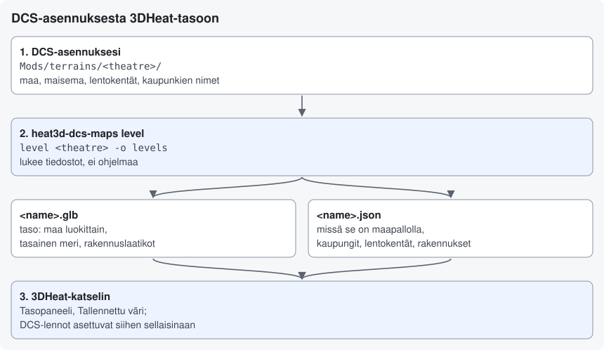

# 3DHeat DCS {#dheat-dcs}

**Mitä se on?** Teatteri on DCS Worldin sana kartalle: alueelle, jonka yli lennetään.
Tämä työkalu muuttaa yhden teatterin maaston, luetun **omasta asennuksestasi**, 3D-kentäksi
– mallin, jonka yli voi lentää – [3DHeat](https://github.com/Holdi601/3DHeat)-katselimelle
([dokumentaatio](https://holdi601.github.io/3DHeat/)).

**Miksi käyttäisin sitä?** Nähdäksesi DCS-lentosi pelin oman kartan päällä: sen mäet,
rannikon, lentokentät, tiet, rautatiet, kaupungit ja rakennukset.

**Esimerkki:** `heat3d-dcs-maps level <theatre> -o levels` ->
`levels/<theatre>.glb` (kenttä) + `levels/<theatre>.json` (missä se on maapallolla,
sen kaupungit ja lentokentät).

Tästä on hyötyä:

- **Lennot pelin omalla kartalla.** 3DHeat-maailman taustakuva piirtää nykyisen maapallon
  avoimesta datasta; tämä piirtää teatterin niin kuin DCS sen piirtää.
- **Ei sijoittelua.** Kenttä on DCS:n omissa maailmametreissä, joten DCS-metreissä oleva
  telemetria (3DHeat Watcherin DCS-liitännäinen kirjoittaa juuri sen) asettuu siihen
  katselimen oletusasetuksilla.
- **Leveys- ja pituusaste.** Jokainen kenttä kantaa mukanaan projektionsa, kulmansa ja
  kaupunkinsa molemmissa koordinaatistoissa.



## Pikaohje {#quick-start}

Uusi komentorivin kanssa? Lue ensin [Ennen aloittamista](before-you-start.md).
Suorita nämä kansiossa, johon kloonasit tai purit työkalun:

```bash
python -m pip install -e .                         # asentaa komennon heat3d-dcs-maps
heat3d-dcs-maps list                               # asennetut teatterit ja se, voidaanko kukin lukea
heat3d-dcs-maps level <theatre> -o levels          # koko (pieni) teatteri
heat3d-dcs-maps level <theatre> --around <lat> <lon> 12 -o levels --name <name>   # 12 km pisteen molemmin puolin
```

`list`-komento tulostaa yhden rivin teatteria kohden, ja rivin lopussa lukee `readable`.
Lataa sitten `levels/<name>.glb` katselimen Tausta / kenttä -paneeliin
([Kentät](https://holdi601.github.io/3DHeat/levels.html)).

Kentät, jotka se kirjoittaa, on rakennettu pelin tiedoista: ne pysyvät **koneellasi**,
katseltaviksi, eivät jaettaviksi tai julkaistaviksi ([Ehdot](terms.md)).

Jokainen pelinlukija on oma pieni projektinsa, jolla on oma lisenssitiedosto, omat julkaisut ja oma vikaseuranta, joten sen voi asentaa, päivittää, ylläpitää - tai vetää pois oikeudenhaltijan pyynnöstä - erikseen ilman, että katseluohjelma tai muut työkalut muuttuvat.

## Sivut {#pages}

| Sivu | Mitä se kattaa |
|---|---|
| [Ennen aloittamista](before-you-start.md) | Python, pääte, ensimmäinen ajo |
| [Teatterien etsiminen: list](list.md) | mistä asennus löydetään, mitä `list` tulostaa |
| [Kentän rakentaminen: level](level.md) | jokainen asetus, alueet, koko, vaihe vaiheelta |
| [Kenttätiedostot](output.md) | `.glb`-osat, maaluokat ja niiden värit, `.json`, koordinaatit |
| [Paikannimet: towns](towns.md) | teatterin kaupungit DCS-koordinaatteina |
| [Projektiot: fit](fit.md) | teatterin projektion löytäminen tallenteesta |
| [Miten tiedostot luetaan](reading.md) | muodot, mitä on todennettu, mitä ei lueta |
| [Ehdot ja lisenssi](terms.md) | mitä luetaan, mitä ei toimiteta, lisenssi |
| [Komentoviite](../cli-reference.md) | jokainen asetus, luotu koodista |
| [Dokumentaation ylläpito](maintaining.md) | julkaisun tarkistuslista |

## Liittyvää {#related}

- 3DHeat-katselin: [github.com/Holdi601/3DHeat](https://github.com/Holdi601/3DHeat),
  dokumentaatio osoitteessa [holdi601.github.io/3DHeat](https://holdi601.github.io/3DHeat/).
- Näiden kenttien telemetria: [3DHeat Watcher](https://holdi601.github.io/3DHeat-Watcher/)
  tallentaa DCS-lennot; katselimen tiedostomuodot, mukaan lukien sen yhden ottelun
  yhden tiedoston säiliö, on kuvattu sivulla
  [Yksi tiedosto ottelua kohden (.3dheat)](https://holdi601.github.io/3DHeat/container.html).

## 3DHeat-työkalut {#the-3dheat-tools}

| Työkalu | Mitä se tekee | Koodi | Dokumentaatio |
|---|---|---|---|
| 3DHeat-katselin | näyttää tiedot: lämpökartat, kilpa-analyysin, ottelun tarkastelun | [3DHeat](https://github.com/Holdi601/3DHeat) | [dokumentaatio](https://holdi601.github.io/3DHeat/) |
| GameFiles | kentät ja radat pelien omista tiedostoista | [3DHeat-GameFiles](https://github.com/Holdi601/3DHeat-GameFiles) | [dokumentaatio](https://holdi601.github.io/3DHeat-GameFiles/) |
| GameCapture | kierrosten telemetria ja videosta pelistä rakennetut kentät | [3DHeat-GameCapture](https://github.com/Holdi601/3DHeat-GameCapture) | [dokumentaatio](https://holdi601.github.io/3DHeat-GameCapture/) |
| Unreal Exporter | Unreal Editor -liitännäinen: kenttä yhtenä `.glb`-tiedostona | [3DHeat-UnrealExporter](https://github.com/Holdi601/3DHeat-UnrealExporter) | [dokumentaatio](https://holdi601.github.io/3DHeat-UnrealExporter/) |
| CS2 | Counter-Strike 2 -demot ja kartat | [3DHeat-CS2](https://github.com/Holdi601/3DHeat-CS2) | [dokumentaatio](https://holdi601.github.io/3DHeat-CS2/) |
| Watcher | tallentaa sen, mitä pelit julkaisevat pelatessasi | [3DHeat-Watcher](https://github.com/Holdi601/3DHeat-Watcher) | [dokumentaatio](https://holdi601.github.io/3DHeat-Watcher/) |
| Ext-WarThunder | War Thunder -tallenteet | [3DHeat-Ext-WarThunder](https://github.com/Holdi601/3DHeat-Ext-WarThunder) | [dokumentaatio](https://holdi601.github.io/3DHeat-Ext-WarThunder/) |
| Ext-WoT | World of Tanks -tallenteet | [3DHeat-Ext-WoT](https://github.com/Holdi601/3DHeat-Ext-WoT) | [dokumentaatio](https://holdi601.github.io/3DHeat-Ext-WoT/) |
| Ext-WoWs | World of Warships -tallenteet | [3DHeat-Ext-WoWs](https://github.com/Holdi601/3DHeat-Ext-WoWs) | [dokumentaatio](https://holdi601.github.io/3DHeat-Ext-WoWs/) |
| Ext-Squad | Squad-palvelindemot | [3DHeat-Ext-Squad](https://github.com/Holdi601/3DHeat-Ext-Squad) | [dokumentaatio](https://holdi601.github.io/3DHeat-Ext-Squad/) |
| Ext-DCS | DCS World -kartat 3D-kenttinä | [3DHeat-Ext-DCS](https://github.com/Holdi601/3DHeat-Ext-DCS) | [dokumentaatio](https://holdi601.github.io/3DHeat-Ext-DCS/) |
| Ext-IL2 | IL-2 Sturmovik -kartat 3D-kenttinä | [3DHeat-Ext-IL2](https://github.com/Holdi601/3DHeat-Ext-IL2) | [dokumentaatio](https://holdi601.github.io/3DHeat-Ext-IL2/) |
