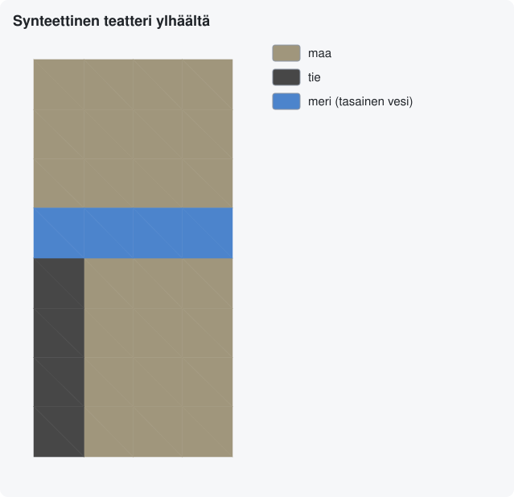
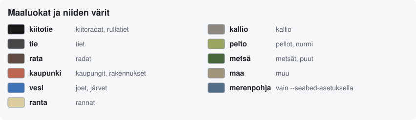

# Tasotiedostot {#the-level-files}

Taso on maan 3D-malli; teatteri on DCS Worldin sana kartalle.

`<out>/<name>.glb` ja sen vieressä `<name>.json`.

| Osa | Mitä se on |
|---|---|
| `ground:<Level>` | maaston omat kolmiot, värjättynä sen mukaan, mitä peli piirtää niiden päälle |
| `water:<Level>` | jokainen kolmio, jonka peli merkitsee merenpinnan alle, litteänä merenpinnan tasolla |
| `structure:<Level>` | teatterin rakennukset laatikoina sinne, minne peli ne sijoittaa (alla) |

Värit ovat alla olevat luokat:

Värit näkyvät katselimen tasopaneelin kohdassa **Tallennettu väri**. Jokainen maakolmio saa sen
peittokuvan luokan, jolla peli sen piirtää:

| Luokka | Väri | Pelin peittokuvasta |
|---|---|---|
| runway (kiitotie) | lähes musta | `Runway`: kiitoradat, rullatiet ja asemat |
| road (tie) | tummanharmaa | `Road` |
| rail (rata) | ruskea | `Rail` |
| town (kaupunki) | tiilenpunainen | `Town`, `Building` |
| water (vesi) | sininen | `River`, `Lake` (sisävesi, piirretään maana) |
| beach (ranta) | hiekka | `Beach` |
| rock (kallio) | harmaa | `Rock` |
| field (pelto) | vaaleanvihreä | `Field`, `Grass` |
| forest (metsä) | tummanvihreä | `Forest`, `Trees` |
| land (maa) | khaki | ei mitään näistä |
| seabed (merenpohja) | liuskeensininen | vain `--seabed`-asetuksella |

Kun useampi peittokuva piirtää saman kolmion, taulukon järjestys ratkaisee (tie metsän läpi on
tie). Jokainen peittokuvan kolmio on yksi maaston omista – tarkistettu jokaisella kokeillun
teatterin luokalla, ja jokainen osui – joten luokat ovat tarkkoja eivätkä arvattuja läheisistä pisteistä.

**Koordinaatit** ovat DCS:n omia maailmametrejä: x pohjoiseen, y ylös, z itään, ja glTF-akselit
ovat samat (X = x, Y = y, Z = z). DCS-metreissä oleva telemetria – 3DHeat Watcherin DCS-liitännäinen
kirjoittaa juuri sen – asettuu tasolle katselimen oletusasetuksilla (Y ylös, mittakaava 1) ilman
sijoittelua.

**Leveys- ja pituusaste:** jokainen teatteri on Transverse Mercator -projektio omilla vakioillaan;
`<name>.json` kantaa ne, tason kulmat leveys- ja pituusasteina sekä jokaisen kaupungin sekä
leveys- ja pituusasteen että DCS:n x/z-arvot. Kun teatterin vakioita ei ole julkaistu, ne sovitetaan
sen oman `beacons.lua`-tiedoston majakoihin molemmissa koordinaatistoissa (muutaman sentin juuren
keskineliövirhe; sama sovitus antaa muiden teatterien julkaistut vakiot takaisin millimetrin tarkkuudella).
Teatterille ilman vakioita [`fit`](fit.md) löytää ne mistä tahansa tallenteesta, jossa on molemmat,
kuten yhden lennon Watcher-istunnosta.

**Meren pohja** jätetään pois (lentosimulaattorin lämpökartta ei tarvitse merenpohjaa); `--seabed`
pitää sen maana. `--no-water` jättää tasaisen meren pois.

**Koko.** Katso [Tason rakentaminen: Koko](level.md#size).

**Lentokentät.** Jokainen `AirfieldsTaxiways/<name>.rn4` kantaa yhden lentokentän rullatieverkon, nimettynä
sen mukaan; sen pisteet ovat (x, y, z) kaksoistarkkuuden lukuina DCS-metreinä. Tason `.json` luettelee
jokaisen alueen sisällä olevan lentokentän nimineen (tiedoston oma nimi), pisteiden laatikon keskikohdan,
laatikon ja maan siinä kohdassa. Kokeillulla teatterilla jokainen lentokenttätiedosto luettiin, ja jokainen
sijoittui kentälleen (muutaman sadan metrin sisällä mitatusta lentoaseman vertailupisteestä: rullateiden
keskeltä, ei kiitoradalta).

**Rakennukset.** `Scenes/<theatre>.scn5` sijoittaa jokaisen teatterin kohteen (miljoonia – puita, lamppuja,
aitoja, johtoja, taloja). Ne, jotka nimensä ja kokonsa perusteella ovat rakennuksia (talot, asunnot, kuurit,
hallit, tehtaat, tornit, terminaalit: murto-osa malleista, satoja tuhansia sijoituksia), piirretään
laatikoina: jokaisen mallin oma rajalaatikko tiedostosta käännettynä sen suuntaan ja seisomassa siellä,
minne peli sen asettaa, alkaen enintään 3 m alle sen origon (sen jalkakohta rinteessä) aina sen
huippuun asti. Puita, pensaita, valoja, pylväitä, johtoja, aitoja, seiniä, kylttejä, ajoneuvoja, vaunuja,
veneitä, nostureita, mastoja, pylväitä ja siltoja ei oteta mukaan. Pelin mallien muotoa tai tekstuuria ei
kopioida: laatikko jokaiselle rakennukselle, värjättynä lajin mukaan (talo, lohko, teollinen, lentokenttä,
torni, muu). `<name>.json` luettelee ne myös (`buildings.rows`: x, z, pohja, korkeus, puolipituudet,
suunta, laji) katselimen hybriditaustaa varten, joka piirtää ne pelin kaupungeissa kartoitettujen rakennusten
sijaan. `--no-buildings` jättää ne pois.

`<name>.json` kirjaa myös lähdetiedoston, sen koon ja päivämäärän, luetut ruudut, kolmioiden määrän luokittain
sekä sen, montako teatterin kaupunkia osuu maahan – projektion tarkistus, jonka pitäisi näyttää "N of N".

Taso on glTF-binääri, jossa on nimettyjä osia, kuten jokainen 3DHeat-taso; katselimen
[Tasot](https://holdi601.github.io/3DHeat/levels.html)-sivu kertoo, miten ne ladataan.
