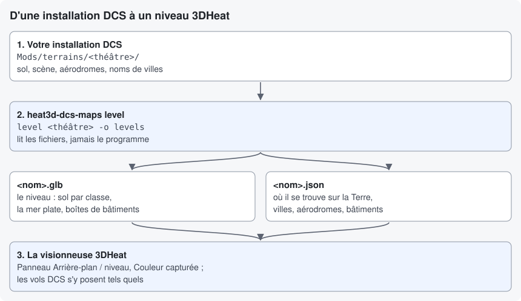

# 3DHeat DCS {#dheat-dcs}

**Qu'est-ce que c'est ?** Un théâtre (theatre) est le mot de DCS World pour une carte : une
région du monde au-dessus de laquelle on vole. Cet outil transforme le sol d'un théâtre, lu depuis
**votre propre installation**, en un niveau 3D - un modèle au-dessus duquel on peut voler - pour le
visualiseur [3DHeat](https://github.com/Holdi601/3DHeat)
([documentation](https://holdi601.github.io/3DHeat/)).

**À quoi ça sert ?** À voir vos vols DCS sur la carte propre au jeu : ses collines, sa côte, ses
aérodromes, ses routes, ses voies ferrées, ses villes et ses bâtiments.

**Exemple :** `heat3d-dcs-maps level <théâtre> -o levels` ->
`levels/<théâtre>.glb` (le niveau) + `levels/<théâtre>.json` (où il se trouve sur
la Terre, ses villes et ses aérodromes).

Ce qu'il apporte :

- **Des vols sur la carte propre au jeu.** Le fond de carte du monde de 3DHeat dessine la Terre
  d'aujourd'hui à partir de données ouvertes ; celui-ci dessine le théâtre tel que DCS le dessine.
- **Aucune étape de placement.** Le niveau est dans les mètres du monde de DCS, donc la télémétrie
  en mètres DCS (le crochet DCS du 3DHeat Watcher écrit exactement cela) s'y pose avec les réglages par défaut
  du visualiseur.
- **Latitude et longitude.** Chaque niveau porte sa projection, ses coins et ses villes dans les deux repères.



## Démarrage rapide {#quick-start}

Vous débutez avec la ligne de commande ? Lisez d'abord [Avant de commencer](before-you-start.md).
Lancez ces commandes dans le dossier que vous avez cloné ou décompressé :

```bash
python -m pip install -e .                         # installe la commande heat3d-dcs-maps
heat3d-dcs-maps list                               # les théâtres installés, et si chacun peut être lu
heat3d-dcs-maps level <théâtre> -o levels          # un théâtre entier (petit)
heat3d-dcs-maps level <théâtre> --around <lat> <lon> 12 -o levels --name <nom>   # 12 km de part et d'autre d'un point
```

Vous devez voir une ligne par théâtre avec `list`, se terminant par `readable`.
Chargez ensuite `levels/<nom>.glb` dans le panneau Arrière-plan / niveau du visualiseur
([Niveaux](https://holdi601.github.io/3DHeat/levels.html)).

Les niveaux écrits sont construits à partir des données du jeu : ils restent **sur votre
ordinateur**, pour les consulter, et non pour les partager ou les publier ([Conditions](terms.md)).

Chaque lecteur de jeu est un petit projet à part, avec son propre fichier de licence, ses propres versions et son propre suivi des tickets : il peut être installé, mis à jour, maintenu - ou retiré à la demande d'un ayant droit - séparément, sans toucher au visualiseur ni aux autres outils.

## Pages {#pages}

| Page | Ce qu'elle explique |
|---|---|
| [Avant de commencer](before-you-start.md) | Python, un terminal, un premier essai |
| [Trouver les théâtres : list](list.md) | où l'installation est trouvée, ce qu'affiche `list` |
| [Construire un niveau : level](level.md) | chaque option, les régions, la taille, pas à pas |
| [Les fichiers de niveau](output.md) | les parties `.glb`, les classes de sol et leurs couleurs, le `.json`, les coordonnées |
| [Noms de lieux : towns](towns.md) | les villes d'un théâtre avec leurs coordonnées DCS |
| [Projections : fit](fit.md) | trouver la projection d'un théâtre à partir d'un enregistrement |
| [Comment les fichiers sont lus](reading.md) | les formats, ce qui a été vérifié, ce qui n'est pas lu |
| [Conditions et licence](terms.md) | ce qui est lu, ce qui n'est pas livré, la licence |
| [Référence des commandes](../cli-reference.md) | chaque option, générée depuis le code |
| [Maintenir ces documents](maintaining.md) | la liste de contrôle des versions |

## Voir aussi {#related}

- Le visualiseur 3DHeat : [github.com/Holdi601/3DHeat](https://github.com/Holdi601/3DHeat),
  documentation sur [holdi601.github.io/3DHeat](https://holdi601.github.io/3DHeat/).
- Télémétrie pour ces niveaux : le [3DHeat Watcher](https://holdi601.github.io/3DHeat-Watcher/)
  enregistre les vols DCS ; les formats de fichiers du visualiseur, dont son
  conteneur d'un fichier par match, sont décrits dans
  [Un fichier par match (.3dheat)](https://holdi601.github.io/3DHeat/container.html).

## Les outils 3DHeat {#the-3dheat-tools}

| Outil | Ce qu'il fait | Code | Documentation |
|---|---|---|---|
| Visualiseur 3DHeat | affiche les données : cartes de chaleur, analyse de course, revue de partie | [3DHeat](https://github.com/Holdi601/3DHeat) | [documentation](https://holdi601.github.io/3DHeat/) |
| GameFiles | niveaux et circuits tirés des fichiers du jeu | [3DHeat-GameFiles](https://github.com/Holdi601/3DHeat-GameFiles) | [documentation](https://holdi601.github.io/3DHeat-GameFiles/) |
| GameCapture | télémétrie de tour, et niveaux reconstruits à partir de vidéos de jeu | [3DHeat-GameCapture](https://github.com/Holdi601/3DHeat-GameCapture) | [documentation](https://holdi601.github.io/3DHeat-GameCapture/) |
| Unreal Exporter | un plugin de l'éditeur Unreal : un niveau en un seul `.glb` | [3DHeat-UnrealExporter](https://github.com/Holdi601/3DHeat-UnrealExporter) | [documentation](https://holdi601.github.io/3DHeat-UnrealExporter/) |
| CS2 | démos et cartes de Counter-Strike 2 | [3DHeat-CS2](https://github.com/Holdi601/3DHeat-CS2) | [documentation](https://holdi601.github.io/3DHeat-CS2/) |
| Watcher | enregistre ce que les jeux publient pendant que vous jouez | [3DHeat-Watcher](https://github.com/Holdi601/3DHeat-Watcher) | [documentation](https://holdi601.github.io/3DHeat-Watcher/) |
| Ext-WarThunder | replays de War Thunder | [3DHeat-Ext-WarThunder](https://github.com/Holdi601/3DHeat-Ext-WarThunder) | [documentation](https://holdi601.github.io/3DHeat-Ext-WarThunder/) |
| Ext-WoT | replays de World of Tanks | [3DHeat-Ext-WoT](https://github.com/Holdi601/3DHeat-Ext-WoT) | [documentation](https://holdi601.github.io/3DHeat-Ext-WoT/) |
| Ext-WoWs | replays de World of Warships | [3DHeat-Ext-WoWs](https://github.com/Holdi601/3DHeat-Ext-WoWs) | [documentation](https://holdi601.github.io/3DHeat-Ext-WoWs/) |
| Ext-Squad | démos de serveurs Squad | [3DHeat-Ext-Squad](https://github.com/Holdi601/3DHeat-Ext-Squad) | [documentation](https://holdi601.github.io/3DHeat-Ext-Squad/) |
| Ext-DCS | cartes de DCS World sous forme de niveaux 3D | [3DHeat-Ext-DCS](https://github.com/Holdi601/3DHeat-Ext-DCS) | [documentation](https://holdi601.github.io/3DHeat-Ext-DCS/) |
| Ext-IL2 | cartes d'IL-2 Sturmovik sous forme de niveaux 3D | [3DHeat-Ext-IL2](https://github.com/Holdi601/3DHeat-Ext-IL2) | [documentation](https://holdi601.github.io/3DHeat-Ext-IL2/) |
| Ext-Dota | la carte de Dota 2 de votre propre installation, en niveau 3D | [3DHeat-Ext-Dota](https://github.com/Holdi601/3DHeat-Ext-Dota) | [documentation](https://holdi601.github.io/3DHeat-Ext-Dota/) |
| Ext-DotaReplay | replays de Dota 2 | [3DHeat-Ext-DotaReplay](https://github.com/Holdi601/3DHeat-Ext-DotaReplay) | [documentation](https://holdi601.github.io/3DHeat-Ext-DotaReplay/) |
| Ext-Riot | replays de League of Legends et VALORANT (ce qu'ils transportent en clair) | [3DHeat-Ext-Riot](https://github.com/Holdi601/3DHeat-Ext-Riot) | [documentation](https://holdi601.github.io/3DHeat-Ext-Riot/) |
| Ext-Forza | parcours, courses et voitures de Forza de votre propre installation | [3DHeat-Ext-Forza](https://github.com/Holdi601/3DHeat-Ext-Forza) | [documentation](https://holdi601.github.io/3DHeat-Ext-Forza/) |
| Ext-Battlefield | niveaux Battlefield (Frostbite) en niveaux 3D | [3DHeat-Ext-Battlefield](https://github.com/Holdi601/3DHeat-Ext-Battlefield) | [documentation](https://holdi601.github.io/3DHeat-Ext-Battlefield/) |
| Ext-BeamNG | parcours de BeamNG.drive | [3DHeat-Ext-BeamNG](https://github.com/Holdi601/3DHeat-Ext-BeamNG) | [documentation](https://holdi601.github.io/3DHeat-Ext-BeamNG/) |
| Ext-ACRally | étapes d'Assetto Corsa Rally en parcours | [3DHeat-Ext-ACRally](https://github.com/Holdi601/3DHeat-Ext-ACRally) | [documentation](https://holdi601.github.io/3DHeat-Ext-ACRally/) |
| Ext-Reforger | mondes d'Arma Reforger (Enfusion) en niveaux 3D | [3DHeat-Ext-Reforger](https://github.com/Holdi601/3DHeat-Ext-Reforger) | [documentation](https://holdi601.github.io/3DHeat-Ext-Reforger/) |
| Ext-R6 | replays de matchs Rainbow Six Siege | [3DHeat-Ext-R6](https://github.com/Holdi601/3DHeat-Ext-R6) | [documentation](https://holdi601.github.io/3DHeat-Ext-R6/) |
