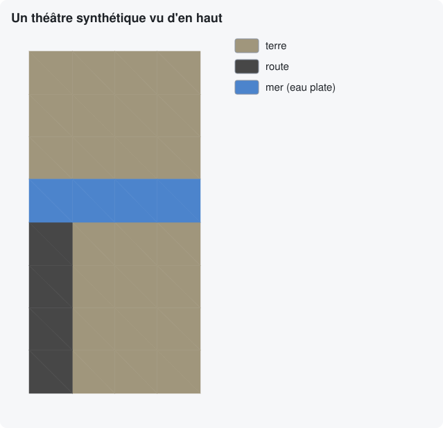
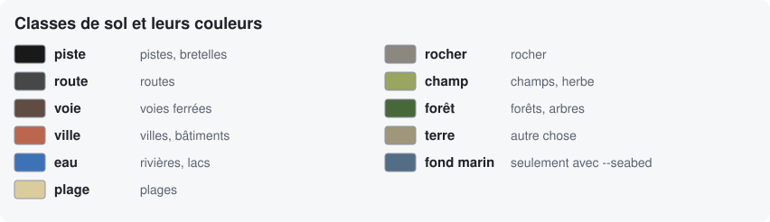

# Les fichiers de niveau {#the-level-files}

Un niveau est un modèle 3D du sol ; un théâtre est le mot de DCS World pour une carte.

`<dossier>/<nom>.glb` et `<nom>.json` à côté.

| Partie | Ce que c'est |
|---|---|
| `ground:<Niveau>` | les triangles propres au terrain, colorés selon ce que le jeu dessine par-dessus chacun |
| `water:<Niveau>` | chaque triangle que le jeu marque comme sous la mer, posé à plat au niveau de la mer |
| `structure:<Niveau>` | les bâtiments du théâtre sous forme de boîtes, là où le jeu les place (plus bas) |

Les couleurs correspondent aux classes ci-dessous :

Les couleurs s'affichent avec **Couleur capturée** dans le panneau Arrière-plan / niveau du visualiseur. Chaque
triangle de sol prend la classe de la superposition que le jeu lui dessine :

| Classe | Couleur | D'après la superposition du jeu |
|---|---|---|
| runway | noir profond | `Runway` - pistes, voies de circulation et aires de stationnement |
| road | gris foncé | `Road` |
| rail | brun | `Rail` |
| town | rouge brique | `Town`, `Building` |
| water | bleu | `River`, `Lake` (eau intérieure, dessinée comme du sol) |
| beach | sable | `Beach` |
| rock | gris | `Rock` |
| field | vert clair | `Field`, `Grass` |
| forest | vert foncé | `Forest`, `Trees` |
| land | kaki | aucune de celles-ci |
| seabed | bleu ardoise | seulement avec `--seabed` |

Quand plusieurs superpositions dessinent le même triangle, l'ordre du tableau décide
(une route à travers une forêt est une route). Chaque triangle de superposition est l'un des triangles propres
au sol - vérifié sur chaque classe des théâtres essayés, chacun correspondait - donc les
classes sont exactes, et non devinées à partir de points voisins.

**Les coordonnées** sont les mètres-monde propres à DCS : x vers le nord, y vers le haut, z vers l'est, et les
axes glTF sont les mêmes (X = x, Y = y, Z = z). La télémétrie en mètres DCS - le crochet DCS du
3DHeat Watcher écrit exactement cela - se pose sur le niveau avec les réglages par défaut du
visualiseur (Y vers le haut, échelle 1) et sans étape de placement.

**Latitude et longitude :** chaque théâtre est une projection de Transverse Mercator avec ses propres
constantes ; `<nom>.json` les contient, ainsi que les coins du niveau en latitude et longitude, et chaque
ville avec à la fois sa latitude/longitude et ses x/z DCS. Quand les constantes d'un théâtre ne sont pas publiées, elles sont
ajustées aux balises que donne son propre `beacons.lua` dans les deux repères (une erreur quadratique moyenne
de quelques cm ; le même ajustement retrouve les constantes publiées d'autres théâtres au millimètre près).
Pour un théâtre sans constantes, [`fit`](fit.md) les trouve à partir de tout enregistrement qui contient les deux,
comme une session Watcher d'un vol.

**Le fond de la mer** est omis (une carte de chaleur de simulateur de vol n'a pas besoin du fond de la mer) ;
`--seabed` le garde comme sol. `--no-water` omet la mer plate.

**Taille.** Voir [Construire un niveau : Taille](level.md#size).

**Aérodromes.** Chaque `AirfieldsTaxiways/<nom>.rn4` contient le réseau de circulation d'un aérodrome, nommé d'après lui ;
ses points sont des doubles (x, y, z) en mètres DCS. Le `.json` du niveau liste chaque aérodrome
situé dans la région avec son nom (celui du fichier), le milieu de la boîte de ses points, la boîte, et le
sol à cet endroit. Sur le théâtre essayé, chaque fichier d'aérodrome a été lu, et chacun est placé sur son
terrain (à quelques centaines de mètres près du point de référence de l'aéroport : le milieu des voies de circulation,
et non celui de la piste).

**Bâtiments.** `Scenes/<théâtre>.scn5` place chaque objet du théâtre
(des millions - arbres, lampadaires, clôtures, fils, maisons). Ceux qui sont des bâtiments
par leur nom et leur taille (maisons, immeubles, abris, hangars,
usines, tours, aérogares : une fraction des modèles, des centaines de milliers de placements) sont dessinés en boîtes : la boîte
englobante propre à chaque modèle, tirée du fichier, tournée selon son cap et posée là où le jeu la place, allant
jusqu'à 3 m sous son origine (son ancrage sur une pente) jusqu'à son sommet. Arbres, arbustes,
lumières, poteaux, fils, clôtures, murs, panneaux, véhicules, wagons, bateaux, grues,
mâts, pylônes et ponts sont omis. Aucune forme de modèle ni aucune texture du jeu n'est copiée : une boîte par
bâtiment, colorée selon sa nature (maison, immeuble, industriel, aérodrome, tour, autre). `<nom>.json` les liste aussi
(`buildings.rows` : x, z, base, hauteur, demi-longueurs, cap, nature) pour le fond hybride du visualiseur, qui les dessine dans les villes du jeu à la place des
bâtiments cartographiés. `--no-buildings` les omet.

`<nom>.json` enregistre aussi le fichier source, sa taille et sa date, les tuiles
lues, le nombre de triangles par classe, et combien des villes du théâtre tombent sur le sol - un
contrôle de la projection qui doit afficher « N sur N ».

Le niveau est un binaire glTF avec des parties nommées, comme tout niveau 3DHeat ; la page
[Niveaux](https://holdi601.github.io/3DHeat/levels.html) du visualiseur explique comment il les charge.
