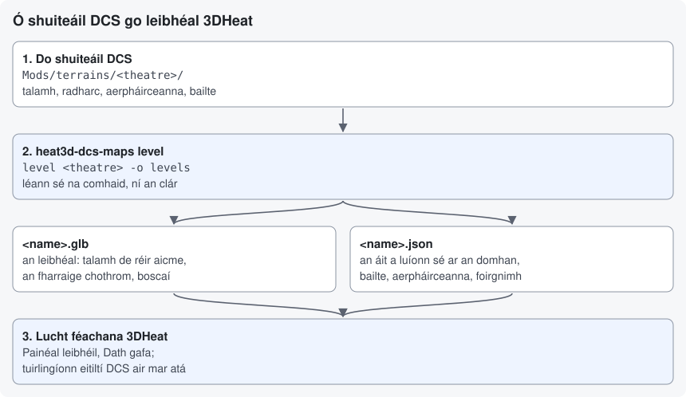

# 3DHeat DCS {#dheat-dcs}

**Cad é?** Is é téatar focal DCS World ar léarscáil: réigiún den
domhan a eitlíonn tú os a chionn. Casann an uirlis seo talamh téatair amháin, léite ó
**do shuiteáil féin**, ina leibhéal 3D - samhail a fhéadann tú eitilt os a chionn - don lucht féachana
[3DHeat](https://github.com/Holdi601/3DHeat)
([doiciméadúchán](https://holdi601.github.io/3DHeat/)).

**Cén fáth a n-úsáidfinn é?** Chun d'eitiltí DCS a fheiceáil thar léarscáil an chluiche féin: a
cnoic, cósta, aerpháirceanna, bóithre, iarnróid, bailte agus foirgnimh.

**Sampla:** `heat3d-dcs-maps level <theatre> -o levels` ->
`levels/<theatre>.glb` (an leibhéal) + `levels/<theatre>.json` (an áit a luíonn sé ar
an domhan, a bhailte agus a aerpháirceanna).

Cad chuige a bhfuil sé úsáideach:

- **Eitiltí ar léarscáil an chluiche féin.** Tarraingíonn cúlra domhain 3DHeat inniu
  an domhan ó shonraí oscailte; tarraingíonn an uirlis seo an téatar mar a tharraingíonn DCS é.
- **Gan céim chuir i bhfeidhm.** Tá an leibhéal i méadair dhomhain DCS féin, mar sin tuirlingíonn telemetry
  i méadair DCS (scríobhann crúca DCS de chuid 3DHeat Watcher go beacht é sin) air
  le réamhshocruithe an lucht féachana.
- **Domhanleithead agus domhanfhad.** Iompraíonn gach leibhéal a theilgean, a rinn
  agus a bhailte sa dá fhráma.



## Tús tapa {#quick-start}

An bhfuil tú nua leis an líne ordaithe? Léigh [Sula dtosaíonn tú](before-you-start.md) ar dtús.
Rith iad seo san fhillteán a chlónáil nó a dhízipeáil tú:

```bash
python -m pip install -e .                         # installs the heat3d-dcs-maps command
heat3d-dcs-maps list                               # the theatres installed, and whether each can be read
heat3d-dcs-maps level <theatre> -o levels          # a whole (small) theatre
heat3d-dcs-maps level <theatre> --around <lat> <lon> 12 -o levels --name <name>   # 12 km either side of a point
```

Ba chóir duit líne amháin a fheiceáil in aghaidh an téatair ó `list`, ag críochnú `readable`.
Ansin lódáil `levels/<name>.glb` i bpainéal Cúlra / leibhéal an lucht féachana
([Leibhéil](https://holdi601.github.io/3DHeat/levels.html)).

Tógtar na leibhéil a scríobhann sé ó shonraí an chluiche: fanann siad **ar do
mheaisín**, le féachaint orthu, ní le roinnt ná le foilsiú ([Téarmaí](terms.md)).

## Leathanaigh {#pages}

| Leathanach | Cad a chlúdaíonn sé |
|---|---|
| [Sula dtosaíonn tú](before-you-start.md) | Python, teirminéal, céad rith |
| [Téatair a aimsiú: list](list.md) | an áit a n-aimsítear an tsuiteáil, cad a phriontálann `list` |
| [Leibhéal a thógáil: level](level.md) | gach rogha, réigiúin, méid, céim ar chéim |
| [Comhaid an leibhéil](output.md) | codanna an `.glb`, na haicmí talún agus a ndathanna, an `.json`, na comhordanáidí |
| [Logainmneacha: towns](towns.md) | bailte téatair le comhordanáidí DCS |
| [Teilgeanna: fit](fit.md) | teilgean téatair a aimsiú ó thaifeadadh |
| [Conas a léitear na comhaid](reading.md) | na formáidí, cad a fíoraíodh, cad nach léitear |
| [Téarmaí agus ceadúnas](terms.md) | ceadúnas Eagle Dynamics, agus cén fáth gur pacáiste ar leith é seo |
| [Tagairt orduithe](../cli-reference.md) | gach rogha, ginte ón gcód |
| [Na doiciméid seo a chothabháil](maintaining.md) | an seicliosta eisiúna |

## Gaolmhar {#related}

- An lucht féachana 3DHeat: [github.com/Holdi601/3DHeat](https://github.com/Holdi601/3DHeat),
  doiciméadúchán ag [holdi601.github.io/3DHeat](https://holdi601.github.io/3DHeat/).
- Telemetry do na leibhéil seo: taifeadann [3DHeat Watcher](https://holdi601.github.io/3DHeat-Watcher/)
  eitiltí DCS; tá formáidí comhad an lucht féachana, lena n-áirítear a
  choimeádán comhad-amháin-in-aghaidh-an-chluiche, curtha síos in
  [Comhad amháin in aghaidh an chluiche (.3dheat)](https://holdi601.github.io/3DHeat/container.html).

## Uirlisí 3DHeat {#the-3dheat-tools}

| Uirlis | Cad a dhéanann sí | Cód | Doiciméid |
|---|---|---|---|
| Lucht féachana 3DHeat | taispeánann sé na sonraí: léarscáileanna teasa, anailís rása, athbhreithniú cluiche | [3DHeat](https://github.com/Holdi601/3DHeat) | [docs](https://holdi601.github.io/3DHeat/) |
| GameFiles | leibhéil agus cúrsaí ó chomhaid féin cluiche | [3DHeat-GameFiles](https://github.com/Holdi601/3DHeat-GameFiles) | [docs](https://holdi601.github.io/3DHeat-GameFiles/) |
| GameCapture | telemetry cuarta, agus leibhéil atógtha ó fhíseán cluiche | [3DHeat-GameCapture](https://github.com/Holdi601/3DHeat-GameCapture) | [docs](https://holdi601.github.io/3DHeat-GameCapture/) |
| Unreal Exporter | breiseán d'Unreal Editor: leibhéal mar `.glb` amháin | [3DHeat-UnrealExporter](https://github.com/Holdi601/3DHeat-UnrealExporter) | [docs](https://holdi601.github.io/3DHeat-UnrealExporter/) |
| CS2 | demos agus léarscáileanna Counter-Strike 2 | [3DHeat-CS2](https://github.com/Holdi601/3DHeat-CS2) | [docs](https://holdi601.github.io/3DHeat-CS2/) |
| Watcher | taifeadann sé an méid a fhoilsíonn cluichí agus tú ag imirt | [3DHeat-Watcher](https://github.com/Holdi601/3DHeat-Watcher) | [docs](https://holdi601.github.io/3DHeat-Watcher/) |
| Ext-WarThunder | athsheinmeanna War Thunder | [3DHeat-Ext-WarThunder](https://github.com/Holdi601/3DHeat-Ext-WarThunder) | [docs](https://holdi601.github.io/3DHeat-Ext-WarThunder/) |
| Ext-WoT | athsheinmeanna World of Tanks | [3DHeat-Ext-WoT](https://github.com/Holdi601/3DHeat-Ext-WoT) | [docs](https://holdi601.github.io/3DHeat-Ext-WoT/) |
| Ext-WoWs | athsheinmeanna World of Warships | [3DHeat-Ext-WoWs](https://github.com/Holdi601/3DHeat-Ext-WoWs) | [docs](https://holdi601.github.io/3DHeat-Ext-WoWs/) |
| Ext-Squad | demos freastalaí Squad | [3DHeat-Ext-Squad](https://github.com/Holdi601/3DHeat-Ext-Squad) | [docs](https://holdi601.github.io/3DHeat-Ext-Squad/) |
| Ext-DCS | léarscáileanna DCS World mar leibhéil 3D | [3DHeat-Ext-DCS](https://github.com/Holdi601/3DHeat-Ext-DCS) | [docs](https://holdi601.github.io/3DHeat-Ext-DCS/) |
| Ext-IL2 | léarscáileanna IL-2 Sturmovik mar leibhéil 3D | [3DHeat-Ext-IL2](https://github.com/Holdi601/3DHeat-Ext-IL2) | [docs](https://holdi601.github.io/3DHeat-Ext-IL2/) |
