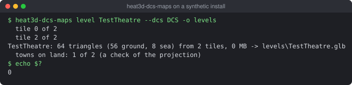

# Leibhéal a thógáil: `level` {#building-a-level-level}

```text
heat3d-dcs-maps level <theatre> -o <folder> [--dcs FOLDER] [--name NAME]
                      [--around LAT LON KM | --bounds X0 Z0 X1 Z1] [--cell M]
                      [--seabed] [--no-water] [--no-buildings] [--force]
                      [--projection LON0 FE FN]
```

## Céim ar chéim {#step-by-step}

An bhfuil tú nua leis an líne ordaithe? Léigh [Sula dtosaíonn tú](before-you-start.md) ar dtús.

1. Aimsigh ainm fhillteán an téatair le [`list`](list.md).
2. Do théatar beag, tóg ar fad é: `heat3d-dcs-maps level <theatre> -o levels`.
3. Do cheann mór, roghnaigh réigiún: `--around <lat> <lon> <km>` (cearnóg
   a bhfuil an oiread sin km ar gach taobh de phointe) nó `--bounds X0 Z0 X1 Z1` i méadair
   DCS. Ainmnigh é le `--name`.
4. Priontálann an t-ordú na tíleanna de réir mar a léann sé iad, líon na dtriantán, an
   comhad a scríobhadh, agus cé mhéad de bhailte an téatair a thagann ar an talamh - seic
   ar an teilgean ba chóir a léamh "N de N".
5. Lódáil `<folder>/<name>.glb` i bpainéal Cúlra / leibhéal an lucht féachana agus cuir
   **Dath gafa** air chun na haicmí talún a fheiceáil.



Réigiún den téatar sintéiseach céanna, de réir méadar DCS:


## Roghanna {#options}

| Rogha | Réamhshocrú | Cad a dhéanann sí |
|---|---|---|
| `theatre` | - | ainm an fhillteáin faoi `Mods\terrains`, mar a phriontálann `list` é (aon chás) |
| `-o`, `--out` | riachtanach | an fillteán inar scríobhfar `<name>.glb` agus `<name>.json` |
| `--dcs FOLDER` | aimsithe | fillteán DCS World ([an áit a n-aimsítear é](list.md#where-the-install-is-found)) |
| `--name NAME` | ainm an téatair | ainm an leibhéil, agus a chomhad |
| `--around LAT LON KM` | - | cearnóg amháin an oiread sin km ar gach taobh de phointe |
| `--bounds X0 Z0 X1 Z1` | - | an bosca seo amháin, i méadair DCS (x ó thuaidh, z soir) |
| `--cell M` | `0` | tanaigh an mogall: éiríonn gach rinn laistigh de *M* méadar ina cheann amháin (0: triantáin an chluiche féin) |
| `--seabed` | as | coinnigh urlár na farraige mar thalamh (de réir réamhshocraithe fágtar ar lár é) |
| `--no-water` | as | fág an fharraige chothrom ar lár |
| `--no-buildings` | as | fág foirgnimh radharc an téatair ar lár |
| `--force` | as | easpórtáil léarscáil an-mhór ar fad ar mhionsonraí iomlána |
| `--projection LON0 FE FN` | ceann an téatair | seasmhachtaí Transverse Mercator do théatar nach bhfuil aithne ag an uirlis seo air ([fit](fit.md)) |

Gach rogha, mar a phriontálann an clár í: [Tagairt orduithe](../cli-reference.md).

## Méid {#size}

Tá mogall an chluiche oiriúnaitheach - farraige oscailte i dtriantáin ciliméadar ar leithead, cóstaí
agus bóithre i gcúpla méadar. Is cúpla milliún triantán téatar beag; is deich milliúin
rinn iad na cinn mhóra. Os cionn 30 milliún rinn le léamh, stopann `level`
(stádas scoir 1) agus iarrann sé réigiún, mogall níos tanaí (`--cell 50`) nó
`--force`.

Stádas scoir: 0 déanta; 1 theip nó rómhór; 2 níor aimsíodh an tsuiteáil ná an téatar
(liostaítear na téatair a aimsíodh).

## Samplaí {#examples}

```bash
heat3d-dcs-maps level <theatre> -o levels                                       # whole, full detail
heat3d-dcs-maps level <theatre> --around <lat> <lon> 12 -o levels --name Part   # a 24 km square
heat3d-dcs-maps level <theatre> --bounds 1000 2000 1390 2390 -o levels          # a box in DCS metres
heat3d-dcs-maps level <theatre> --cell 50 -o levels                             # whole, thinned to 50 m
heat3d-dcs-maps level <theatre> --no-buildings --no-water -o levels             # the ground alone
```

Cad atá sna comhaid: [Comhaid an leibhéil](output.md).
