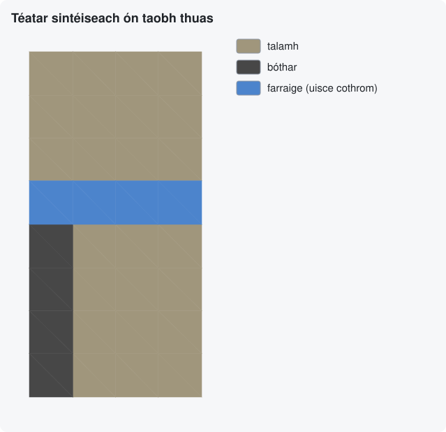
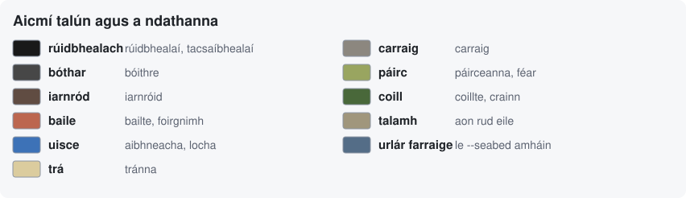

# Comhaid an leibhéil {#the-level-files}

Is samhail 3D den talamh é leibhéal; is é téatar focal DCS World ar léarscáil.

`<out>/<name>.glb` agus `<name>.json` lena thaobh.

| Cuid | Cad é |
|---|---|
| `ground:<Level>` | triantáin an tír-raoin féin, daite de réir an méid a tharraingíonn an cluiche os cionn gach ceann |
| `water:<Level>` | gach triantán a mharcálann an cluiche mar atá faoin bhfarraige, leagtha cothrom ag leibhéal na farraige |
| `structure:<Level>` | foirgnimh an téatair mar bhoscaí, san áit a gcuireann an cluiche iad (thíos) |

Is iad na dathanna na haicmí thíos:

Taispeántar na dathanna le **Dath gafa** i bpainéal leibhéil an lucht féachana. Glacann gach
triantán talún aicme an forleagain lena dtarraingíonn an cluiche é:

| Aicme | Dath | Ó fhorleagan an chluiche |
|---|---|---|
| runway | beagnach dubh | `Runway` - rúidbhealaí, bealaí tacsaíochta agus aprúin |
| road | liath dhorcha | `Road` |
| rail | donn | `Rail` |
| town | dearg bríce | `Town`, `Building` |
| water | gorm | `River`, `Lake` (uisce intíre, tarraingthe mar thalamh) |
| beach | gaineamh | `Beach` |
| rock | liath | `Rock` |
| field | glas éadrom | `Field`, `Grass` |
| forest | glas dorcha | `Forest`, `Trees` |
| land | khaki | aon cheann de seo |
| seabed | gormghlas scláta | le `--seabed` amháin |

Nuair a tharraingíonn roinnt forleagan an triantán céanna, socraíonn ord an tábla é
(is bóthar bóthar trí choill). Is triantán de chuid na talún féin gach triantán forleagain - seiceáilte ar gach aicme de na téatair a triaileadh, mheaitseáil gach ceann - mar sin
tá na haicmí beacht, gan buille faoi thuairim ó phointí in aice láimhe.

**Comhordanáidí** is méadair domhain DCS féin iad: x ó thuaidh, y suas, z soir, agus tá
na haiseanna glTF mar an gcéanna (X = x, Y = y, Z = z). Tuirlingíonn telemetry i méadair DCS - scríobhann
crúca DCS de chuid 3DHeat Watcher é sin go beacht - ar an leibhéal le
réamhshocruithe an lucht féachana (Y suas, scála 1) agus gan aon chéim chuir i bhfeidhm.

**Domhanleithead agus domhanfhad:** is teilgean Transverse Mercator é gach téatar
lena sheasmhachtaí féin; iompraíonn `<name>.json` iad, rinn an leibhéil i
ndomhanleithead agus domhanfhad, agus gach baile lena dhomhanleithead/domhanfhad agus
a x/z DCS. Nuair nach bhfoilsítear seasmhachtaí téatair, feistítear iad
leis na beacons a thugann a `beacons.lua` féin sa dá fhráma (cúpla cm fréamh-mheánchearnach;
tugann an feistiú céanna seasmhachtaí foilsithe téatar eile ar ais go dtí
an milliméadar).
Do théatar gan seasmhachtaí, aimsíonn [`fit`](fit.md) iad ó aon
taifeadadh ina bhfuil an dá cheann, mar shuíomh Watcher d'eitilt amháin.

**Fágtar urlár na farraige** ar lár (níl urlár na farraige ag teastáil ó léarscáil teasa
d'insamhlóir eitilte); coinníonn `--seabed` mar thalamh é. Fágann `--no-water` an
fharraige chothrom ar lár.

**Méid.** Féach [Leibhéal a thógáil: Méid](level.md#size).

**Aerpháirceanna.** Coinníonn gach `AirfieldsTaxiways/<name>.rn4` líonra tacsaíochta aerpháirce
amháin, ainmnithe ina diaidh; is doubles (x, y, z) i méadair DCS a pointí. Liostaíonn
`.json` an leibhéil gach aerpháirc laistigh den réigiún lena hainm (ainm an
chomhaid), lár bhosca a pointí, an bosca, agus an talamh ansin. Ar an téatar a triaileadh, léadh gach comhad aerpháirce, gach ceann curtha ar a pháirc
(laistigh de chúpla céad méadar den phointe tagartha suirbhéithe aerfoirt: lár
na mbealaí tacsaíochta, ní an rúidbhealach).

**Foirgnimh.** Cuireann `Scenes/<theatre>.scn5` gach réad den téatar
(milliúin díobh - crainn, lampaí, fálta, sreanga, tithe). Tarraingítear na cinn
atá ina bhfoirgnimh de réir ainm agus méide (tithe, árasáin, scioból, haingeir,
monarchana, túir, críochfoirt: cuid bheag de na samhlacha, na céadta
mílte cuir) mar bhoscaí: bosca teorann gach samhla ón
gcomhad, casta go dtí a threo agus ina sheasamh san áit a gcuireann an cluiche é, ó suas le
3 m faoina bhunús (a chos ar fhána) go dtí a bharr. Fágtar crainn, toir,
soilse, cuaillí, sreanga, fálta, ballaí, comharthaí, feithiclí, vaigíní, báid, craenacha,
crainn árdáin, pioláin agus droichid ar lár. Ní chóipeáiltear aon chruth samhla ná uigeacht de chuid an
chluiche: bosca amháin in aghaidh an fhoirgnimh, daite de réir cineáil (teach, bloc,
tionsclaíoch, aerpháirc, túr, eile). Liostaíonn `<name>.json` iad freisin
(`buildings.rows`: x, z, base, height, leath-fhaid, heading, kind) do chúlra
hibrideach an lucht féachana, a tharraingíonn iad i mbailte an chluiche in ionad
na bhfoirgneamh mapáilte. Fágann `--no-buildings` ar lár iad.

Taifeadann `<name>.json` freisin an comhad foinse, a mhéid agus a dháta, na tíleanna
a léadh, líon na dtriantán in aghaidh na haicme, agus cé mhéad de bhailte an téatair a thagann
ar an talamh - seic ar an teilgean ba chóir a léamh "N de N".

Is glTF dénártha le codanna ainmnithe é an leibhéal, mar atá gach leibhéal 3DHeat; insíonn leathanach
[Leibhéil](https://holdi601.github.io/3DHeat/levels.html) an lucht féachana conas a lódálann sé iad.
