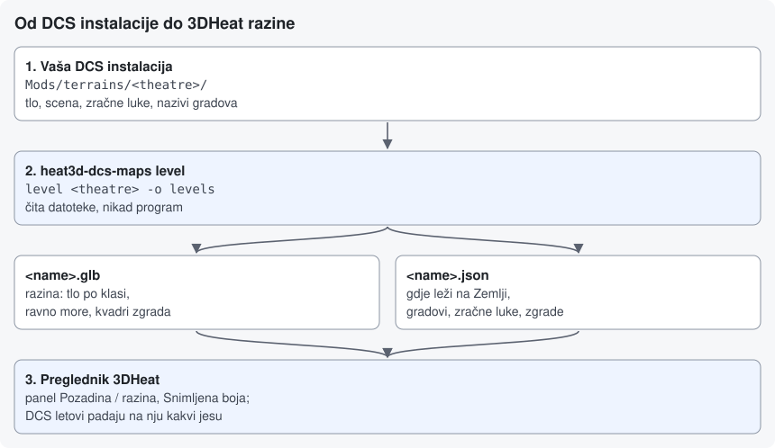

# 3DHeat DCS {#dheat-dcs}

**Što je to?** Karta (theatre) je u DCS Worldu riječ za mapu: regija svijeta preko koje letite. Ovaj alat pretvara tlo jedne karte, čitano iz **vaše vlastite instalacije**, u 3D razinu - model preko kojeg možete letjeti - za
[3DHeat](https://github.com/Holdi601/3DHeat) preglednik
([dokumentacija](https://holdi601.github.io/3DHeat/)).

**Zašto bih ga koristio?** Da vidite svoje DCS letove preko same igrine karte: njezina brda, obalu, zračne luke, ceste, pruge, gradove i zgrade.

**Primjer:** `heat3d-dcs-maps level <theatre> -o levels` ->
`levels/<theatre>.glb` (razina) + `levels/<theatre>.json` (gdje leži na
Zemlji, njezini gradovi i zračne luke).

Za što je korisno:

- **Letovi na igrinoj vlastitoj karti.** Pozadina svijeta u 3DHeatu danas crta Zemlju iz otvorenih podataka; ovo crta kartu onako kako je crta DCS.
- **Nema koraka postavljanja.** Razina je u DCS-ovim vlastitim svjetskim metrima, pa telemetrija u DCS metrima (DCS kuka programa 3DHeat Watcher zapisuje upravo to) na nju padne sa zadanim postavkama preglednika.
- **Geografska širina i dužina.** Svaka razina nosi svoju projekciju, svoje kutove i svoje gradove u oba koordinatna sustava.



## Brzi početak {#quick-start}

Ne znate ništa o naredbenom retku? Prvo pročitajte [Prije nego što počnete](before-you-start.md).
Pokrenite ove naredbe u mapi u koju ste klonirali ili raspakirali alat:

```bash
python -m pip install -e .                         # instalira naredbu heat3d-dcs-maps
heat3d-dcs-maps list                               # instalirane karte i može li se svaka čitati
heat3d-dcs-maps level <theatre> -o levels          # cijela (mala) karta
heat3d-dcs-maps level <theatre> --around <lat> <lon> 12 -o levels --name <name>   # 12 km na obje strane točke
```

Trebali biste vidjeti jedan redak po karti iz `list`, koji završava s `readable`.
Zatim učitajte `levels/<name>.glb` u panel Pozadina / razina preglednika
([Razine](https://holdi601.github.io/3DHeat/levels.html)).

Razine koje alat piše izrađene su iz podataka igre, pa **ostaju na vašem računalu**, za gledanje, a ne za dijeljenje ili objavljivanje ([Uvjeti](terms.md)).

## Stranice {#pages}

| Stranica | Što obuhvaća |
|---|---|
| [Prije nego što počnete](before-you-start.md) | Python, terminal, prvo pokretanje |
| [Pronalaženje karata: list](list.md) | gdje se nalazi instalacija, što ispisuje `list` |
| [Izrada razine: level](level.md) | svaka opcija, regije, veličina, korak po korak |
| [Datoteke razine](output.md) | `.glb` dijelovi, klase tla i njihove boje, `.json`, koordinate |
| [Nazivi mjesta: towns](towns.md) | gradovi karte s DCS koordinatama |
| [Projekcije: fit](fit.md) | pronalaženje projekcije karte iz snimke |
| [Kako se datoteke čitaju](reading.md) | formati, što je provjereno, što se ne čita |
| [Uvjeti i licenca](terms.md) | licenca tvrtke Eagle Dynamics i zašto je ovo zaseban paket |
| [Referenca naredbi](../cli-reference.md) | svaka opcija, generirano iz koda |
| [Održavanje ovih stranica](maintaining.md) | popis za izdavanje verzije |

## Povezano {#related}

- Preglednik 3DHeat: [github.com/Holdi601/3DHeat](https://github.com/Holdi601/3DHeat),
  dokumentacija na [holdi601.github.io/3DHeat](https://holdi601.github.io/3DHeat/).
- Telemetrija za ove razine: [3DHeat Watcher](https://holdi601.github.io/3DHeat-Watcher/)
  bilježi DCS letove; formati datoteka preglednika, uključujući spremnik jedne datoteke po meču, opisani su u
  [Jedna datoteka po meču (.3dheat)](https://holdi601.github.io/3DHeat/container.html).

## Alati 3DHeat {#the-3dheat-tools}

| Alat | Što radi | Kod | Dokumentacija |
|---|---|---|---|
| Preglednik 3DHeat | prikazuje podatke: toplinske karte, analizu utrka, pregled meča | [3DHeat](https://github.com/Holdi601/3DHeat) | [dokumentacija](https://holdi601.github.io/3DHeat/) |
| GameFiles | razine i staze iz vlastitih datoteka igre | [3DHeat-GameFiles](https://github.com/Holdi601/3DHeat-GameFiles) | [dokumentacija](https://holdi601.github.io/3DHeat-GameFiles/) |
| GameCapture | telemetrija krugova i razine rekonstruirane iz snimke igranja | [3DHeat-GameCapture](https://github.com/Holdi601/3DHeat-GameCapture) | [dokumentacija](https://holdi601.github.io/3DHeat-GameCapture/) |
| Unreal Exporter | dodatak za Unreal Editor: razina kao jedna `.glb` datoteka | [3DHeat-UnrealExporter](https://github.com/Holdi601/3DHeat-UnrealExporter) | [dokumentacija](https://holdi601.github.io/3DHeat-UnrealExporter/) |
| CS2 | demoi i mape Counter-Strike 2 | [3DHeat-CS2](https://github.com/Holdi601/3DHeat-CS2) | [dokumentacija](https://holdi601.github.io/3DHeat-CS2/) |
| Watcher | bilježi ono što igre objavljuju dok igrate | [3DHeat-Watcher](https://github.com/Holdi601/3DHeat-Watcher) | [dokumentacija](https://holdi601.github.io/3DHeat-Watcher/) |
| Ext-WarThunder | War Thunder replay-i | [3DHeat-Ext-WarThunder](https://github.com/Holdi601/3DHeat-Ext-WarThunder) | [dokumentacija](https://holdi601.github.io/3DHeat-Ext-WarThunder/) |
| Ext-WoT | World of Tanks replay-i | [3DHeat-Ext-WoT](https://github.com/Holdi601/3DHeat-Ext-WoT) | [dokumentacija](https://holdi601.github.io/3DHeat-Ext-WoT/) |
| Ext-WoWs | World of Warships replay-i | [3DHeat-Ext-WoWs](https://github.com/Holdi601/3DHeat-Ext-WoWs) | [dokumentacija](https://holdi601.github.io/3DHeat-Ext-WoWs/) |
| Ext-Squad | demoi Squad servera | [3DHeat-Ext-Squad](https://github.com/Holdi601/3DHeat-Ext-Squad) | [dokumentacija](https://holdi601.github.io/3DHeat-Ext-Squad/) |
| Ext-DCS | DCS World karte kao 3D razine | [3DHeat-Ext-DCS](https://github.com/Holdi601/3DHeat-Ext-DCS) | [dokumentacija](https://holdi601.github.io/3DHeat-Ext-DCS/) |
| Ext-IL2 | karte IL-2 Sturmovik kao 3D razine | [3DHeat-Ext-IL2](https://github.com/Holdi601/3DHeat-Ext-IL2) | [dokumentacija](https://holdi601.github.io/3DHeat-Ext-IL2/) |
