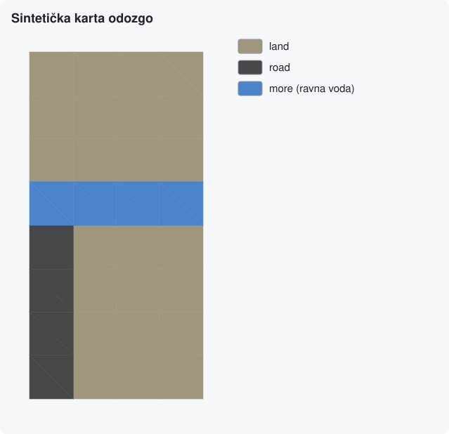
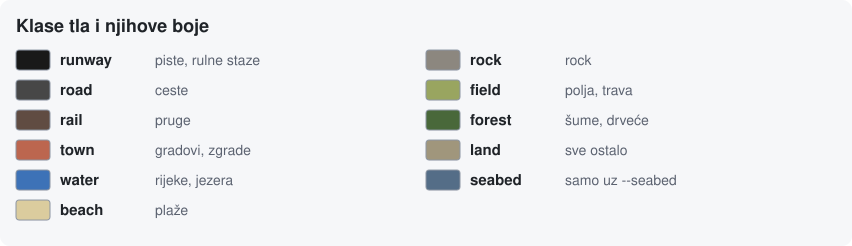

# Datoteke razine {#the-level-files}

Razina je 3D model tla; karta je u DCS Worldu riječ za mapu.

`<out>/<name>.glb` i `<name>.json` uz nju.

| Dio | Što je |
|---|---|
| `ground:<Level>` | vlastiti trokuti terena, obojeni prema onome što igra crta preko svakog od njih |
| `water:<Level>` | svaki trokut koji igra označava kao pod morem, položen ravno na razinu mora |
| `structure:<Level>` | zgrade karte kao kvadri, tamo gdje ih igra postavlja (dolje) |

Boje su klase u nastavku:

Boje se vide s **Snimljena boja** u panelu Pozadina / razina preglednika. Svaki trokut tla
uzima klasu sloja koji igra crta preko njega:

| Klasa | Boja | Iz sloja igre |
|---|---|---|
| runway | gotovo crna | `Runway` - piste, rulne staze i perona |
| road | tamnosiva | `Road` |
| rail | smeđa | `Rail` |
| town | cigla crvena | `Town`, `Building` |
| water | plava | `River`, `Lake` (kopnena voda, crtana kao tlo) |
| beach | pješčana | `Beach` |
| rock | siva | `Rock` |
| field | svijetlozelena | `Field`, `Grass` |
| forest | tamnozelena | `Forest`, `Trees` |
| land | kaki | nijedan od ovih |
| seabed | plavosiva | samo uz `--seabed` |

Gdje više slojeva crta isti trokut, odlučuje redoslijed u tablici (cesta kroz šumu je cesta). Svaki trokut sloja je jedan od vlastitih trokuta tla - provjereno na svakoj klasi isprobanih karata, svaki se podudario - pa su klase točne, a ne pogođene iz obližnjih točaka.

**Koordinate** su vlastiti svjetski metri DCS-a: x sjever, y gore, z istok, a glTF osi su iste (X = x, Y = y, Z = z). Telemetrija u DCS metrima - DCS kuka programa 3DHeat Watcher zapisuje upravo to - pada na razinu sa zadanim postavkama preglednika (Y gore, mjerilo 1) i bez koraka postavljanja.

**Geografska širina i dužina:** svaka karta je Transverzalna Mercatorova projekcija sa svojim konstantama; `<name>.json` ih nosi, kutove razine u geografskoj širini i dužini te svaki grad s njegovom geografskom širinom/dužinom i DCS x/z. Gdje konstante karte nisu objavljene, prilagođene su svjetionicima koje njezin vlastiti `beacons.lua` daje u oba koordinatna sustava (korijenska srednja kvadratna pogreška nekoliko cm; ista prilagodba vraća objavljene konstante drugih karata na milimetar). Za kartu bez konstanti, [`fit`](fit.md) ih pronalazi iz bilo koje snimke koja sadrži oboje, kao što je sesija Watchera jednog leta.

**Morsko dno** se izostavlja (toplinska karta letenja ne treba morsko dno); `--seabed` ga zadržava kao tlo. `--no-water` izostavlja ravno more.

**Veličina.** Vidi [Izrada razine: Veličina](level.md#size).

**Zračne luke.** Svaka `AirfieldsTaxiways/<name>.rn4` datoteka sadrži mrežu rulnih staza jedne zračne luke, nazvanu po njoj; njezine točke su (x, y, z) dvostruke vrijednosti u DCS metrima. Razinski `.json` navodi svaku zračnu luku unutar regije s njezinim imenom (iz datoteke), sredinom okvira njezinih točaka, okvirom i tlom na tom mjestu. Na isprobanoj karti svaka datoteka zračne luke je pročitana i smještena na svoje polje (unutar nekoliko stotina metara od izmjerene referentne točke zračne luke: sredine rulnih staza, a ne piste).

**Zgrade.** `Scenes/<theatre>.scn5` smješta svaki objekt karte (milijune - drveće, svjetiljke, ograde, žice, kuće). One koje su po imenu i veličini zgrade (kuće, stanovi, šupe, hangari, tvornice, tornjevi, terminali: dio modela, stotine tisuća postavljanja) crtaju se kao kvadri: vlastiti ograničavajući okvir svakog modela iz datoteke, okrenut prema njegovu smjeru i stojeći gdje ga igra postavlja, od do 3 m ispod svog ishodišta (njegov oslonac na padini) do vrha. Drveće, grmlje, svjetla, stupovi, žice, ograde, zidovi, znakovi, vozila, vagoni, brodovi, dizalice, jarboli, stupovi dalekovoda i mostovi se izostavljaju. Nijedan oblik modela ni tekstura igre nije kopiran: jedan kvadar po zgradi, obojen prema vrsti (kuća, blok, industrijska, zračna luka, toranj, ostalo). `<name>.json` ih također navodi (`buildings.rows`: x, z, baza, visina, polovice duljina, smjer, vrsta) za hibridnu pozadinu preglednika, koja ih crta u gradovima igre umjesto kartiranih zgrada. `--no-buildings` ih izostavlja.

`<name>.json` također bilježi izvornu datoteku, njezinu veličinu i datum, pročitane pločice, broj trokuta po klasi i koliko gradova karte leži na tlu - provjera projekcije na kojoj piše "N od N".

Razina je glTF binarna datoteka s imenovanim dijelovima, kao i svaka 3DHeat razina; stranica preglednika [Razine](https://holdi601.github.io/3DHeat/levels.html) kaže kako ih učitava.
