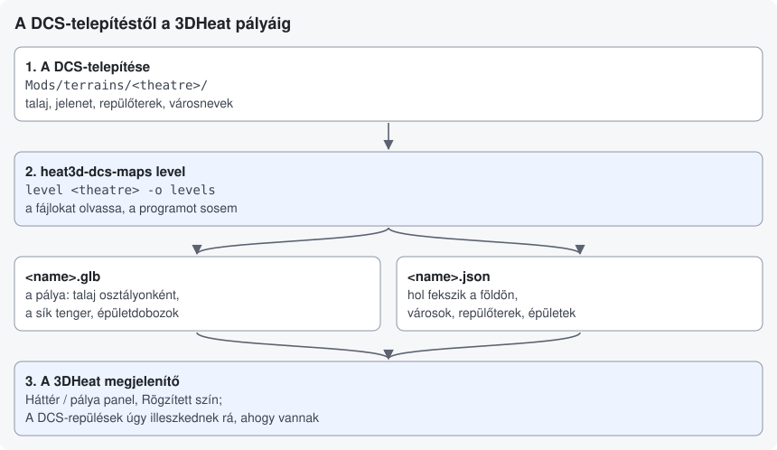

# 3DHeat DCS {#dheat-dcs}

**Mi ez?** A theatre (színház) a DCS World szava a térképre: a világnak egy területe, amely
felett repülsz. Ez az eszköz egy színház talaját, amelyet **a saját telepítésedből** olvas be,
3D pályává alakítja: olyan modellé, amely felett repülni lehet, a [3DHeat](https://github.com/Holdi601/3DHeat)
megjelenítőhöz ([dokumentáció](https://holdi601.github.io/3DHeat/)).

**Mire jó?** Hogy a DCS-repüléseidet a játék saját térképén lásd: a dombokat, a partvonalat,
a repülőtereket, utakat, vasútvonalakat, városokat és épületeket.

**Példa:** `heat3d-dcs-maps level <theatre> -o levels` ->
`levels/<theatre>.glb` (a pálya) + `levels/<theatre>.json` (hol fekszik a földön, a városai
és a repülőterei).

Mire használható:

- **Repülések a játék saját térképén.** A 3DHeat világ háttere a mai Földet nyílt adatokból
  rajzolja; ez a színházat úgy rajzolja, ahogy a DCS is rajzolja.
- **Nincs elhelyezési lépés.** A pálya a DCS saját világméterében készül, így a DCS méterekben
  rögzített telemetria (a 3DHeat Watcher DCS-csatlakozója pontosan ezt írja) a megjelenítő
  alapbeállításaival illeszkedik rá.
- **Földrajzi szélesség és hosszúság.** Minden pálya tartalmazza a vetítését, a sarkait és a
  városait mindkét koordinátarendszerben.



## Gyors kezdés {#quick-start}

Még nem használt parancssort? Előbb olvasd el a [Mielőtt elkezded](before-you-start.md) oldalt.
Ezeket a mappában futtasd, ahová klónoztad vagy kicsomagoltad:

```bash
python -m pip install -e .                         # telepíti a heat3d-dcs-maps parancsot
heat3d-dcs-maps list                               # a telepített színházak, és hogy mindegyik olvasható-e
heat3d-dcs-maps level <theatre> -o levels          # egy egész (kicsi) színház
heat3d-dcs-maps level <theatre> --around <lat> <lon> 12 -o levels --name <name>   # 12 km egy pont két oldalán
```

A `list` parancs színházanként egy sort ír ki, a végén `readable` szóval.
Ezután töltsd be a `levels/<name>.glb` fájlt a megjelenítő Háttér / pálya paneljén
([Pályák](https://holdi601.github.io/3DHeat/levels.html)).

Az általad írt pályák a játék adataiból készülnek, ezért **a te gépeden maradnak**: megtekintésre
valók, megosztásra vagy közzétételre nem ([Feltételek](terms.md)).

## Oldalak {#pages}

| Oldal | Mit tartalmaz |
|---|---|
| [Mielőtt elkezded](before-you-start.md) | Python, egy terminál, az első futtatás |
| [Színházak keresése: list](list.md) | hol találod a telepítést, mit ír ki a `list` |
| [Pálya építése: level](level.md) | minden kapcsoló, régiók, méret, lépésről lépésre |
| [A pályafájlok](output.md) | a `.glb` részei, a talajosztályok és színeik, a `.json`, a koordináták |
| [Helynevek: towns](towns.md) | egy színház városai DCS-koordinátákkal |
| [Vetítések: fit](fit.md) | egy színház vetítésének megtalálása egy felvételből |
| [Hogyan olvasódnak be a fájlok](reading.md) | a formátumok, mi lett ellenőrizve, mi nem olvasódik be |
| [Feltételek és licenc](terms.md) | az Eagle Dynamics licence, és hogy miért külön csomag ez |
| [Parancsleírás](../cli-reference.md) | minden kapcsoló, a kódból generálva |
| [A dokumentáció karbantartása](maintaining.md) | a kiadási ellenőrzőlista |

## Kapcsolódó oldalak {#related}

- A 3DHeat megjelenítő: [github.com/Holdi601/3DHeat](https://github.com/Holdi601/3DHeat),
  dokumentáció: [holdi601.github.io/3DHeat](https://holdi601.github.io/3DHeat/).
- Telemetria ezekhez a pályákhoz: a [3DHeat Watcher](https://holdi601.github.io/3DHeat-Watcher/)
  rögzíti a DCS-repüléseket; a megjelenítő fájlformátumait, köztük az egy-fájl-meccs tárolót, ebben
  írjuk le: [Egy fájl meccsenként (.3dheat)](https://holdi601.github.io/3DHeat/container.html).

## A 3DHeat eszközei {#the-3dheat-tools}

| Eszköz | Mit csinál | Kód | Dokumentáció |
|---|---|---|---|
| 3DHeat megjelenítő | megmutatja az adatokat: hőtérképeket, versenyelemzést, meccsáttekintést | [3DHeat](https://github.com/Holdi601/3DHeat) | [dokumentáció](https://holdi601.github.io/3DHeat/) |
| GameFiles | pályák és versenypályák egy játék saját fájljaiból | [3DHeat-GameFiles](https://github.com/Holdi601/3DHeat-GameFiles) | [dokumentáció](https://holdi601.github.io/3DHeat-GameFiles/) |
| GameCapture | körtelemetria, és pályák rekonstruálva játékvideóból | [3DHeat-GameCapture](https://github.com/Holdi601/3DHeat-GameCapture) | [dokumentáció](https://holdi601.github.io/3DHeat-GameCapture/) |
| Unreal Exporter | Unreal Editor bővítmény: egy pálya egyetlen `.glb` fájlban | [3DHeat-UnrealExporter](https://github.com/Holdi601/3DHeat-UnrealExporter) | [dokumentáció](https://holdi601.github.io/3DHeat-UnrealExporter/) |
| CS2 | Counter-Strike 2 demók és pályák | [3DHeat-CS2](https://github.com/Holdi601/3DHeat-CS2) | [dokumentáció](https://holdi601.github.io/3DHeat-CS2/) |
| Watcher | azt rögzíti, amit a játékok közzétesznek játék közben | [3DHeat-Watcher](https://github.com/Holdi601/3DHeat-Watcher) | [dokumentáció](https://holdi601.github.io/3DHeat-Watcher/) |
| Ext-WarThunder | War Thunder visszajátszások | [3DHeat-Ext-WarThunder](https://github.com/Holdi601/3DHeat-Ext-WarThunder) | [dokumentáció](https://holdi601.github.io/3DHeat-Ext-WarThunder/) |
| Ext-WoT | World of Tanks visszajátszások | [3DHeat-Ext-WoT](https://github.com/Holdi601/3DHeat-Ext-WoT) | [dokumentáció](https://holdi601.github.io/3DHeat-Ext-WoT/) |
| Ext-WoWs | World of Warships visszajátszások | [3DHeat-Ext-WoWs](https://github.com/Holdi601/3DHeat-Ext-WoWs) | [dokumentáció](https://holdi601.github.io/3DHeat-Ext-WoWs/) |
| Ext-Squad | Squad-szerverdemók | [3DHeat-Ext-Squad](https://github.com/Holdi601/3DHeat-Ext-Squad) | [dokumentáció](https://holdi601.github.io/3DHeat-Ext-Squad/) |
| Ext-DCS | DCS World térképek 3D pályaként | [3DHeat-Ext-DCS](https://github.com/Holdi601/3DHeat-Ext-DCS) | [dokumentáció](https://holdi601.github.io/3DHeat-Ext-DCS/) |
| Ext-IL2 | IL-2 Sturmovik térképek 3D pályaként | [3DHeat-Ext-IL2](https://github.com/Holdi601/3DHeat-Ext-IL2) | [dokumentáció](https://holdi601.github.io/3DHeat-Ext-IL2/) |
