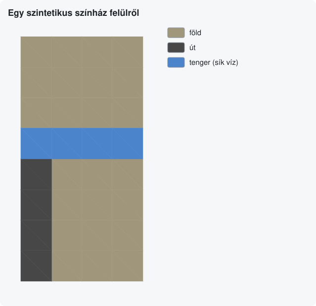
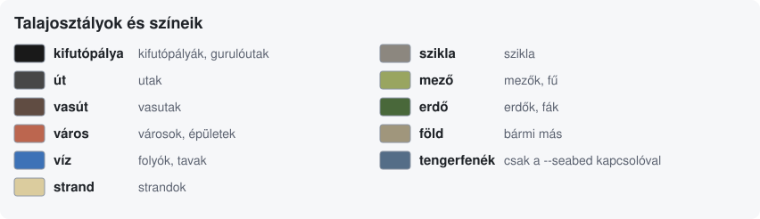

# A pályafájlok {#the-level-files}

A pálya egy 3D-modell a talajról; a színház a DCS World szava a térképre.

`<out>/<name>.glb` és mellette a `<name>.json`.

| Rész | Mi az |
|---|---|
| `ground:<Level>` | a terep saját háromszögei, színezve aszerint, amit a játék rajzol rájuk |
| `water:<Level>` | minden háromszög, amelyet a játék a tenger alattinak jelöl, laposan, tengerszinten |
| `structure:<Level>` | a színház épületei dobozokként, ahol a játék elhelyezi őket (lent) |

A színek az alábbi osztályok:

A színeket a megjelenítő pálya-paneljén a **Rögzített szín** (Captured colour) kapcsolóval lehet
megnézni. Minden talaj-háromszög azt az osztályt kapja, amelyik átfedés alapján a játék rajzolja:

| Osztály | Szín | A játék átfedéséből |
|---|---|---|
| runway (kifutópálya) | majdnem fekete | `Runway` - kifutópályák, gurulóutak és várók |
| road (út) | sötétszürke | `Road` |
| rail (vasút) | barna | `Rail` |
| town (város) | téglavörös | `Town`, `Building` |
| water (víz) | kék | `River`, `Lake` (szárazföldi víz, talajként rajzolva) |
| beach (strand) | homokszín | `Beach` |
| rock (szikla) | szürke | `Rock` |
| field (mező) | világoszöld | `Field`, `Grass` |
| forest (erdő) | sötétzöld | `Forest`, `Trees` |
| land (föld) | khaki | egyik sem |
| seabed (tengerfenék) | palakék | csak a `--seabed` kapcsolóval |

Ha több átfedés rajzolja ugyanazt a háromszöget, a táblázat sorrendje dönt (az erdőn átvezető
út út marad). Minden átfedési háromszög a talaj saját háromszöge közül való – a kipróbált színházak
minden osztályán ellenőrizve, és mindegyik egyezett –, így az osztályok pontosak, nem a közeli
pontokból becsültek.

**A koordináták** a DCS saját világméterei: x észak, y fölfelé, z kelet, és a glTF tengelyek ugyanazok
(X = x, Y = y, Z = z). A DCS-méterben rögzített telemetria – a 3DHeat Watcher DCS-csatlakozója pontosan
ezt írja – a megjelenítő alapbeállításaival (Y fölfelé, méretarány 1) illeszkedik a pályára, elhelyezési
lépés nélkül.

**Szélességi és hosszúsági fok:** minden színház egy saját állandókkal rendelkező Transverse Mercator-vetítés;
a `<name>.json` tartalmazza ezeket, a pálya sarkait szélességi és hosszúsági fokban, és minden várost
mindkét koordinátájával: a szélességi/hosszúsági fokkal és a DCS x/z értékével. Ahol a színház állandói nincsenek
közzétéve, azok a `beacons.lua` fájl jeladóihoz illesztettek mindkét rendszerben (néhány cm átlagos négyzetes
hiba; ugyanez az illesztés más színházak közzétett állandóit is a milliméterig visszaadja).
Állandók nélküli színházhoz a [`fit`](fit.md) bármilyen olyan felvételből megtalálja őket, amely mindkettőt
tartalmazza, például egy Watcher-munkamenetből egy repülésről.

**A tengerfenék** kimarad (egy repülős-szimulátoros hőtérképhez nincs rá szükség); a `--seabed` talajként
megtartja. A `--no-water` kihagyja a sík tengert.

**Méret.** Lásd: [Pálya építése: Méret](level.md#size).

**Repülőterek.** Minden `AirfieldsTaxiways/<name>.rn4` egy repülőtér gurulóhálózatát tartalmazza, a nevéről
elnevezve; pontjai DCS-méterben megadott (x, y, z) dupla számok. A pálya `.json` fájlja felsorolja az adott
régióban lévő összes repülőteret a nevével (a fájlból), a pontjai dobozának közepével, a dobozzal és az ottani
talajjal. A kipróbált színházon minden repülőtér-fájl beolvasódott, és mindegyik a saját mezőjére került
(néhány száz méteren belül a felmért repülőtéri referenciaponttól: a gurulóutak közepétől, nem a kifutópályáétól).

**Épületek.** A `Scenes/<theatre>.scn5` a színház minden objektumát tartalmazza (milliókat – fákat, lámpákat,
kerítéseket, vezetékeket, házakat). Azok, amelyek nevükről és méretükről épületnek számítanak (házak, lakások,
műhelyek, hangárok, gyárak, tornyok, terminálok: a modellek egy töredéke, több százezer elhelyezés), dobozként
rajzolódnak: minden modell saját határoló doboza a fájlból, a fejlécére forgatva, és ott állva, ahová a játék
teszi, a származási pontja alatt legfeljebb 3 m-ig (a lejtőn való alapozása) a tetejéig. Fák, bokrok, lámpák,
oszlopok, vezetékek, kerítések, falak, táblák, járművek, vagonok, hajók, daruk, árbócok, villanyoszlopok és hidak
kimaradnak. A játék modellformáját vagy textúráját nem másoljuk: épületenként egy doboz, típus szerint színezve
(ház, blokk, ipari, repülőtér, torony, egyéb). A `<name>.json` is felsorolja őket (`buildings.rows`: x, z, alap,
magasság, félhosszak, fejléc, típus) a megjelenítő hibrid háttere számára, amely a játék városaiban a leképezett
épületek helyett ezeket rajzolja. A `--no-buildings` kihagyja őket.

A `<name>.json` rögzíti még a forrásfájlt, annak méretét és dátumát, a beolvasott csempéket, a háromszögek számát
osztályonként, és hogy a színház hány városa esik a talajra – a vetítés ellenőrzése, amelynek „N of N” értéket kell
mutatnia.

A pálya névvel ellátott részekkel rendelkező glTF bináris fájl, ahogy minden 3DHeat-pálya; a megjelenítő
[Pályák](https://holdi601.github.io/3DHeat/levels.html) oldala írja le, hogyan töltődnek be.
