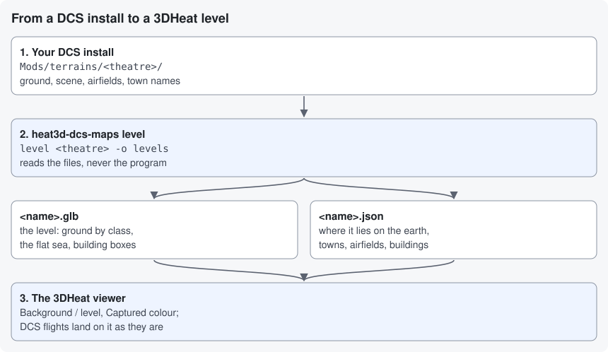

# 3DHeat DCS

**What is it?** A theatre is DCS World's word for a map: a region of the
world you fly over. This tool turns the ground of one theatre, read from
**your own install**, into a 3D level - a model you can fly over - for the
[3DHeat](https://github.com/Holdi601/3DHeat) viewer
([documentation](https://holdi601.github.io/3DHeat/)).

**Why would I use it?** To see your DCS flights over the game's own map: its
hills, coast, airfields, roads, railways, towns and buildings.

**Example:** `heat3d-dcs-maps level <theatre> -o levels` ->
`levels/<theatre>.glb` (the level) + `levels/<theatre>.json` (where it lies on
the earth, its towns and airfields).

What it is useful for:

- **Flights on the game's own map.** The 3DHeat world backdrop draws today's
  earth from open data; this draws the theatre as DCS draws it.
- **No placement step.** The level is in DCS's own world metres, so telemetry
  in DCS metres (the 3DHeat Watcher's DCS hook writes exactly that) lands on
  it with the viewer's defaults.
- **Latitude and longitude.** Every level carries its projection, its corners
  and its towns in both frames.



## Quick start

New to the command line? Read [Before you start](before-you-start.md) first.
Run these in the folder you cloned or unzipped:

```bash
python -m pip install -e .                         # installs the heat3d-dcs-maps command
heat3d-dcs-maps list                               # the theatres installed, and whether each can be read
heat3d-dcs-maps level <theatre> -o levels          # a whole (small) theatre
heat3d-dcs-maps level <theatre> --around <lat> <lon> 12 -o levels --name <name>   # 12 km either side of a point
```

You should see one line per theatre from `list`, ending `readable`.
Then load `levels/<name>.glb` in the viewer's Background / level panel
([Levels](https://holdi601.github.io/3DHeat/levels.html)).

The levels it writes are built from the game's data: they stay **on your
machine**, to view, not to share or publish ([Terms](terms.md)).

## Pages

| Page | What it covers |
|---|---|
| [Before you start](before-you-start.md) | Python, a terminal, a first run |
| [Finding theatres: list](list.md) | where the install is found, what `list` prints |
| [Building a level: level](level.md) | every option, regions, size, step by step |
| [The level files](output.md) | the `.glb` parts, the ground classes and their colours, the `.json`, the coordinates |
| [Place names: towns](towns.md) | a theatre's towns with DCS coordinates |
| [Projections: fit](fit.md) | finding a theatre's projection from a recording |
| [How the files are read](reading.md) | the formats, what was verified, what is not read |
| [Terms and licence](terms.md) | Eagle Dynamics' licence, and why this is a separate package |
| [Command reference](cli-reference.md) | every option, generated from the code |
| [Maintaining these docs](maintaining.md) | the release checklist |

## Related

- The 3DHeat viewer: [github.com/Holdi601/3DHeat](https://github.com/Holdi601/3DHeat),
  documentation at [holdi601.github.io/3DHeat](https://holdi601.github.io/3DHeat/).
- Telemetry for these levels: the [3DHeat Watcher](https://holdi601.github.io/3DHeat-Watcher/)
  records DCS flights; the viewer's file formats, including its
  one-file-a-match container, are described in
  [One file a match (.3dheat)](https://holdi601.github.io/3DHeat/container.html).

## The 3DHeat tools

| Tool | What it does | Code | Docs |
|---|---|---|---|
| 3DHeat viewer | shows the data: heatmaps, race analysis, match review | [3DHeat](https://github.com/Holdi601/3DHeat) | [docs](https://holdi601.github.io/3DHeat/) |
| GameFiles | levels and courses from a game's own files | [3DHeat-GameFiles](https://github.com/Holdi601/3DHeat-GameFiles) | [docs](https://holdi601.github.io/3DHeat-GameFiles/) |
| GameCapture | lap telemetry, and levels rebuilt from gameplay video | [3DHeat-GameCapture](https://github.com/Holdi601/3DHeat-GameCapture) | [docs](https://holdi601.github.io/3DHeat-GameCapture/) |
| Unreal Exporter | an Unreal Editor plugin: a level as one `.glb` | [3DHeat-UnrealExporter](https://github.com/Holdi601/3DHeat-UnrealExporter) | [docs](https://holdi601.github.io/3DHeat-UnrealExporter/) |
| CS2 | Counter-Strike 2 demos and maps | [3DHeat-CS2](https://github.com/Holdi601/3DHeat-CS2) | [docs](https://holdi601.github.io/3DHeat-CS2/) |
| Watcher | records what games publish while you play | [3DHeat-Watcher](https://github.com/Holdi601/3DHeat-Watcher) | [docs](https://holdi601.github.io/3DHeat-Watcher/) |
| Ext-WarThunder | War Thunder replays | [3DHeat-Ext-WarThunder](https://github.com/Holdi601/3DHeat-Ext-WarThunder) | [docs](https://holdi601.github.io/3DHeat-Ext-WarThunder/) |
| Ext-WoT | World of Tanks replays | [3DHeat-Ext-WoT](https://github.com/Holdi601/3DHeat-Ext-WoT) | [docs](https://holdi601.github.io/3DHeat-Ext-WoT/) |
| Ext-WoWs | World of Warships replays | [3DHeat-Ext-WoWs](https://github.com/Holdi601/3DHeat-Ext-WoWs) | [docs](https://holdi601.github.io/3DHeat-Ext-WoWs/) |
| Ext-Squad | Squad server demos | [3DHeat-Ext-Squad](https://github.com/Holdi601/3DHeat-Ext-Squad) | [docs](https://holdi601.github.io/3DHeat-Ext-Squad/) |
| Ext-DCS | DCS World maps as 3D levels | [3DHeat-Ext-DCS](https://github.com/Holdi601/3DHeat-Ext-DCS) | [docs](https://holdi601.github.io/3DHeat-Ext-DCS/) |
| Ext-IL2 | IL-2 Sturmovik maps as 3D levels | [3DHeat-Ext-IL2](https://github.com/Holdi601/3DHeat-Ext-IL2) | [docs](https://holdi601.github.io/3DHeat-Ext-IL2/) |
