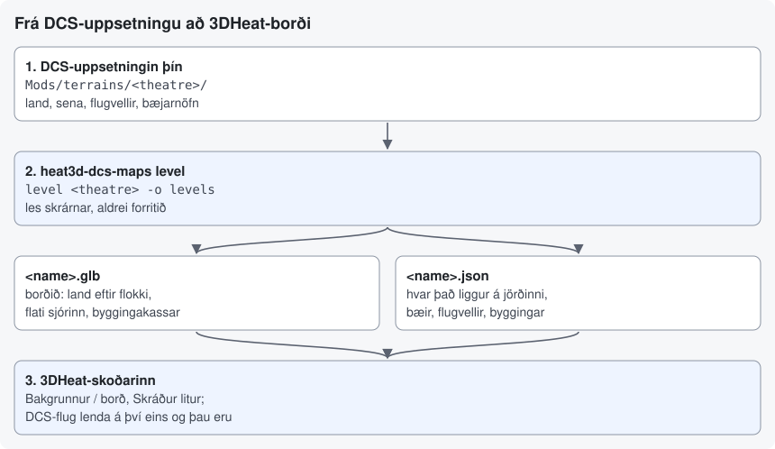

# 3DHeat DCS {#dheat-dcs}

**Hvað er þetta?** Theatre er orð DCS World yfir kort: svæði af
heiminum sem þú flýgur yfir. Þetta verkfæri breytir landslagi eins leiksvæðis, lesnu úr
**þinni eigin uppsetningu**, í 3D borð - líkan sem þú getur flogið yfir - fyrir
[3DHeat](https://github.com/Holdi601/3DHeat)-skoðarann
([skjöl](https://holdi601.github.io/3DHeat/)).

**Hvers vegna ætti ég að nota það?** Til að sjá DCS-flugin þín yfir eigin korti leiksins: hæðir
þess, strönd, flugvelli, vegi, járnbrautir, bæi og byggingar.

**Dæmi:** `heat3d-dcs-maps level <theatre> -o levels` ->
`levels/<theatre>.glb` (borðið) + `levels/<theatre>.json` (hvar það liggur á
jörðinni, bæir þess og flugvellir).

Til hvers það nýtist:

- **Flug á eigin korti leiksins.** Heimsbakgrunnur 3DHeat teiknar jörðina eins og
  hún er í dag úr opnum gögnum; þetta teiknar leiksvæðið eins og DCS teiknar það.
- **Ekkert staðsetningarskref.** Borðið er í eigin heimsmetrum DCS, svo mælingagögn
  í DCS-metrum (DCS-krókur 3DHeat Watcher skrifar nákvæmlega það) lenda á
  því með sjálfgefnum stillingum skoðarans.
- **Breiddar- og lengdargráða.** Sérhvert borð ber vörpun sína, horn sín
  og bæi sína í báðum viðmiðunarrömmum.



## Fljótleg byrjun {#quick-start}

Hefurðu aldrei notað skipanalínu? Lestu fyrst [Áður en þú byrjar](before-you-start.md).
Keyrðu þetta í möppunni sem þú klónaðir eða pakkaðir upp:

```bash
python -m pip install -e .                         # installs the heat3d-dcs-maps command
heat3d-dcs-maps list                               # the theatres installed, and whether each can be read
heat3d-dcs-maps level <theatre> -o levels          # a whole (small) theatre
heat3d-dcs-maps level <theatre> --around <lat> <lon> 12 -o levels --name <name>   # 12 km either side of a point
```

Þú ættir að sjá eina línu fyrir hvert leiksvæði frá `list`, sem endar á `readable`.
Hladdu síðan `levels/<name>.glb` í spjaldinu Bakgrunnur / borð í skoðaranum
([Borð](https://holdi601.github.io/3DHeat/levels.html)).

Borðin sem það skrifar eru smíðuð úr gögnum leiksins: þau haldast **á þinni
vél**, til að skoða, ekki til að deila eða birta ([Skilmálar](terms.md)).

## Síður {#pages}

| Síða | Hvað hún fjallar um |
|---|---|
| [Áður en þú byrjar](before-you-start.md) | Python, skipanalína, fyrsta keyrsla |
| [Að finna leiksvæði: list](list.md) | hvar uppsetningin finnst, hvað `list` prentar |
| [Að smíða borð: level](level.md) | hver valkostur, svæði, stærð, skref fyrir skref |
| [Borðaskrárnar](output.md) | hlutar `.glb`, landflokkarnir og litir þeirra, `.json`, hnitin |
| [Staðarnöfn: towns](towns.md) | bæir leiksvæðis með DCS-hnitum |
| [Vörpun: fit](fit.md) | að finna vörpun leiksvæðis úr upptöku |
| [Hvernig skrárnar eru lesnar](reading.md) | sniðin, hvað var staðfest, hvað er ekki lesið |
| [Skilmálar og leyfi](terms.md) | leyfi Eagle Dynamics og hvers vegna þetta er sérstakur pakki |
| [Skipanayfirlit](../cli-reference.md) | hver valkostur, búið til úr kóðanum |
| [Viðhald þessara skjala](maintaining.md) | gátlisti útgáfu |

## Tengt {#related}

- 3DHeat-skoðarinn: [github.com/Holdi601/3DHeat](https://github.com/Holdi601/3DHeat),
  skjöl á [holdi601.github.io/3DHeat](https://holdi601.github.io/3DHeat/).
- Mælingagögn fyrir þessi borð: [3DHeat Watcher](https://holdi601.github.io/3DHeat-Watcher/)
  skráir DCS-flug; skráasnið skoðarans, þar á meðal gámurinn
  með eina skrá fyrir hvern leik, eru lýst í
  [Ein skrá fyrir hvern leik (.3dheat)](https://holdi601.github.io/3DHeat/container.html).

## 3DHeat verkfærin {#the-3dheat-tools}

| Verkfæri | Hvað það gerir | Kóði | Skjöl |
|---|---|---|---|
| 3DHeat-skoðari | sýnir gögnin: hitakort, kappakstursgreiningu, leikjayfirlit | [3DHeat](https://github.com/Holdi601/3DHeat) | [skjöl](https://holdi601.github.io/3DHeat/) |
| GameFiles | borð og brautir úr eigin skrám leiks | [3DHeat-GameFiles](https://github.com/Holdi601/3DHeat-GameFiles) | [skjöl](https://holdi601.github.io/3DHeat-GameFiles/) |
| GameCapture | hringtímagögn og borð endurbyggð úr leikmyndbandi | [3DHeat-GameCapture](https://github.com/Holdi601/3DHeat-GameCapture) | [skjöl](https://holdi601.github.io/3DHeat-GameCapture/) |
| Unreal Exporter | viðbót fyrir Unreal Editor: borð sem ein `.glb` | [3DHeat-UnrealExporter](https://github.com/Holdi601/3DHeat-UnrealExporter) | [skjöl](https://holdi601.github.io/3DHeat-UnrealExporter/) |
| CS2 | Counter-Strike 2 demo og kort | [3DHeat-CS2](https://github.com/Holdi601/3DHeat-CS2) | [skjöl](https://holdi601.github.io/3DHeat-CS2/) |
| Watcher | skráir það sem leikir birta meðan þú spilar | [3DHeat-Watcher](https://github.com/Holdi601/3DHeat-Watcher) | [skjöl](https://holdi601.github.io/3DHeat-Watcher/) |
| Ext-WarThunder | War Thunder upptökur | [3DHeat-Ext-WarThunder](https://github.com/Holdi601/3DHeat-Ext-WarThunder) | [skjöl](https://holdi601.github.io/3DHeat-Ext-WarThunder/) |
| Ext-WoT | World of Tanks upptökur | [3DHeat-Ext-WoT](https://github.com/Holdi601/3DHeat-Ext-WoT) | [skjöl](https://holdi601.github.io/3DHeat-Ext-WoT/) |
| Ext-WoWs | World of Warships upptökur | [3DHeat-Ext-WoWs](https://github.com/Holdi601/3DHeat-Ext-WoWs) | [skjöl](https://holdi601.github.io/3DHeat-Ext-WoWs/) |
| Ext-Squad | Squad þjónsdemo | [3DHeat-Ext-Squad](https://github.com/Holdi601/3DHeat-Ext-Squad) | [skjöl](https://holdi601.github.io/3DHeat-Ext-Squad/) |
| Ext-DCS | DCS World kort sem 3D borð | [3DHeat-Ext-DCS](https://github.com/Holdi601/3DHeat-Ext-DCS) | [skjöl](https://holdi601.github.io/3DHeat-Ext-DCS/) |
| Ext-IL2 | IL-2 Sturmovik kort sem 3D borð | [3DHeat-Ext-IL2](https://github.com/Holdi601/3DHeat-Ext-IL2) | [skjöl](https://holdi601.github.io/3DHeat-Ext-IL2/) |
