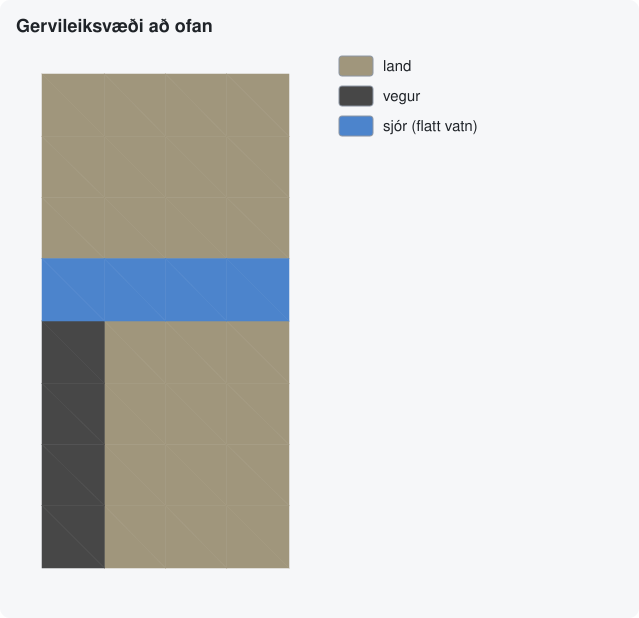
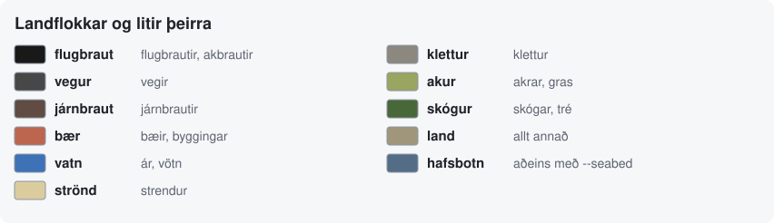

# Borðaskrárnar {#the-level-files}

Borð er 3D líkan af landinu; theatre er orð DCS World yfir kort.

`<out>/<name>.glb` og `<name>.json` við hliðina.

| Hluti | Hvað það er |
|---|---|
| `ground:<Level>` | eigin þríhyrningar landsins, litaðir eftir því sem leikurinn teiknar yfir hvern |
| `water:<Level>` | sérhver þríhyrningur sem leikurinn merkir sem undir sjó, lagður flatur í sjávarmáli |
| `structure:<Level>` | byggingar leiksvæðisins sem kassar, þar sem leikurinn setur þær (hér að neðan) |

Litirnir eru flokkarnir hér að neðan:

Litirnir birtast með **Skráður litur** í spjaldinu Bakgrunnur / borð í skoðaranum. Hver
landþríhyrningur fær flokk yfirlagsins sem leikurinn teiknar hann með:

| Flokkur | Litur | Úr yfirlagi leiksins |
|---|---|---|
| runway | næstum svartur | `Runway` - flugbrautir, akbrautir og flughlöð |
| road | dökkgrár | `Road` |
| rail | brúnn | `Rail` |
| town | múrsteinsrauður | `Town`, `Building` |
| water | blár | `River`, `Lake` (vötn og ár á landi, teiknuð sem land) |
| beach | sandlitur | `Beach` |
| rock | grár | `Rock` |
| field | ljósgrænn | `Field`, `Grass` |
| forest | dökkgrænn | `Forest`, `Trees` |
| land | kakí | ekkert af þessu |
| seabed | skífublár | aðeins með `--seabed` |

Þar sem mörg yfirlög teikna sama þríhyrning ræður röð töflunnar
(vegur gegnum skóg er vegur). Sérhver yfirlagsþríhyrningur er einn af
eigin þríhyrningum landsins - athugað á hverjum flokki leiksvæðanna sem prófuð voru, hver og einn passaði - svo
flokkarnir eru nákvæmir, ekki getgátur út frá nálægum punktum.

**Hnit** eru eigin heimsmetrar DCS: x norður, y upp, z austur, og
glTF-ásarnir eru þeir sömu (X = x, Y = y, Z = z). Mælingagögn í DCS-metrum - 
DCS-krókur 3DHeat Watcher skrifar nákvæmlega það - lenda á borðinu með
sjálfgefnum stillingum skoðarans (Y upp, kvarði 1) og engu staðsetningarskrefi.

**Breiddar- og lengdargráða:** sérhvert leiksvæði er Transverse Mercator vörpun
með eigin fasta; `<name>.json` ber þá, horn borðsins í
breiddar- og lengdargráðu, og sérhvern bæ bæði með breiddar-/lengdargráðu sinni og
DCS x/z. Þar sem fastar leiksvæðis eru ekki birtir eru þeir fittaðir
við leiðarmerkin (beacons) sem eigin `beacons.lua` þess gefur í báðum römmum (nokkrir cm kvaðratmeðaltal;
sama passun gefur birta fasta annarra leiksvæða aftur upp á
millimetra).
Fyrir leiksvæði án fasta finnur [`fit`](fit.md) þá úr hvaða
upptöku sem er sem geymir bæði, til dæmis Watcher lotu af einu flugi.

**Hafsbotninum** er sleppt (hitakort fyrir flugherma þarf ekki
hafsbotn); `--seabed` heldur honum sem landi. `--no-water` sleppir
flata sjónum.

**Stærð.** Sjá [Að smíða borð: Stærð](level.md#size).

**Flugvellir.** Hver `AirfieldsTaxiways/<name>.rn4` geymir akbrautanet eins flugvallar,
nefnt eftir honum; punktar þess eru (x, y, z) tvöfaldar fleytitölur í DCS-metrum. `.json`
borðsins telur upp sérhvern flugvöll innan svæðisins með nafni hans (skrárinnar), miðju
kassa punkta hans, kassanum og landinu þar. Á leiksvæðinu sem prófað var las sérhver flugvallaskrá, hver og ein sett á völl sinn
(innan nokkur hundruð metra frá könnuðum viðmiðunarpunkti flugvallarins: miðju
akbrautanna, ekki flugbrautarinnar).

**Byggingar.** `Scenes/<theatre>.scn5` setur sérhvern hlut leiksvæðisins
(milljónir þeirra - tré, ljósastaurar, girðingar, vírar, hús). Þeir
sem eru byggingar eftir nafni og stærð (hús, íbúðir, skúrar, flugskýli,
verksmiðjur, turnar, flugstöðvar: brot af líkönunum, hundruð
þúsunda staðsetninga) eru teiknaðir sem kassar: eigin umlykjandi kassi hvers líkans úr
skránni, snúinn í stefnu sína og standandi þar sem leikurinn setur hann, frá allt að
3 m undir upphafspunkti hans (fótfesta í halla) að toppi hans. Tré, runnar,
ljós, staurar, vírar, girðingar, veggir, skilti, ökutæki, vagnar, bátar, kranar,
möstur, rafmagnsmöstur og brýr eru útilokuð. Ekkert líkanform eða áferð
leiksins er afrituð: einn kassi á byggingu, litaður eftir gerð (hús, blokk,
iðnaður, flugvöllur, turn, annað). `<name>.json` telur þær líka upp
(`buildings.rows`: x, z, base, height, half lengths, heading, kind) fyrir
blendingsbakgrunn skoðarans, sem teiknar þær í bæjum leiksins í stað
kortlagðra bygginga. `--no-buildings` sleppir þeim.

`<name>.json` skráir líka upprunaskrána, stærð hennar og dagsetningu, flísarnar sem
voru lesnar, fjölda þríhyrninga í hverjum flokki, og hversu margir bæir leiksvæðisins lenda
á landinu - athugun á vörpuninni sem ætti að sýna „N of N“.

Borðið er glTF tvíundarskrá með nefndum hlutum, eins og öll 3DHeat-borð; síðan
[Borð](https://holdi601.github.io/3DHeat/levels.html) í skoðaranum segir hvernig hann hleður þeim.
