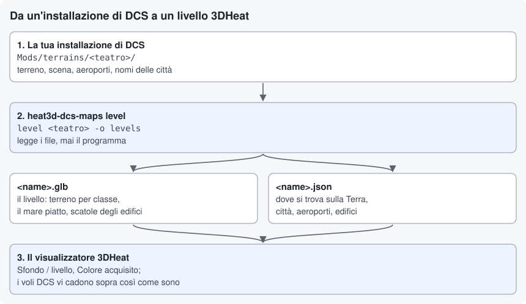

# 3DHeat DCS {#dheat-dcs}

**Che cos'è?** Un teatro è la parola di DCS World per una mappa: una regione del mondo sopra
cui si vola. Questo strumento trasforma il terreno di un teatro, letto dalla **tua installazione**,
in un livello 3D - un modello sopra cui si può volare - per il visualizzatore
[3DHeat](https://github.com/Holdi601/3DHeat) ([documentazione](https://holdi601.github.io/3DHeat/)).

**A cosa serve?** A vedere i tuoi voli DCS sulla mappa del gioco stessa: le sue colline, la costa,
gli aeroporti, le strade, le ferrovie, le città e gli edifici.

**Esempio:** `heat3d-dcs-maps level <teatro> -o levels` ->
`levels/<teatro>.glb` (il livello) + `levels/<teatro>.json` (dove si trova sulla Terra, le sue città
e i suoi aeroporti).

A cosa serve:

- **Voli sulla mappa del gioco.** Lo sfondo del mondo di 3DHeat disegna la Terra di oggi a partire
  da dati aperti; questo disegna il teatro come lo disegna DCS.
- **Nessun passaggio di posizionamento.** Il livello è nelle metri del mondo di DCS, quindi la
  telemetria in metri DCS (il collegamento DCS di 3DHeat Watcher scrive esattamente quello) vi
  cade sopra con i valori predefiniti del visualizzatore.
- **Latitudine e longitudine.** Ogni livello riporta la sua proiezione, i suoi angoli e le sue città
  in entrambi i sistemi.



## Avvio rapido {#quick-start}

Non hai mai usato la riga di comando? Leggi prima [Prima di iniziare](before-you-start.md).
Esegui questi comandi nella cartella in cui hai clonato o decompresso lo strumento:

```bash
python -m pip install -e .                         # installa il comando heat3d-dcs-maps
heat3d-dcs-maps list                               # i teatri installati, e se ciascuno può essere letto
heat3d-dcs-maps level <teatro> -o levels           # un teatro intero (piccolo)
heat3d-dcs-maps level <teatro> --around <lat> <lon> 12 -o levels --name <nome>   # 12 km per lato da un punto
```

Dovresti vedere una riga per ogni teatro da `list`, che termina con `readable`.
Poi carica `levels/<nome>.glb` nel pannello Sfondo / livello del visualizzatore
([Livelli](https://holdi601.github.io/3DHeat/levels.html)).

I livelli che scrive sono costruiti con i dati del gioco: restano **sul tuo computer**, per
visualizzarli, non per condividerli o pubblicarli ([Condizioni](terms.md)).

## Pagine {#pages}

| Pagina | Cosa contiene |
|---|---|
| [Prima di iniziare](before-you-start.md) | Python, un terminale, una prima esecuzione |
| [Trovare i teatri: list](list.md) | dove si trova l'installazione, cosa stampa `list` |
| [Costruire un livello: level](level.md) | ogni opzione, le regioni, la dimensione, passo per passo |
| [I file del livello](output.md) | le parti `.glb`, le classi di terreno e i loro colori, il `.json`, le coordinate |
| [Nomi di luoghi: towns](towns.md) | le città di un teatro con le coordinate di DCS |
| [Proiezioni: fit](fit.md) | trovare la proiezione di un teatro da una registrazione |
| [Come vengono letti i file](reading.md) | i formati, cosa è stato verificato, cosa non viene letto |
| [Condizioni e licenza](terms.md) | la licenza di Eagle Dynamics, e perché questo è un pacchetto separato |
| [Riferimento dei comandi](../cli-reference.md) | ogni opzione, generata dal codice |
| [Manutenzione di questa documentazione](maintaining.md) | la lista di controllo per ogni rilascio |

## Collegamenti {#related}

- Il visualizzatore 3DHeat: [github.com/Holdi601/3DHeat](https://github.com/Holdi601/3DHeat),
  documentazione su [holdi601.github.io/3DHeat](https://holdi601.github.io/3DHeat/).
- Telemetria per questi livelli: il [3DHeat Watcher](https://holdi601.github.io/3DHeat-Watcher/)
  registra i voli DCS; i formati di file del visualizzatore, incluso il suo contenitore con una
  partita per file, sono descritti in
  [Una partita in un file (.3dheat)](https://holdi601.github.io/3DHeat/container.html).

## Gli strumenti 3DHeat {#the-3dheat-tools}

| Strumento | Cosa fa | Codice | Documentazione |
|---|---|---|---|
| Visualizzatore 3DHeat | mostra i dati: mappe di calore, analisi di gara, revisione della partita | [3DHeat](https://github.com/Holdi601/3DHeat) | [documentazione](https://holdi601.github.io/3DHeat/) |
| GameFiles | livelli e percorsi dai file di un gioco | [3DHeat-GameFiles](https://github.com/Holdi601/3DHeat-GameFiles) | [documentazione](https://holdi601.github.io/3DHeat-GameFiles/) |
| GameCapture | telemetria dei giri, e livelli ricostruiti dai video di gioco | [3DHeat-GameCapture](https://github.com/Holdi601/3DHeat-GameCapture) | [documentazione](https://holdi601.github.io/3DHeat-GameCapture/) |
| Unreal Exporter | un plugin per l'Editor di Unreal: un livello come un unico `.glb` | [3DHeat-UnrealExporter](https://github.com/Holdi601/3DHeat-UnrealExporter) | [documentazione](https://holdi601.github.io/3DHeat-UnrealExporter/) |
| CS2 | demo e mappe di Counter-Strike 2 | [3DHeat-CS2](https://github.com/Holdi601/3DHeat-CS2) | [documentazione](https://holdi601.github.io/3DHeat-CS2/) |
| Watcher | registra ciò che i giochi pubblicano mentre giochi | [3DHeat-Watcher](https://github.com/Holdi601/3DHeat-Watcher) | [documentazione](https://holdi601.github.io/3DHeat-Watcher/) |
| Ext-WarThunder | replay di War Thunder | [3DHeat-Ext-WarThunder](https://github.com/Holdi601/3DHeat-Ext-WarThunder) | [documentazione](https://holdi601.github.io/3DHeat-Ext-WarThunder/) |
| Ext-WoT | replay di World of Tanks | [3DHeat-Ext-WoT](https://github.com/Holdi601/3DHeat-Ext-WoT) | [documentazione](https://holdi601.github.io/3DHeat-Ext-WoT/) |
| Ext-WoWs | replay di World of Warships | [3DHeat-Ext-WoWs](https://github.com/Holdi601/3DHeat-Ext-WoWs) | [documentazione](https://holdi601.github.io/3DHeat-Ext-WoWs/) |
| Ext-Squad | demo dei server di Squad | [3DHeat-Ext-Squad](https://github.com/Holdi601/3DHeat-Ext-Squad) | [documentazione](https://holdi601.github.io/3DHeat-Ext-Squad/) |
| Ext-DCS | mappe del mondo di DCS come livelli 3D | [3DHeat-Ext-DCS](https://github.com/Holdi601/3DHeat-Ext-DCS) | [documentazione](https://holdi601.github.io/3DHeat-Ext-DCS/) |
| Ext-IL2 | mappe di IL-2 Sturmovik come livelli 3D | [3DHeat-Ext-IL2](https://github.com/Holdi601/3DHeat-Ext-IL2) | [documentazione](https://holdi601.github.io/3DHeat-Ext-IL2/) |
