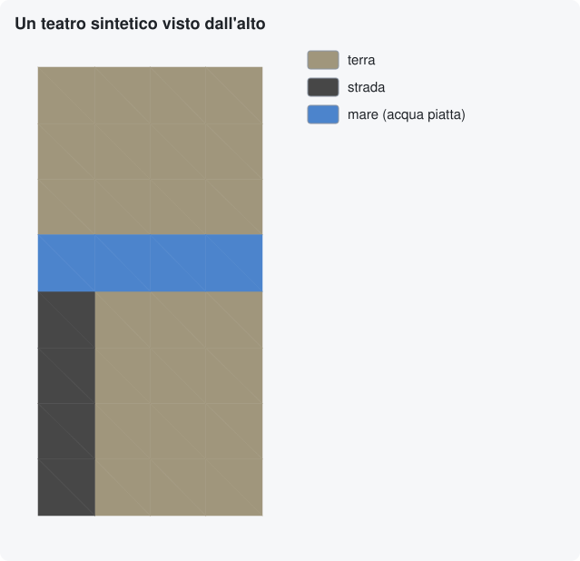
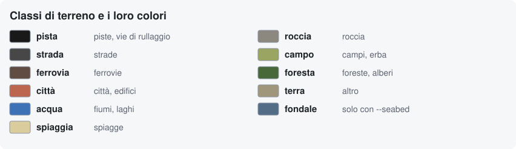

# I file del livello {#the-level-files}

Un livello è un modello 3D del terreno; un teatro è la parola di DCS World per una mappa.

`<out>/<nome>.glb` e, accanto, `<nome>.json`.

| Parte | Cosa è |
|---|---|
| `ground:<Livello>` | i triangoli stessi del terreno, colorati in base a ciò che il gioco disegna sopra ciascuno |
| `water:<Livello>` | ogni triangolo che il gioco segna come sott'acqua, appiattito al livello del mare |
| `structure:<Livello>` | gli edifici del teatro come scatole, dove il gioco li colloca (sotto) |

I colori sono le classi qui sotto:

I colori si vedono con **Colore catturato** nel pannello Sfondo / livello del visualizzatore. Ogni
triangolo del terreno prende la classe della sovrapposizione con cui il gioco lo disegna:

| Classe | Colore | Dalla sovrapposizione del gioco |
|---|---|---|
| runway | quasi nero | `Runway` - piste, vie di rullaggio e piazzali |
| road | grigio scuro | `Road` |
| rail | marrone | `Rail` |
| town | rosso mattone | `Town`, `Building` |
| water | blu | `River`, `Lake` (acqua interna, disegnata come terreno) |
| beach | sabbia | `Beach` |
| rock | grigio | `Rock` |
| field | verde chiaro | `Field`, `Grass` |
| forest | verde scuro | `Forest`, `Trees` |
| land | cachi | nessuna di queste |
| seabed | blu ardesia | solo con `--seabed` |

Dove più sovrapposizioni disegnano lo stesso triangolo, decide l'ordine della tabella (una strada
attraverso una foresta è strada). Ogni triangolo di sovrapposizione è uno di quelli del terreno
stesso - verificato su ogni classe dei teatri provati, tutti corrispondono - quindi le classi sono
esatte, non indovinate dai punti vicini.

**Le coordinate** sono le metri del mondo di DCS: x verso nord, y verso l'alto, z verso est, e gli
assi glTF sono gli stessi (X = x, Y = y, Z = z). La telemetria in metri DCS - il collegamento DCS di
3DHeat Watcher scrive esattamente quello - cade sul livello con i valori predefiniti del
visualizzatore (Y verso l'alto, scala 1) e senza alcun passaggio di posizionamento.

**Latitudine e longitudine:** ogni teatro è una proiezione di Mercatore trasversa con le sue
costanti; `<nome>.json` le riporta, insieme agli angoli del livello in latitudine e longitudine, e
ogni città con sia la sua latitudine/longitudine sia la sua x/z DCS. Dove le costanti di un teatro
non sono pubblicate, vengono adattate ai punti di riferimento che il suo `beacons.lua` dà in entrambi
i sistemi (un errore quadratico medio di pochi cm; lo stesso adattamento restituisce le costanti
pubblicate di altri teatri fino al millimetro).
Per un teatro senza costanti, [`fit`](fit.md) le trova da una qualsiasi registrazione che contenga
entrambi, come una sessione di Watcher di un volo.

**Il fondale marino** viene lasciato fuori (una mappa di calore per simulatori di volo non ha bisogno
del fondale); `--seabed` lo conserva come terreno. `--no-water` lascia fuori il mare piatto.

**Dimensione.** Vedi [Costruire un livello: Dimensione](level.md#size).

**Aeroporti.** Ogni `AirfieldsTaxiways/<nome>.rn4` contiene la rete di rullaggio di un aeroporto,
con il nome dell'aeroporto; i suoi punti sono coppie (x, y, z) in doppia precisione in metri DCS.
Il `.json` del livello elenca ogni aeroporto nella regione con il suo nome (quello del file), il
centro del riquadro dei suoi punti, il riquadro e il terreno lì. Sul teatro provato, ogni file di
aeroporto è stato letto, e ognuno è stato collocato sul suo campo (entro poche centinaia di metri dal
punto di riferimento dell'aeroporto rilevato: il centro delle vie di rullaggio, non della pista).

**Edifici.** `Scenes/<teatro>.scn5` colloca ogni oggetto del teatro (milioni - alberi, lampioni,
recinzioni, fili, case). Quelli che sono edifici per nome e dimensione (case, appartamenti, capanni,
hangar, fabbriche, torri, terminal: una frazione dei modelli, centinaia di migliaia di collocazioni)
vengono disegnati come scatole: il riquadro di delimitazione di ciascun modello dal file, ruotato
secondo il suo orientamento e posato dove il gioco lo mette, da fino a 3 m sotto la sua origine (il
suo appoggio su un pendio) fino alla sua sommità. Alberi, cespugli, luci, pali, fili, recinzioni,
muri, insegne, veicoli, vagoni, barche, gru, antenne, tralicci e ponti vengono lasciati fuori. Non
viene copiata nessuna forma o trama di modello del gioco: una scatola per edificio, colorata per
tipo (casa, blocco, industriale, aeroporto, torre, altro). Anche `<nome>.json` li elenca
(`buildings.rows`: x, z, base, altezza, mezze lunghezze, orientamento, tipo) per lo sfondo ibrido del
visualizzatore, che li disegna nelle città del gioco al posto degli edifici mappati. `--no-buildings`
li lascia fuori.

`<nome>.json` registra anche il file di origine, la sua dimensione e data, le tessere lette, il
numero di triangoli per classe, e quante città del teatro cadono sul terreno - un controllo della
proiezione che dovrebbe dire "N di N".

Il livello è un glTF binario con parti con nome, come ogni livello 3DHeat; la pagina
[Livelli](https://holdi601.github.io/3DHeat/levels.html) del visualizzatore spiega come li carica.
