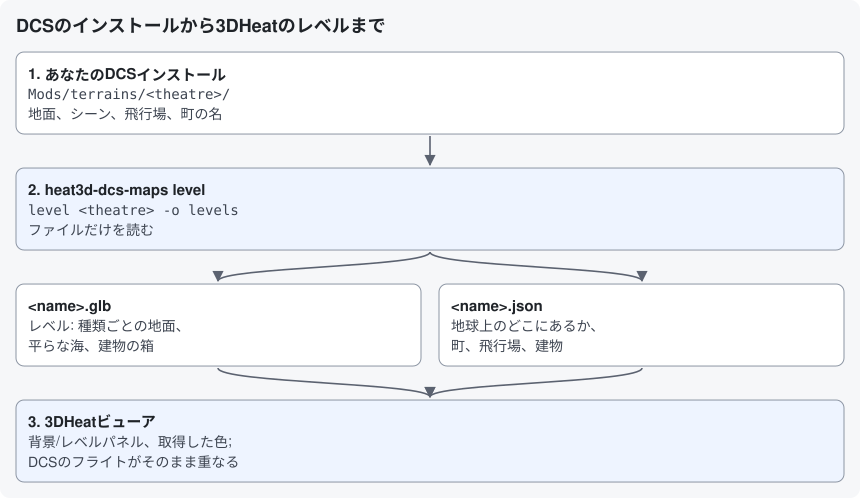

# 3DHeat DCS {#dheat-dcs}

**これは何？** DCS Worldで「シアター」とは、マップのことです。飛んで越えられる、世界の一つの地域です。このツールは、一つのシアターの地面を**あなた自身のインストール**から読み取り、[3DHeat](https://github.com/Holdi601/3DHeat)ビューア（[ドキュメント](https://holdi601.github.io/3DHeat/)）のための3Dレベルに変えます。飛び回れる3Dのモデルです。

**何に使うの？** DCSのフライトを、ゲーム自身のマップの上で見るためです。丘、海岸、飛行場、道路、鉄道、町、建物が見られます。

**例:** `heat3d-dcs-maps level <theatre> -o levels` →
`levels/<theatre>.glb`（レベル）＋ `levels/<theatre>.json`（それが地球上のどこにあるか、その町と飛行場）。

役に立つ点:

- **ゲーム自身のマップでのフライト。** 3DHeatの世界の背景は、今日の地球をオープンデータから描きます。これは、DCSが描くとおりのシアターを描きます。
- **配置の手順が要らない。** レベルはDCS自身の世界のメートルで作られています。そのため、DCSのメートルで書かれたテレメトリ（3DHeat WatcherのDCSフックがまさにそれを書きます）は、ビューアの既定の設定のままでそこに重なります。
- **緯度と経度。** どのレベルも、その投影法、四隅、町を両方の座標系で持っています。



## クイックスタート {#quick-start}

コマンドラインは初めてですか？ まず[始める前に](before-you-start.md)を読んでください。
クローンまたは展開したフォルダーで、次を実行します:

```bash
python -m pip install -e .                         # heat3d-dcs-maps コマンドをインストール
heat3d-dcs-maps list                               # インストールされたシアターと、それぞれ読めるかどうか
heat3d-dcs-maps level <theatre> -o levels          # シアター全体（小さいもの）
heat3d-dcs-maps level <theatre> --around <lat> <lon> 12 -o levels --name <name>   # ある地点の両側12km
```

`list` からは、シアターごとに1行ずつ、最後が `readable` で終わって表示されるはずです。
その後、`levels/<name>.glb` をビューアの背景/レベルパネルで読み込みます（[レベル](https://holdi601.github.io/3DHeat/levels.html)）。

書き出されるレベルは、ゲームのデータから作られます。そのため、見るためだけに**あなたのマシンの中に**置いてください。共有や公開はしないでください（[利用条件](terms.md)）。

ゲームごとのリーダーは、それぞれ独自のライセンスファイル、リリース、課題トラッカーを持つ小さな独立したプロジェクトです。そのため、ビューアーや他のツールに影響を与えずに、単独でインストール、更新、保守したり、権利者の要請に応じて取り下げたりできます。

## ページ {#pages}

| ページ | 内容 |
|---|---|
| [始める前に](before-you-start.md) | Python、ターミナル、最初の実行 |
| [シアターを探す: list](list.md) | インストールの場所、`list` が表示するもの |
| [レベルを作る: level](level.md) | すべてのオプション、範囲、サイズ、手順ごとの説明 |
| [レベルのファイル](output.md) | `.glb` の部品、地面の種類とその色、`.json`、座標 |
| [地名: towns](towns.md) | シアターの町とDCSの座標 |
| [投影法: fit](fit.md) | 記録から、シアターの投影法を求める |
| [ファイルの読み方](reading.md) | 形式、確かめたこと、読まれないもの |
| [利用条件とライセンス](terms.md) | 何を読むか、何を同梱しないか、ライセンス |
| [コマンドリファレンス](../cli-reference.md) | すべてのオプション。コードから生成 |
| [このドキュメントの保守](maintaining.md) | リリースのチェックリスト |

## 関連 {#related}

- 3DHeatビューア: [github.com/Holdi601/3DHeat](https://github.com/Holdi601/3DHeat)。ドキュメントは [holdi601.github.io/3DHeat](https://holdi601.github.io/3DHeat/)。
- これらのレベルのテレメトリ: [3DHeat Watcher](https://holdi601.github.io/3DHeat-Watcher/) がDCSのフライトを記録します。1 マッチを 1 ファイルにまとめたコンテナを含む、ビューアのファイル形式は [1 マッチを 1 ファイルに（.3dheat）](https://holdi601.github.io/3DHeat/container.html) に説明があります。

## 3DHeatのツール {#the-3dheat-tools}

| ツール | 内容 | コード | ドキュメント |
|---|---|---|---|
| 3DHeat viewer | データを表示：ヒートマップ、レース分析、マッチの振り返り | [3DHeat](https://github.com/Holdi601/3DHeat) | [ドキュメント](https://holdi601.github.io/3DHeat/) |
| GameFiles | ゲーム自身のファイルからのレベルとコース | [3DHeat-GameFiles](https://github.com/Holdi601/3DHeat-GameFiles) | [ドキュメント](https://holdi601.github.io/3DHeat-GameFiles/) |
| GameCapture | ラップのテレメトリ、およびゲーム映像から再構築したレベル | [3DHeat-GameCapture](https://github.com/Holdi601/3DHeat-GameCapture) | [ドキュメント](https://holdi601.github.io/3DHeat-GameCapture/) |
| Unreal Exporter | Unreal Editorのプラグイン：レベルを1つの `.glb` として書き出し | [3DHeat-UnrealExporter](https://github.com/Holdi601/3DHeat-UnrealExporter) | [ドキュメント](https://holdi601.github.io/3DHeat-UnrealExporter/) |
| CS2 | Counter-Strike 2のデモとマップ | [3DHeat-CS2](https://github.com/Holdi601/3DHeat-CS2) | [ドキュメント](https://holdi601.github.io/3DHeat-CS2/) |
| Watcher | プレイ中にゲームが公開する情報を記録 | [3DHeat-Watcher](https://github.com/Holdi601/3DHeat-Watcher) | [ドキュメント](https://holdi601.github.io/3DHeat-Watcher/) |
| Ext-WarThunder | War Thunderのリプレイ | [3DHeat-Ext-WarThunder](https://github.com/Holdi601/3DHeat-Ext-WarThunder) | [ドキュメント](https://holdi601.github.io/3DHeat-Ext-WarThunder/) |
| Ext-WoT | World of Tanksのリプレイ | [3DHeat-Ext-WoT](https://github.com/Holdi601/3DHeat-Ext-WoT) | [ドキュメント](https://holdi601.github.io/3DHeat-Ext-WoT/) |
| Ext-WoWs | World of Warshipsのリプレイ | [3DHeat-Ext-WoWs](https://github.com/Holdi601/3DHeat-Ext-WoWs) | [ドキュメント](https://holdi601.github.io/3DHeat-Ext-WoWs/) |
| Ext-Squad | Squadサーバーのデモ | [3DHeat-Ext-Squad](https://github.com/Holdi601/3DHeat-Ext-Squad) | [ドキュメント](https://holdi601.github.io/3DHeat-Ext-Squad/) |
| Ext-DCS | DCS Worldのマップを3Dレベルとして | [3DHeat-Ext-DCS](https://github.com/Holdi601/3DHeat-Ext-DCS) | [ドキュメント](https://holdi601.github.io/3DHeat-Ext-DCS/) |
| Ext-IL2 | IL-2 Sturmovikのマップを3Dレベルとして | [3DHeat-Ext-IL2](https://github.com/Holdi601/3DHeat-Ext-IL2) | [ドキュメント](https://holdi601.github.io/3DHeat-Ext-IL2/) |
