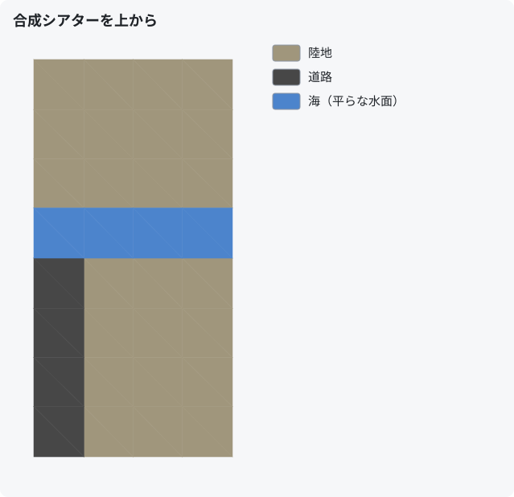
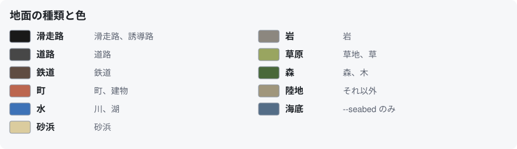

# レベルのファイル {#the-level-files}

レベルは地面の3Dモデルです。シアターは、DCS Worldでマップを指す言葉です。

`<out>/<name>.glb` と、その隣の `<name>.json`。

| 部品 | 中身 |
|---|---|
| `ground:<Level>` | 地形自身の三角形。ゲームがその上に描く重ね塗りで色分けされたもの |
| `water:<Level>` | ゲームが海面下と印を付けたすべての三角形。海面の高さに平らに置かれたもの |
| `structure:<Level>` | シアターの建物を箱として。ゲームが置いている場所に（下記） |

色は次の種類を表します:

色は、ビューアの背景/レベルパネルの **取得した色** で表示されます。各地面の三角形は、ゲームがその上に描く重ね塗りの種類をとります:

| 種類 | 色 | ゲームの重ね塗りから |
|---|---|---|
| runway | ほぼ黒 | `Runway` - 滑走路、誘導路、エプロン |
| road | 濃いグレー | `Road` |
| rail | 茶色 | `Rail` |
| town | レンガ色 | `Town`、`Building` |
| water | 青 | `River`、`Lake`（内陸の水。地面として描かれる） |
| beach | 砂色 | `Beach` |
| rock | グレー | `Rock` |
| field | 明るい緑 | `Field`、`Grass` |
| forest | 濃い緑 | `Forest`、`Trees` |
| land | カーキ色 | どれにも当てはまらない |
| seabed | スレート青 | `--seabed` を付けた場合のみ |

いくつかの重ね塗りが同じ三角形を描いている場合は、この表の順序で決まります（森の中の道路は道路です）。すべての重ね塗りの三角形は、地面自身のものの一つです。試した各シアターのすべての種類で確認し、すべてが一致しました。そのため、種類は近くの点から推測したものではなく、正確です。

**座標** は、DCS自身の世界のメートルです。北へ x、上へ y、東へ z。glTFの軸も同じです（X = x、Y = y、Z = z）。DCSのメートルでのテレメトリ（3DHeat WatcherのDCSフックがまさにそれを書きます）は、ビューアの既定の設定（Yが上、スケール 1）で、配置の手順なしにレベルへ重なります。

**緯度と経度:** どのシアターも、独自の定数を持つ横メルカトル図法です。`<name>.json` にその定数、レベルの四隅の緯度・経度、そして各町の緯度・経度とDCSの x/z の両方を含みます。シアターの定数が公開されていない場合は、そのシアター自身の `beacons.lua` が両方の座標系で与える標識に合わせて求めます（二乗平均平方根で数cm。同じ方法で、他のシアターの公開された定数も、ミリメートル単位まで再現します）。定数のないシアターについては、両方を含む記録（1回のフライトのWatcherセッションなど）から [`fit`](fit.md) が求めます。

**海底** は除外されます（フライトシミュレーターのヒートマップに海底は要りません）。`--seabed` を付けると地面として残ります。`--no-water` は平らな海を除きます。

**サイズ。** [レベルを作る: サイズ](level.md#サイズ) を参照してください。

**飛行場。** 各 `AirfieldsTaxiways/<name>.rn4` には、一つの飛行場の誘導路網が入っていて、その名前が付いています。その点は、DCSのメートルでの (x, y, z) の倍精度です。レベルの `.json` には、その範囲内のすべての飛行場が、その名前（ファイルのもの）、点の箱の中心、箱、そしてそこの地面の高さとともに挙げられています。試したシアターでは、すべての飛行場ファイルが読め、それぞれが自分の飛行場の上に置かれました（測量された空港の基準点から数百メートル以内。滑走路ではなく誘導路の中心です）。

**建物。** `Scenes/<theatre>.scn5` は、シアターのすべてのオブジェクト（木、街灯、フェンス、電線、家など、何百万もの配置）を配置しています。名前と大きさで建物とされるもの（家、アパート、小屋、格納庫、工場、塔、ターミナル。モデルの一部で、数十万の配置）は、箱として描かれます。各モデル自身の、ファイルにあるバウンディングボックスを、その向きに回し、ゲームが置いている場所に立てます。その高さは、原点の3m下（斜面での基礎）から頂上まで。木、低木、ライト、柱、電線、フェンス、壁、標識、乗り物、貨車、船、クレーン、マスト、鉄塔、橋は除外されます。ゲームのモデルの形もテクスチャもコピーしていません。建物ごとに一つの箱で、種類（家、ブロック、工業、飛行場、塔、その他）で色分けされます。`<name>.json` にもそれらが挙げられます（`buildings.rows`: x、z、基部、高さ、半分の長さ、向き、種類）。これはビューアのハイブリッド背景が使うもので、マップ化された建物の代わりに、ゲームの町の中にそれを描きます。`--no-buildings` で除外されます。

`<name>.json` には、元のファイル、そのサイズと日付、読んだタイル、種類ごとの三角形の数、そしてシアターの町のうち地面に乗った数も記録されます。これは投影法の確認で、「N of N」と表示されるはずです。

レベルは、名前付きの部品を持つglTFのバイナリです。すべての3DHeatのレベルと同じです。ビューアの[レベル](https://holdi601.github.io/3DHeat/levels.html)のページが、それらの読み込み方を説明しています。
