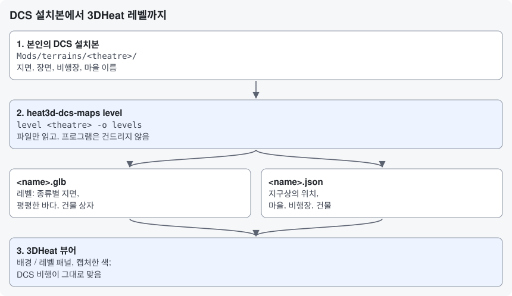

# 3DHeat DCS {#dheat-dcs}

**무엇입니까?** theatre는 DCS World가 맵을 부르는 말입니다. 비행하며 내려다보는 세계의 한 지역이지요. 이 도구는 **본인의 설치본**에서 읽은 한 맵의 지면을, [3DHeat](https://github.com/Holdi601/3DHeat) 뷰어를 위한 3D 레벨로 바꿉니다. 그 위를 날아다닐 수 있는 모델입니다([문서](https://holdi601.github.io/3DHeat/)).

**왜 씁니까?** 게임 자체의 맵 위에서 DCS 비행을 보기 위해서입니다. 언덕, 해안, 비행장, 도로, 철도, 마을과 건물을 그대로 볼 수 있습니다.

**예시:** `heat3d-dcs-maps level <theatre> -o levels` ->
`levels/<theatre>.glb` (레벨) + `levels/<theatre>.json` (지구상의 위치, 마을과 비행장).

이런 일에 쓸 수 있습니다:

- **게임 자체의 맵 위 비행.** 3DHeat 세계 배경은 오늘날의 지구를 공개 데이터로 그립니다. 이 도구는 DCS가 그리는 그대로 맵을 그립니다.
- **위치 맞추기 단계가 없습니다.** 레벨은 DCS 자체의 세계 미터 단위로 되어 있으므로, DCS 미터 단위의 텔레메트리(3DHeat Watcher의 DCS 연동이 바로 그렇게 기록합니다)는 뷰어의 기본값으로 그대로 맞습니다.
- **위도와 경도.** 모든 레벨은 투영, 모서리, 마을을 두 좌표계 모두로 담고 있습니다.



## 빠른 시작 {#quick-start}

명령줄이 처음입니까? 먼저 [시작하기 전에](before-you-start.md)를 읽으세요. 복제하거나 압축을 푼 폴더에서 다음을 실행하세요:

```bash
python -m pip install -e .                         # heat3d-dcs-maps 명령을 설치합니다
heat3d-dcs-maps list                               # 설치된 맵과, 각각 읽을 수 있는지
heat3d-dcs-maps level <theatre> -o levels          # 작은 맵 전체
heat3d-dcs-maps level <theatre> --around <lat> <lon> 12 -o levels --name <name>   # 한 점의 양옆 12km씩
```

`list`는 맵마다 한 줄씩 출력하며, 줄의 끝은 `readable`이어야 합니다.
그다음 뷰어의 배경 / 레벨 패널에서 `levels/<name>.glb`를 불러오세요 ([레벨](https://holdi601.github.io/3DHeat/levels.html)).

이 도구가 쓰는 레벨은 게임의 데이터로 만든 것입니다. 그러므로 보는 용도로 **본인의 컴퓨터에만** 두고, 공유하거나 게시하지 마세요 ([약관](terms.md)).

## 페이지 {#pages}

| 페이지 | 내용 |
|---|---|
| [시작하기 전에](before-you-start.md) | Python, 터미널, 첫 실행 |
| [맵 찾기: list](list.md) | 설치 위치를 찾는 방법, `list`가 출력하는 것 |
| [레벨 만들기: level](level.md) | 모든 옵션, 영역, 크기, 단계별 안내 |
| [레벨 파일](output.md) | `.glb` 부분들, 지면 종류와 색, `.json`, 좌표 |
| [지명: 마을](towns.md) | 맵의 마을들과 DCS 좌표 |
| [투영: fit](fit.md) | 기록에서 맵의 투영 찾기 |
| [파일을 읽는 방법](reading.md) | 형식, 검증한 내용, 읽지 않는 것 |
| [약관과 라이선스](terms.md) | Eagle Dynamics의 라이선스, 그리고 이것이 별도의 패키지인 이유 |
| [명령 참조](../cli-reference.md) | 코드에서 만든, 모든 옵션 |
| [문서 관리](maintaining.md) | 릴리스 체크리스트 |

## 관련 자료 {#related}

- 3DHeat 뷰어: [github.com/Holdi601/3DHeat](https://github.com/Holdi601/3DHeat),
  문서는 [holdi601.github.io/3DHeat](https://holdi601.github.io/3DHeat/)에 있습니다.
- 이 레벨들의 텔레메트리: [3DHeat Watcher](https://holdi601.github.io/3DHeat-Watcher/)가 DCS 비행을 기록합니다. 뷰어의 파일 형식, 매치 하나를 파일 하나에 담는 컨테이너 포함, 은 [매치 하나를 파일 하나로 (.3dheat)](https://holdi601.github.io/3DHeat/container.html)에 설명되어 있습니다.

## 3DHeat 도구들 {#the-3dheat-tools}

| 도구 | 하는 일 | 코드 | 문서 |
|---|---|---|---|
| 3DHeat 뷰어 | 데이터를 보여 줍니다: 히트맵, 레이스 분석, 매치 리뷰 | [3DHeat](https://github.com/Holdi601/3DHeat) | [문서](https://holdi601.github.io/3DHeat/) |
| GameFiles | 게임 자체 파일에서 얻는 레벨과 코스 | [3DHeat-GameFiles](https://github.com/Holdi601/3DHeat-GameFiles) | [문서](https://holdi601.github.io/3DHeat-GameFiles/) |
| GameCapture | 랩 텔레메트리, 그리고 게임 영상에서 복원한 레벨 | [3DHeat-GameCapture](https://github.com/Holdi601/3DHeat-GameCapture) | [문서](https://holdi601.github.io/3DHeat-GameCapture/) |
| Unreal Exporter | 레벨을 `.glb` 하나로 내보내는 Unreal 에디터 플러그인 | [3DHeat-UnrealExporter](https://github.com/Holdi601/3DHeat-UnrealExporter) | [문서](https://holdi601.github.io/3DHeat-UnrealExporter/) |
| CS2 | Counter-Strike 2 데모와 맵 | [3DHeat-CS2](https://github.com/Holdi601/3DHeat-CS2) | [문서](https://holdi601.github.io/3DHeat-CS2/) |
| Watcher | 플레이하는 동안 게임이 공개하는 데이터를 기록합니다 | [3DHeat-Watcher](https://github.com/Holdi601/3DHeat-Watcher) | [문서](https://holdi601.github.io/3DHeat-Watcher/) |
| Ext-WarThunder | 워 썬더 리플레이 | [3DHeat-Ext-WarThunder](https://github.com/Holdi601/3DHeat-Ext-WarThunder) | [문서](https://holdi601.github.io/3DHeat-Ext-WarThunder/) |
| Ext-WoT | 월드 오브 탱크 리플레이 | [3DHeat-Ext-WoT](https://github.com/Holdi601/3DHeat-Ext-WoT) | [문서](https://holdi601.github.io/3DHeat-Ext-WoT/) |
| Ext-WoWs | 월드 오브 워십 리플레이 | [3DHeat-Ext-WoWs](https://github.com/Holdi601/3DHeat-Ext-WoWs) | [문서](https://holdi601.github.io/3DHeat-Ext-WoWs/) |
| Ext-Squad | Squad 서버 데모 | [3DHeat-Ext-Squad](https://github.com/Holdi601/3DHeat-Ext-Squad) | [문서](https://holdi601.github.io/3DHeat-Ext-Squad/) |
| Ext-DCS | DCS World 맵을 3D 레벨로 | [3DHeat-Ext-DCS](https://github.com/Holdi601/3DHeat-Ext-DCS) | [문서](https://holdi601.github.io/3DHeat-Ext-DCS/) |
| Ext-IL2 | IL-2 Sturmovik 맵을 3D 레벨로 | [3DHeat-Ext-IL2](https://github.com/Holdi601/3DHeat-Ext-IL2) | [문서](https://holdi601.github.io/3DHeat-Ext-IL2/) |
