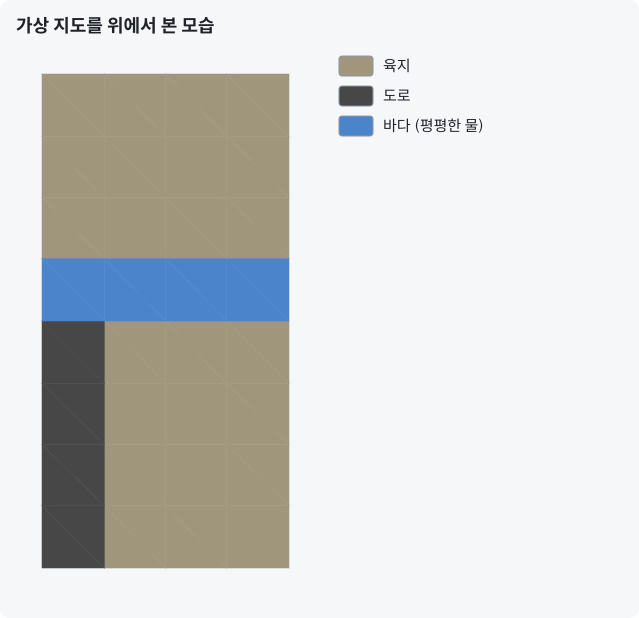
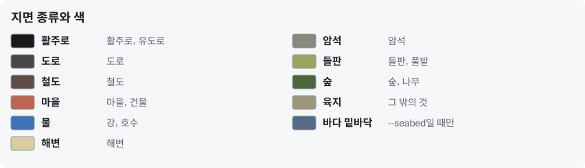

# 레벨 파일 {#the-level-files}

레벨은 지면의 3D 모델입니다. theatre는 DCS World가 맵을 부르는 말입니다.

`<out>/<name>.glb`와 그 옆의 `<name>.json`.

| 부분 | 뜻 |
|---|---|
| `ground:<Level>` | 지형 자체의 삼각형들. 게임이 그 위에 그리는 것에 따라 색이 칠해집니다 |
| `water:<Level>` | 게임이 바다 아래로 표시한 모든 삼각형을 해수면 높이에 평평하게 놓은 것 |
| `structure:<Level>` | 맵의 건물들을 상자로. 게임이 놓은 자리에 (아래 참고) |

색은 아래의 종류들입니다:

색은 뷰어의 배경 / 레벨 패널에서 **캡처한 색**을 켜면 보입니다. 지면의 각 삼각형은, 게임이 그 위에 그리는 덧칠(overlay)의 종류를 따릅니다:

| 종류 | 색 | 게임 덧칠에서 온 것 |
|---|---|---|
| runway | 거의 검정 | `Runway` - 활주로, 유도로, 계류장 |
| road | 진한 회색 | `Road` |
| rail | 갈색 | `Rail` |
| town | 벽돌색 | `Town`, `Building` |
| water | 파랑 | `River`, `Lake` (내륙 수역, 지면처럼 그려짐) |
| beach | 모래색 | `Beach` |
| rock | 회색 | `Rock` |
| field | 연한 초록 | `Field`, `Grass` |
| forest | 진한 초록 | `Forest`, `Trees` |
| land | 카키색 | 위 어느 것도 아님 |
| seabed | 슬레이트 파랑 | `--seabed`를 쓸 때만 |

여러 덧칠이 같은 삼각형을 그리면 표의 순서가 정합니다(숲을 지나는 도로는 도로입니다). 모든 덧칠 삼각형은 지면 자체의 삼각형 중 하나입니다. 시도한 맵들의 모든 종류에서 확인했으며, 전부 일치했습니다. 그러므로 종류는 근처 점에서 짐작한 것이 아니라 정확한 값입니다.

**좌표**는 DCS 자체의 세계 미터입니다. x는 북쪽, y는 위, z는 동쪽이며, glTF 축도 같습니다(X = x, Y = y, Z = z). DCS 미터 단위의 텔레메트리(3DHeat Watcher의 DCS 연동이 바로 그렇게 기록합니다)는 뷰어의 기본값(Y가 위, 배율 1)으로, 위치 맞추기 단계 없이 레벨에 놓입니다.

**위도와 경도:** 모든 맵은 각자 고유한 상수를 가진 횡메르카토르 투영입니다. `<name>.json`에 그 상수, 레벨의 모서리를 위도와 경도로 쓴 값, 그리고 모든 마을을 위도/경도와 DCS x/z 두 값으로 담습니다. 맵의 상수가 공개되지 않은 경우, 그 맵의 `beacons.lua`가 두 좌표계 모두로 주는 비콘에 맞춰 상수를 구합니다(평균 제곱근 오차 몇 cm. 같은 방법으로 다른 맵의 공개 상수를 밀리미터 단위까지 되찾습니다). 상수가 없는 맵이라면, 두 값을 모두 담은 기록(예: 한 비행의 Watcher 세션)에서 [`fit`](fit.md)이 상수를 찾아냅니다.

**바다 밑바닥**은 뺍니다(비행 시뮬레이터의 히트맵에는 바다 밑바닥이 필요 없습니다). `--seabed`를 쓰면 지면으로 남깁니다. `--no-water`는 평평한 바다를 뺍니다.

**크기.** [레벨 만들기: 크기](level.md#size)를 보세요.

**비행장.** 각 `AirfieldsTaxiways/<name>.rn4`에는 비행장 하나의 유도로 망이 들어 있고, 그 이름은 비행장의 이름을 따릅니다. 점들은 DCS 미터 단위의 (x, y, z) 배정밀도 값입니다. 레벨의 `.json`에는 영역 안의 모든 비행장이 이름(파일의 이름), 점들이 이루는 상자의 가운데, 그 상자, 그리고 그 자리의 지면과 함께 나열됩니다. 시도한 맵에서는 모든 비행장 파일을 읽었고, 각각 자기 지면 위에 놓였습니다(측량된 공항 기준점에서 수백 미터 이내입니다. 활주로가 아니라 유도로의 가운데를 기준으로 합니다).

**건물.** `Scenes/<theatre>.scn5`에는 맵의 모든 물체(수백만 개입니다. 나무, 가로등, 울타리, 전선, 집)가 놓여 있습니다. 이름과 크기로 건물인 것(집, 아파트, 헛간, 격납고, 공장, 탑, 터미널. 모델의 일부이며 배치는 수십만 개입니다)은 상자로 그립니다. 각 모델은 파일에 있는 자기 경계 상자를, 그 방향으로 돌리고, 게임이 놓은 자리에 세웁니다. 원점에서 3m 아래(경사면의 발판)부터 꼭대기까지입니다. 나무, 관목, 조명, 기둥, 전선, 울타리, 벽, 표지판, 차량, 객차, 배, 크레인, 돛대, 철탑, 다리는 뺍니다. 게임의 모델 형태나 텍스처는 하나도 복사하지 않습니다. 건물마다 상자 하나이며, 종류(house, block, industrial, airfield, tower, other)별로 색을 칠합니다. `<name>.json`에도 이 상자들이 나열됩니다(`buildings.rows`: x, z, 바닥, 높이, 반 길이, 방향, 종류). 뷰어의 혼합 배경이 이것을 씁니다. 그 배경은 매핑된 건물 대신 게임의 마을 안에 이것을 그립니다. `--no-buildings`를 쓰면 빠집니다.

`<name>.json`에는 원본 파일과 그 크기, 날짜, 읽은 타일, 종류별 삼각형 수, 그리고 맵의 마을 중 몇 개가 지면 위에 놓이는지도 기록됩니다. 이 값은 "N of N"(N개 중 N개)이어야 하는, 투영의 검사입니다.

레벨은 모든 3DHeat 레벨과 같이 이름 붙은 부분을 가진 glTF 바이너리입니다. 뷰어의 [레벨](https://holdi601.github.io/3DHeat/levels.html) 페이지가 불러오는 방법을 설명합니다.
