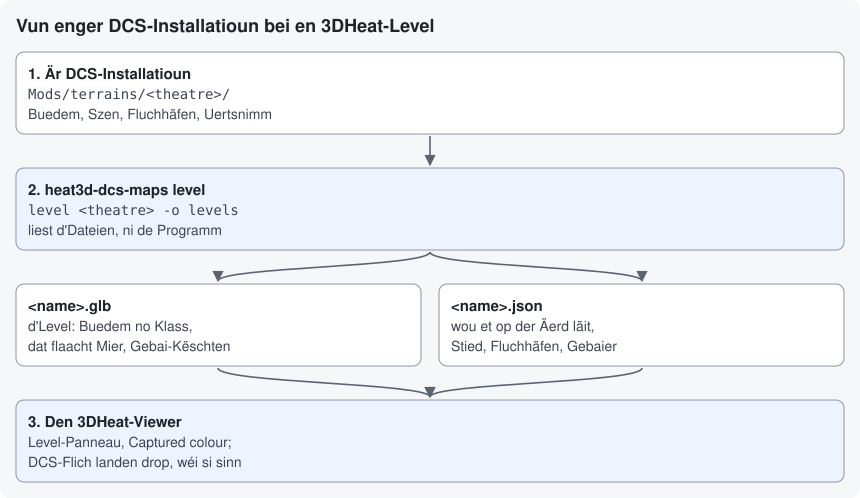

# 3DHeat DCS {#dheat-dcs}

**Wat ass et?** E Theater ass dem DCS World säi Wuert fir eng Map: eng Regioun vun der
Welt, iwwer déi Dir fliegt. Dëst Tool verwandelt de Buedem vun engem Theater, gelies aus
**Ärer eegener Installatioun**, an en 3D-Level - e Modell, iwwer dat Dir fléie kënnt - fir den
[3DHeat](https://github.com/Holdi601/3DHeat)-Viewer
([Dokumentatioun](https://holdi601.github.io/3DHeat/)).

**Firwat sollt ech et benotzen?** Fir Är DCS-Flich iwwer dem Spill seng eegen Map ze gesinn: seng
Hiwwele, Küst, Fluchhäfen, Stroossen, Eisebunnen, Stied a Gebaier.

**Beispill:** `heat3d-dcs-maps level <theatre> -o levels` ->
`levels/<theatre>.glb` (d'Level) + `levels/<theatre>.json` (wou et op
der Äerd läit, seng Stied a Fluchhäfen).

Wofir et nëtzlech ass:

- **Flich op dem Spill seng eegener Map.** Den 3DHeat-Weltuergrond zeechent d'Äerd vun haut
  aus oppenen Daten; dëst zeechent d'Theater esou, wéi DCS et zeechent.
- **Kee Placement-Schrëtt.** D'Level ass an de Weltmeter vun DCS selwer, sou datt Telemetrie
  a DCS-Meter (dem 3DHeat-Watcher säin DCS-Hook schreift genau dat) mat de Standarden
  vum Viewer drop landet.
- **Breeden- a Längtegrad.** All Level dréit seng Projektioun, seng Ecken
  a seng Stied a béide Koordinatesystemer.



## Séier Start {#quick-start}

Nei op der Kommandozeil? Liest fir d'éischt [Ier Dir ufänkt](before-you-start.md).
Féiert dës an dem Ordner aus, deen Dir gekloont oder entzippt hutt:

```bash
python -m pip install -e .                         # installs the heat3d-dcs-maps command
heat3d-dcs-maps list                               # the theatres installed, and whether each can be read
heat3d-dcs-maps level <theatre> -o levels          # a whole (small) theatre
heat3d-dcs-maps level <theatre> --around <lat> <lon> 12 -o levels --name <name>   # 12 km either side of a point
```

Dir sollt eng Zeil pro Theater vun `list` gesinn, déi mat `readable` ophält.
Dann lued `levels/<name>.glb` am Level-Panneau vum Viewer
([Levelen](https://holdi601.github.io/3DHeat/levels.html)).

D'Levelen, déi et schreift, si vun de Daten vum Spill gebaut: si bleiwen **op Ärem
Rechner**, fir ze kucken, net fir ze deelen oder ze publizéieren ([Bedingungen](terms.md)).

## Säiten {#pages}

| Säit | Wat se ofdeckt |
|---|---|
| [Ier Dir ufänkt](before-you-start.md) | Python, e Terminal, e éischte Start |
| [Theatere fannen: list](list.md) | wou d'Installatioun fonnt gëtt, wat `list` ausgëtt |
| [E Level bauen: level](level.md) | all Optioun, Regiounen, Gréisst, Schrëtt fir Schrëtt |
| [D'Level-Dateien](output.md) | d'`.glb`-Deeler, d'Buedemklassen an hir Faarwen, den `.json`, d'Koordinaten |
| [Uertsnimm: towns](towns.md) | d'Stied vun engem Theater mat DCS-Koordinaten |
| [Projektiounen: fit](fit.md) | d'Projektioun vun engem Theater aus enger Opnam fannen |
| [Wéi d'Dateie gelies ginn](reading.md) | d'Formater, wat gepréift gouf, wat net gelies gëtt |
| [Bedingungen a Lizenz](terms.md) | d'Lizenz vun Eagle Dynamics, a firwat dëst e getrennte Package ass |
| [Kommando-Referenz](../cli-reference.md) | all Optioun, aus dem Code generéiert |
| [Dës Dokumentatioun ënnerhalen](maintaining.md) | d'Release-Checklëscht |

## Verwandt {#related}

- Den 3DHeat-Viewer: [github.com/Holdi601/3DHeat](https://github.com/Holdi601/3DHeat),
  Dokumentatioun op [holdi601.github.io/3DHeat](https://holdi601.github.io/3DHeat/).
- Telemetrie fir dës Levelen: den [3DHeat Watcher](https://holdi601.github.io/3DHeat-Watcher/)
  zeechent DCS-Flich op; d'Dateiformater vum Viewer, och säi
  Container mat enger Datei pro Match, si beschriwwen an
  [Eng Datei pro Match (.3dheat)](https://holdi601.github.io/3DHeat/container.html).

## Déi 3DHeat-Tools {#the-3dheat-tools}

| Tool | Wat et mécht | Code | Docs |
|---|---|---|---|
| 3DHeat-Viewer | weist d'Daten: Heatmaps, Course-Analys, Match-Iwwerpréiwung | [3DHeat](https://github.com/Holdi601/3DHeat) | [Docs](https://holdi601.github.io/3DHeat/) |
| GameFiles | Levelen a Course aus de Dateie vun engem Spill | [3DHeat-GameFiles](https://github.com/Holdi601/3DHeat-GameFiles) | [Docs](https://holdi601.github.io/3DHeat-GameFiles/) |
| GameCapture | Ronn-Telemetrie, a Levelen aus Gameplay-Video nei opgebaut | [3DHeat-GameCapture](https://github.com/Holdi601/3DHeat-GameCapture) | [Docs](https://holdi601.github.io/3DHeat-GameCapture/) |
| Unreal Exporter | en Unreal-Editor-Plugin: e Level als eng `.glb` | [3DHeat-UnrealExporter](https://github.com/Holdi601/3DHeat-UnrealExporter) | [Docs](https://holdi601.github.io/3DHeat-UnrealExporter/) |
| CS2 | Counter-Strike-2-Demoen a -Mappen | [3DHeat-CS2](https://github.com/Holdi601/3DHeat-CS2) | [Docs](https://holdi601.github.io/3DHeat-CS2/) |
| Watcher | hält fest, wat Spiller wärend dem Spillen publizéieren | [3DHeat-Watcher](https://github.com/Holdi601/3DHeat-Watcher) | [Docs](https://holdi601.github.io/3DHeat-Watcher/) |
| Ext-WarThunder | War-Thunder-Replays | [3DHeat-Ext-WarThunder](https://github.com/Holdi601/3DHeat-Ext-WarThunder) | [Docs](https://holdi601.github.io/3DHeat-Ext-WarThunder/) |
| Ext-WoT | World-of-Tanks-Replays | [3DHeat-Ext-WoT](https://github.com/Holdi601/3DHeat-Ext-WoT) | [Docs](https://holdi601.github.io/3DHeat-Ext-WoT/) |
| Ext-WoWs | World-of-Warships-Replays | [3DHeat-Ext-WoWs](https://github.com/Holdi601/3DHeat-Ext-WoWs) | [Docs](https://holdi601.github.io/3DHeat-Ext-WoWs/) |
| Ext-Squad | Squad-Server-Demoen | [3DHeat-Ext-Squad](https://github.com/Holdi601/3DHeat-Ext-Squad) | [Docs](https://holdi601.github.io/3DHeat-Ext-Squad/) |
| Ext-DCS | DCS-World-Mappen als 3D-Levelen | [3DHeat-Ext-DCS](https://github.com/Holdi601/3DHeat-Ext-DCS) | [Docs](https://holdi601.github.io/3DHeat-Ext-DCS/) |
| Ext-IL2 | IL-2-Sturmovik-Mappen als 3D-Levelen | [3DHeat-Ext-IL2](https://github.com/Holdi601/3DHeat-Ext-IL2) | [Docs](https://holdi601.github.io/3DHeat-Ext-IL2/) |
