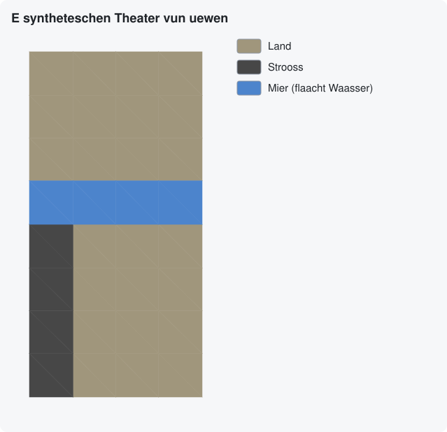
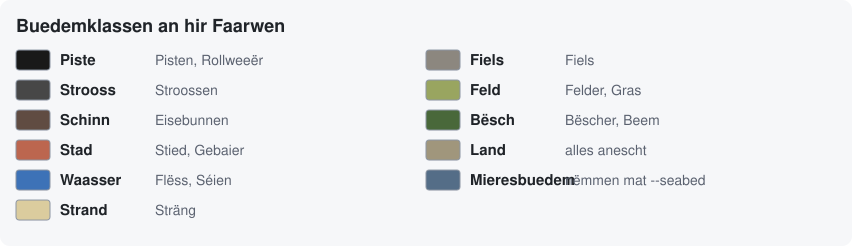

# D'Level-Dateien {#the-level-files}

E Level ass en 3D-Modell vum Buedem; e Theater ass dem DCS World säi Wuert fir eng Map.

`<out>/<name>.glb` an `<name>.json` doniewendrun.

| Deel | Wat et ass |
|---|---|
| `ground:<Level>` | dem Terrain seng eegen Dräiecker, agefierft nodeems, wat d'Spill driwwer zeechent |
| `water:<Level>` | all Dräieck, dat d'Spill als ënner dem Mier markéiert, flaach op Mieresniveau geluecht |
| `structure:<Level>` | d'Gebaier vum Theater als Këschten, wou d'Spill se hisetzt (ënnen) |

D'Faarwe si d'Klassen hei ënnen:

D'Faarwe weisen sech mat **Captured colour** am Level-Panneau vum Viewer. All
Buedem-Dräieck kritt d'Klass vum Overlay, mat deem d'Spill et zeechent:

| Klass | Faarf | Vum Overlay vum Spill |
|---|---|---|
| runway | bal schwaarz | `Runway` - Pisten, Rollweeër a Vorfelder |
| road | donkelgro | `Road` |
| rail | brong | `Rail` |
| town | zillenrout | `Town`, `Building` |
| water | blo | `River`, `Lake` (Bannegewässer, als Buedem gezeechent) |
| beach | Sand | `Beach` |
| rock | gro | `Rock` |
| field | hellgréng | `Field`, `Grass` |
| forest | donkelgréng | `Forest`, `Trees` |
| land | khaki | keen vun dësen |
| seabed | schiefer-blo | nëmmen mat `--seabed` |

Wou e puer Overlays dat selwecht Dräieck zeechnen, entscheet d'Reihenfolleg vun der Tabell
(eng Strooss duerch e Bësch ass Strooss). All Overlay-Dräieck ass ee vun den
eegenen vum Buedem - gepréift bei all Klass vun den Theatere, déi probéiert goufen, all ee huet gepasst - also
sinn d'Klassen exakt, net aus Punkten an der Noperschaft geroden.

**Koordinaten** sinn dem DCS seng eegen Weltmeter: x Norden, y no uewen, z Osten, an
d'glTF-Achse sinn déiselwecht (X = x, Y = y, Z = z). Telemetrie a DCS-Meter - dem
3DHeat Watcher säin DCS-Hook schreift genau dat - landet mat de Standarde vum
Viewer (Y no uewen, Skala 1) um Level, ouni Placement-Schrëtt.

**Breeden- a Längtegrad:** all Theater ass eng Transverse-Mercator-Projektioun
mat eegene Konstanten; `<name>.json` dréit se, d'Ecke vum Level a Breeden- a
Längtegrad, an all Stad souwuel mat hirem Breeden-/Längtegrad wéi mat hirem DCS-x/z. Wou d'Konstante vun engem Theater net publizéiert sinn, ginn se un
d'Beaconen gefëttt, déi säin eegent `beacons.lua` an deenen zwee Koordinatesystemer gëtt (e puer cm Root-Mean-
Square; dee selwechte Fit gëtt déi publizéiert Konstante vun anere Theatere op de Millimeter zeréck).
Fir en Theater ouni Konstanten fënnt [`fit`](fit.md) se aus all
Opnam, déi béid hält, zum Beispill eng Watcher-Sessioun vun engem Fluch.

**De Mieresbuedem** gëtt ausgelooss (eng Fluchsim-Heatmap brauch de Mieresbuedem
net); `--seabed` hält en als Buedem. `--no-water` léisst dat flaacht Mier
aus.

**Gréisst.** Kuckt [E Level bauen: Gréisst](level.md#size).

**Fluchhäfen.** All `AirfieldsTaxiways/<name>.rn4` hält dat Rollwee-
Netz vun engem Fluchhafen, no him benannt; seng Punkte sinn (x, y, z)-Doubles a DCS-Meter. Dem
Level säin `.json` lëscht all Fluchhafen an der Regioun mat sengem Numm (dee vun der
Datei), der Mëtt vun der Këscht vu senge Punkten, der Këscht, an dem Buedem do. Beim Theater, dat probéiert gouf, huet sech all Fluchhafen-Datei liese gelooss, all op sengem Feld plazéiert
(bannent e puer honnert Meter vum vermiessene Fluchhafen-Referenzpunkt: der
Mëtt vun de Rollweeër, net vun der Piste).

**Gebaier.** `Scenes/<theatre>.scn5` placéiert all Objet vum Theater
(Millioune - Beem, Lampen, Zäun, Drot, Haiser). Déi, déi
no Numm a Gréisst Gebaier sinn (Haiser, Wunnengen, Schapen, Hangaren,
Fabriken, Tierm, Terminaler: e Bruchdeel vun de Modeller, Honnertdausende vu Placementer) ginn als Këschten gezeechent: dem Modell seng eegen Bounding-Box aus der
Datei, op säin Heading gedréint a wou d'Spill se hisetzt, vun bis zu
3 m ënner sengem Urspronk (säi Fundament op engem Hang) bis bei säi Spëtz. Beem, Sträich,
Luuchten, Poteaen, Drot, Zäun, Maueren, Schëlder, Gefierer, Wagonen, Boote, Kranen,
Masten, Pylonen a Bréck ginn ausgelooss. Keng Modellform an keng Textur vum
Spill gëtt kopéiert: eng Këscht pro Gebai, agefierft no Zort (Haus, Block,
Industrie, Fluchhafen, Tuerm, anert). `<name>.json` lëscht se och
(`buildings.rows`: x, z, base, height, half lengths, heading, kind) fir
den Hybrid-Uergrond vum Viewer, deen se an de Stied vum Spill zeechent amplaz vun
de gemappte Gebaier. `--no-buildings` léisst se aus.

`<name>.json` hält och d'Quelldatei, hir Gréisst an hiren Datum, d'Kachele,
déi gelies goufen, d'Dräieckszuel pro Klass, a wéi vill vun de Stied vum Theater um Buedem
landen - e Check vun der Projektioun, dee "N of N" soe soll.

D'Level ass eng glTF-Binärdatei mat benannten Deeler, wéi all 3DHeat-Level; d'Säit
[Levelen](https://holdi601.github.io/3DHeat/levels.html) vum Viewer seet, wéi en se lued.
