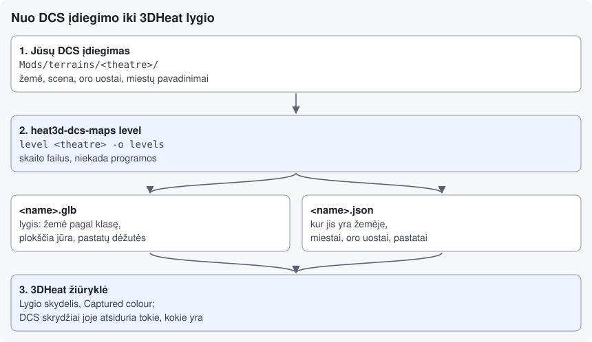

# 3DHeat DCS {#dheat-dcs}

**Kas tai?** Teatras – tai DCS World žodis žemėlapiui: vietovės regionas, virš kurio skraidote. Šis
įrankis paverčia vieno teatro žemę, perskaitytą iš **jūsų pačių įdiegimo**, 3D lygiu – modeliu, virš kurio galima
skraidyti – skirtu [3DHeat](https://github.com/Holdi601/3DHeat) žiūryklei
([dokumentacija](https://holdi601.github.io/3DHeat/)).

**Kam tai naudoti?** Kad matytumėte savo DCS skrydžius ant paties žaidimo žemėlapio: jo kalvas, pakrantę,
oro uostus, kelius, geležinkelius, miestus ir pastatus.

**Pavyzdys:** `heat3d-dcs-maps level <theatre> -o levels` ->
`levels/<theatre>.glb` (lygis) + `levels/<theatre>.json` (kur jis yra žemės paviršiuje, jo miestai ir oro uostai).

Kam tai naudinga:

- **Skrydžiai ant paties žaidimo žemėlapio.** 3DHeat pasaulio fonas šiandien piešia Žemę pagal atvirus
  duomenis; šis įrankis piešia teatrą taip, kaip jį piešia DCS.
- **Nereikia vietos parinkimo.** Lygis yra DCS pasaulio metrais, todėl telemetrija DCS metrais
  (3DHeat Watcher DCS jungtis rašo būtent tai) į jį patenka su žiūryklės numatytosiomis reikšmėmis.
- **Platuma ir ilguma.** Kiekvienas lygis turi savo projekciją, kampus ir miestus abiejose sistemose.



## Greita pradžia {#quick-start}

Nesate įpratę prie komandinės eilutės? Pirmiausia perskaitykite [Prieš pradedant](before-you-start.md).
Vykdykite šias komandas aplanke, į kurį klonavote ar išskleidėte įrankį:

```bash
python -m pip install -e .                         # įdiegia komandą heat3d-dcs-maps
heat3d-dcs-maps list                               # įdiegti teatrai ir ar kiekvienas gali būti nuskaitytas
heat3d-dcs-maps level <theatre> -o levels          # visas (mažas) teatras
heat3d-dcs-maps level <theatre> --around <lat> <lon> 12 -o levels --name <name>   # 12 km į abi puses nuo taško
```

Iš `list` turėtumėte matyti po vieną eilutę kiekvienam teatrui, baigiančią `readable`.
Tada įkelkite `levels/<name>.glb` žiūryklės lygių skydelyje
([Lygiai](https://holdi601.github.io/3DHeat/levels.html)).

Lygiai, kuriuos jis įrašo, sukurti iš žaidimo duomenų, todėl jie lieka **jūsų kompiuteryje**: žiūrėti, o ne dalintis
ar skelbti ([Sąlygos](terms.md)).

## Puslapiai {#pages}

| Puslapis | Ką jame rasite |
|---|---|
| [Prieš pradedant](before-you-start.md) | Python, terminalas, pirmas paleidimas |
| [Teatrų paieška: list](list.md) | kur randamas įdiegimas, ką išveda `list` |
| [Lygio kūrimas: level](level.md) | kiekviena parinktis, regionai, dydis, žingsnis po žingsnio |
| [Lygio failai](output.md) | `.glb` dalys, žemės klasės ir jų spalvos, `.json`, koordinatės |
| [Vietovardžiai: miestai](towns.md) | teatro miestai su DCS koordinatėmis |
| [Projekcijos: fit](fit.md) | teatro projekcijos radimas pagal įrašą |
| [Kaip skaitomi failai](reading.md) | formatai, kas patikrinta, kas neskaitoma |
| [Sąlygos ir licencija](terms.md) | Eagle Dynamics licencija ir kodėl tai atskiras paketas |
| [Komandų nuoroda](../cli-reference.md) | kiekviena parinktis, sugeneruota iš kodo |
| [Šių dokumentų priežiūra](maintaining.md) | išleidimo kontrolinis sąrašas |

## Susiję {#related}

- 3DHeat žiūryklė: [github.com/Holdi601/3DHeat](https://github.com/Holdi601/3DHeat),
  dokumentacija – [holdi601.github.io/3DHeat](https://holdi601.github.io/3DHeat/).
- Šių lygių telemetrija: [3DHeat Watcher](https://holdi601.github.io/3DHeat-Watcher/)
  įrašo DCS skrydžius; žiūryklės failų formatai, įskaitant vieno failo rungtynių konteinerį, aprašyti
  [Vienas failas rungtynėms (.3dheat)](https://holdi601.github.io/3DHeat/container.html).

## 3DHeat įrankiai {#the-3dheat-tools}

| Įrankis | Ką daro | Kodas | Dokumentacija |
|---|---|---|---|
| 3DHeat žiūryklė | rodo duomenis: šilumos žemėlapius, lenktynių analizę, rungtynių apžvalgą | [3DHeat](https://github.com/Holdi601/3DHeat) | [dokumentacija](https://holdi601.github.io/3DHeat/) |
| GameFiles | lygiai ir trasos iš žaidimo pačio failų | [3DHeat-GameFiles](https://github.com/Holdi601/3DHeat-GameFiles) | [dokumentacija](https://holdi601.github.io/3DHeat-GameFiles/) |
| GameCapture | ratų telemetrija ir lygiai, atkurti iš žaidimo vaizdo | [3DHeat-GameCapture](https://github.com/Holdi601/3DHeat-GameCapture) | [dokumentacija](https://holdi601.github.io/3DHeat-GameCapture/) |
| Unreal Exporter | Unreal Editor papildinys: lygis kaip vienas `.glb` | [3DHeat-UnrealExporter](https://github.com/Holdi601/3DHeat-UnrealExporter) | [dokumentacija](https://holdi601.github.io/3DHeat-UnrealExporter/) |
| CS2 | Counter-Strike 2 demo ir žemėlapiai | [3DHeat-CS2](https://github.com/Holdi601/3DHeat-CS2) | [dokumentacija](https://holdi601.github.io/3DHeat-CS2/) |
| Watcher | įrašo, ką žaidimai skelbia, kol žaidžiate | [3DHeat-Watcher](https://github.com/Holdi601/3DHeat-Watcher) | [dokumentacija](https://holdi601.github.io/3DHeat-Watcher/) |
| Ext-WarThunder | War Thunder įrašai | [3DHeat-Ext-WarThunder](https://github.com/Holdi601/3DHeat-Ext-WarThunder) | [dokumentacija](https://holdi601.github.io/3DHeat-Ext-WarThunder/) |
| Ext-WoT | World of Tanks įrašai | [3DHeat-Ext-WoT](https://github.com/Holdi601/3DHeat-Ext-WoT) | [dokumentacija](https://holdi601.github.io/3DHeat-Ext-WoT/) |
| Ext-WoWs | World of Warships įrašai | [3DHeat-Ext-WoWs](https://github.com/Holdi601/3DHeat-Ext-WoWs) | [dokumentacija](https://holdi601.github.io/3DHeat-Ext-WoWs/) |
| Ext-Squad | Squad serverių demo | [3DHeat-Ext-Squad](https://github.com/Holdi601/3DHeat-Ext-Squad) | [dokumentacija](https://holdi601.github.io/3DHeat-Ext-Squad/) |
| Ext-DCS | DCS World žemėlapiai kaip 3D lygiai | [3DHeat-Ext-DCS](https://github.com/Holdi601/3DHeat-Ext-DCS) | [dokumentacija](https://holdi601.github.io/3DHeat-Ext-DCS/) |
| Ext-IL2 | IL-2 Sturmovik žemėlapiai kaip 3D lygiai | [3DHeat-Ext-IL2](https://github.com/Holdi601/3DHeat-Ext-IL2) | [dokumentacija](https://holdi601.github.io/3DHeat-Ext-IL2/) |
