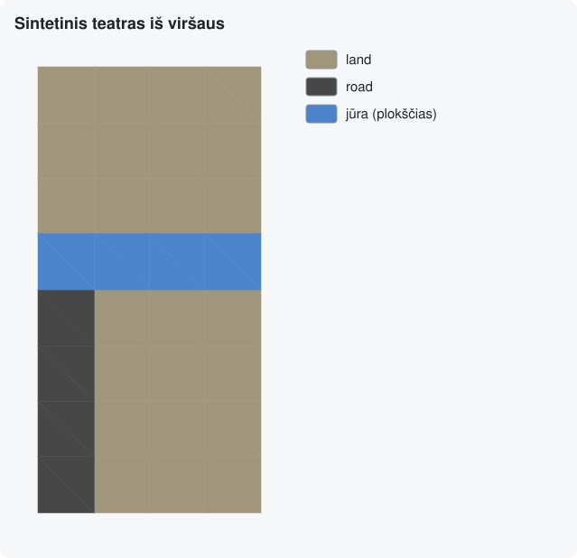
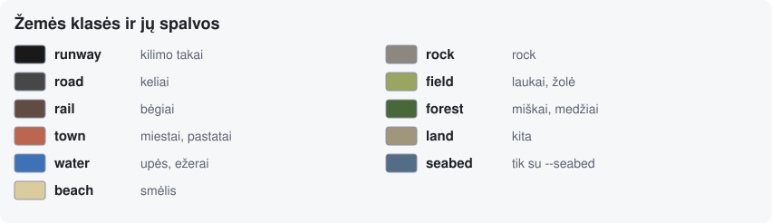

# Lygio failai {#the-level-files}

Lygis – tai 3D žemės modelis; teatras yra DCS World žodis žemėlapiui.

`<out>/<name>.glb` ir šalia jo `<name>.json`.

| Dalis | Ką tai yra |
|---|---|
| `ground:<Level>` | paties reljefo trikampiai, nudažyti pagal tai, ką žaidimas piešia ant kiekvieno |
| `water:<Level>` | kiekvienas trikampis, kurį žaidimas pažymi kaip esantį po jūra, paguldytas plokščiai jūros lygyje |
| `structure:<Level>` | teatro pastatai kaip dėžutės, ten, kur juos deda žaidimas (žemiau) |

Spalvos yra žemiau nurodytos klasės:

Spalvos rodomos su **Captured colour** žiūryklės lygio skydelyje. Kiekvienas žemės trikampis
paima tos perdangos klasę, kuria jį piešia žaidimas:

| Klasė | Spalva | Iš žaidimo perdangos |
|---|---|---|
| runway | beveik juoda | `Runway` – kilimo ir tūpimo takai, rulavimo takai ir aikštelės |
| road | tamsiai pilka | `Road` |
| rail | ruda | `Rail` |
| town | plytų raudona | `Town`, `Building` |
| water | mėlyna | `River`, `Lake` (vidaus vandenys, piešiami kaip žemė) |
| beach | smėlio | `Beach` |
| rock | pilka | `Rock` |
| field | šviesiai žalia | `Field`, `Grass` |
| forest | tamsiai žalia | `Forest`, `Trees` |
| land | khaki | nė vienas iš šių |
| seabed | pilkai mėlyna | tik su `--seabed` |

Kur kelios perdangos piešia tą patį trikampį, lemia lentelės tvarka
(kelias per mišką yra kelias). Kiekvienas perdangos trikampis yra vienas iš paties reljefo – tai patikrinta
kiekvienai bandytų teatrų klasei, ir visi sutapo – todėl klasės tikslios, o ne spėliojamos iš artimų taškų.

**Koordinatės** yra DCS pačios pasaulio metrai: x – į šiaurę, y – aukštyn, z – į rytus, o glTF ašys yra tos pačios
(X = x, Y = y, Z = z). Telemetrija DCS metrais – 3DHeat Watcher DCS jungtis rašo būtent tai – patenka į lygį
su žiūryklės numatytosiomis reikšmėmis (Y aukštyn, mastelis 1) ir be vietos parinkimo.

**Platuma ir ilguma:** kiekvienas teatras yra Transverse Mercator projekcija su savo konstantomis; `<name>.json`
jas saugo, lygio kampus platuma ir ilguma, ir kiekvieną miestą su jo platuma/ilguma bei DCS x/z.
Kur teatro konstantos nepaskelbtos, jos pritaikomos prie švyturių, kuriuos teatro `beacons.lua` pateikia abiejose
sistemose (vidutinė kvadratinė paklaida keli centimetrai; ta pati pritaikymo procedūra grąžina kitų teatrų
paskelbtas konstantas iki milimetro).
Teatrui be konstantų [`fit`](fit.md) jas randa iš bet kurio įrašo, kuriame yra abu, pavyzdžiui, Watcher vieno skrydžio sesijos.

**Jūros dugnas** praleidžiamas (skrydžių simuliatoriaus šilumos žemėlapiui jo nereikia); `--seabed` palieka jį kaip žemę.
`--no-water` praleidžia plokščią jūrą.

**Dydis.** Žr. [Lygio kūrimas: Dydis](level.md#size).

**Oro uostai.** Kiekvienas `AirfieldsTaxiways/<name>.rn4` saugo vieno oro uosto rulavimo tinklą, pavadintą jo vardu; jo taškai yra
(x, y, z) dvigubo tikslumo skaičiai DCS metrais. Lygio `.json` išvardija kiekvieną regione esantį oro uostą su jo pavadinimu (failo),
jo taškų dėžės viduriu, dėže ir žeme ten. Bandytame teatre kiekvienas oro uosto failas buvo nuskaitytas, kiekvienas
pastatytas savo lauke (per kelis šimtus metrų nuo išmatuoto oro uosto orientyro taško: rulavimo takų vidurio, o ne kilimo tako).

**Pastatai.** `Scenes/<theatre>.scn5` deda kiekvieną teatro objektą (milijonus – medžius, lempas, tvoras, laidus, namus). Tie,
kurie pagal pavadinimą ir dydį yra pastatai (namai, butai, kluonai, angarai, gamyklos, bokštai, terminalai: dalis modelių, šimtai
tūkstančių vietų), piešiami kaip dėžutės: kiekvieno modelio paties apibrėžiamoji dėžė iš failo, pasukta pagal kryptį ir
stovinti ten, kur ją deda žaidimas – ne daugiau kaip 3 m žemiau jo pradžios (pamatas ant šlaito) iki viršaus. Medžiai, krūmai,
šviesos, stulpai, laidai, tvoros, sienos, ženklai, transporto priemonės, vagonai, laivai, kranai, stiebai, atramos ir tiltai
praleidžiami. Jokia žaidimo modelio forma ar tekstūra nekopijuojama: po dėžutę kiekvienam pastatui, nudažytą pagal rūšį
(namas, blokas, pramoninis, oro uostas, bokštas, kita). `<name>.json` juos taip pat išvardija (`buildings.rows`: x, z, pagrindas,
aukštis, pusiau ilgiai, kryptis, rūšis) žiūryklės hibridiniam fonui, kuris piešia juos žaidimo miestuose vietoj
susietų pastatų. `--no-buildings` juos praleidžia.

`<name>.json` taip pat įrašo šaltinio failą, jo dydį ir datą, nuskaitytas plyteles, trikampių skaičių
pagal klasę ir kiek teatro miestų patenka ant žemės – projekcijos patikrinimas, kuris turėtų rodyti „N iš N“.

Lygis yra glTF dvejetainis failas su pavadintomis dalimis, kaip ir visi 3DHeat lygiai; žiūryklės
[Lygiai](https://holdi601.github.io/3DHeat/levels.html) puslapis aprašo, kaip jie įkeliami.
