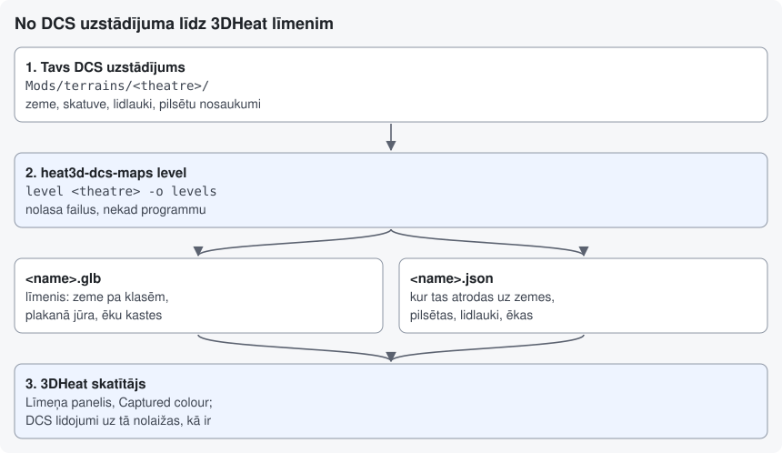

# 3DHeat DCS {#dheat-dcs}

**Kas tas ir?** Teātris ir DCS World vārds kartei: reģions pasaulē, pa kuru lido. Šis rīks pārvērš viena teātra zemi, nolasītu no **jūsu paša uzstādījuma**, par 3D līmeni - modeli, pār kuru var lidot - [3DHeat](https://github.com/Holdi601/3DHeat) skatītājam
([dokumentācija](https://holdi601.github.io/3DHeat/)).

**Kāpēc to lietot?** Lai redzētu savus DCS lidojumus pār spēles pašu karti: tās kalniem, krastu, lidlaukiem, ceļiem, dzelzceļiem, pilsētām un ēkām.

**Piemērs:** `heat3d-dcs-maps level <theatre> -o levels` ->
`levels/<theatre>.glb` (līmenis) + `levels/<theatre>.json` (kur tas atrodas uz zemes, tā pilsētas un lidlauki).

Kam tas noder:

- **Lidojumi pa spēles pašu karti.** 3DHeat pasaules fons zīmē šodienas zemi no atvērtiem datiem; šis zīmē teātri tā, kā to zīmē DCS.
- **Nav novietošanas soļa.** Līmenis ir DCS pašu pasaules metros, tāpēc telemetrija DCS metros (3DHeat Watcher DCS kabatas ieraksta tieši to) uz tā nokrīt ar skatītāja noklusējumiem.
- **Platums un garums.** Katrs līmenis nes savu projekciju, savus stūrus un savas pilsētas abos rāmjos.



## Ātrais sākums {#quick-start}

Nekad neesat strādājis ar komandrindu? Vispirms izlasiet [Pirms sākat](before-you-start.md).
Palaidiet šīs komandas mapē, kurā klonējāt vai izpakojāt rīku:

```bash
python -m pip install -e .                         # uzstāda komandu heat3d-dcs-maps
heat3d-dcs-maps list                               # uzstādītie teātri un vai katrs ir nolasāms
heat3d-dcs-maps level <theatre> -o levels          # viens viss (mazs) teātris
heat3d-dcs-maps level <theatre> --around <lat> <lon> 12 -o levels --name <name>   # 12 km uz katru pusi no punkta
```

No `list` redzēsiet vienu rindu katram teātrim, beidzoties ar `readable`.
Pēc tam ielādējiet `levels/<name>.glb` skatītāja Līmeņa panelī
([Līmeņi](https://holdi601.github.io/3DHeat/levels.html)).

Līmeņi, ko tas raksta, veidoti no spēles datiem un paliek **jūsu datorā**, lai tos skatītos, nevis lai kopīgotu vai publicētu ([Noteikumi](terms.md)).

Katrs spēles lasītājs ir atsevišķs mazs projekts ar savu licences failu, saviem laidieniem un savu problēmu sekotāju, tāpēc to var instalēt, atjaunināt, uzturēt - vai pēc tiesību īpašnieka lūguma atsaukt - atsevišķi, neietekmējot skatītāju vai citus rīkus.

## Lapas {#pages}

| Lapa | Ko tā aptver |
|---|---|
| [Pirms sākat](before-you-start.md) | Python, termināls, pirmā palaišana |
| [Teātru meklēšana: list](list.md) | kur atrast uzstādījumu, ko izdrukā `list` |
| [Līmeņa veidošana: level](level.md) | katra iespēja, reģioni, izmērs, soli pa solim |
| [Līmeņa faili](output.md) | `.glb` daļas, zemes klases un to krāsas, `.json`, koordinātes |
| [Vietu nosaukumi: towns](towns.md) | teātra pilsētas ar DCS koordinātēm |
| [Projekcijas: fit](fit.md) | teātra projekcijas atrašana no ieraksta |
| [Kā tiek nolasīti faili](reading.md) | formāti, kas ir pārbaudīts, kas netiek nolasīts |
| [Noteikumi un licence](terms.md) | ko lasa, ko nepiegādā, licence |
| [Komandu atsauce](../cli-reference.md) | katra iespēja, ģenerēta no koda |
| [Šo lapu uzturēšana](maintaining.md) | izlaides kontrolsaraksts |

## Saistītais {#related}

- 3DHeat skatītājs: [github.com/Holdi601/3DHeat](https://github.com/Holdi601/3DHeat),
  dokumentācija vietnē [holdi601.github.io/3DHeat](https://holdi601.github.io/3DHeat/).
- Telemetrija šiem līmeņiem: [3DHeat Watcher](https://holdi601.github.io/3DHeat-Watcher/)
  ieraksta DCS lidojumus; skatītāja failu formāti, tostarp tā viena faila mača konteiners,
  aprakstīti lapā [Viens fails vienam mačam (.3dheat)](https://holdi601.github.io/3DHeat/container.html).

## 3DHeat rīki {#the-3dheat-tools}

| Rīks | Ko tas dara | Kods | Dokumentācija |
|---|---|---|---|
| 3DHeat skatītājs | rāda datus: siltumkartes, sacensību analīzi, maču pārskatu | [3DHeat](https://github.com/Holdi601/3DHeat) | [dokumentācija](https://holdi601.github.io/3DHeat/) |
| GameFiles | līmeņi un trases no spēles pašu failiem | [3DHeat-GameFiles](https://github.com/Holdi601/3DHeat-GameFiles) | [dokumentācija](https://holdi601.github.io/3DHeat-GameFiles/) |
| GameCapture | telemetrija no apļiem un līmeņi, atjaunoti no spēles video | [3DHeat-GameCapture](https://github.com/Holdi601/3DHeat-GameCapture) | [dokumentācija](https://holdi601.github.io/3DHeat-GameCapture/) |
| Unreal Exporter | Unreal Editor spraudnis: līmenis kā viens `.glb` | [3DHeat-UnrealExporter](https://github.com/Holdi601/3DHeat-UnrealExporter) | [dokumentācija](https://holdi601.github.io/3DHeat-UnrealExporter/) |
| CS2 | Counter-Strike 2 demo un kartes | [3DHeat-CS2](https://github.com/Holdi601/3DHeat-CS2) | [dokumentācija](https://holdi601.github.io/3DHeat-CS2/) |
| Watcher | ieraksta to, ko spēles publicē, kamēr jūs spēlējat | [3DHeat-Watcher](https://github.com/Holdi601/3DHeat-Watcher) | [dokumentācija](https://holdi601.github.io/3DHeat-Watcher/) |
| Ext-WarThunder | War Thunder ieraksti | [3DHeat-Ext-WarThunder](https://github.com/Holdi601/3DHeat-Ext-WarThunder) | [dokumentācija](https://holdi601.github.io/3DHeat-Ext-WarThunder/) |
| Ext-WoT | World of Tanks ieraksti | [3DHeat-Ext-WoT](https://github.com/Holdi601/3DHeat-Ext-WoT) | [dokumentācija](https://holdi601.github.io/3DHeat-Ext-WoT/) |
| Ext-WoWs | World of Warships ieraksti | [3DHeat-Ext-WoWs](https://github.com/Holdi601/3DHeat-Ext-WoWs) | [dokumentācija](https://holdi601.github.io/3DHeat-Ext-WoWs/) |
| Ext-Squad | Squad servera demo | [3DHeat-Ext-Squad](https://github.com/Holdi601/3DHeat-Ext-Squad) | [dokumentācija](https://holdi601.github.io/3DHeat-Ext-Squad/) |
| Ext-DCS | DCS World kartes kā 3D līmeņi | [3DHeat-Ext-DCS](https://github.com/Holdi601/3DHeat-Ext-DCS) | [dokumentācija](https://holdi601.github.io/3DHeat-Ext-DCS/) |
| Ext-IL2 | IL-2 Sturmovik kartes kā 3D līmeņi | [3DHeat-Ext-IL2](https://github.com/Holdi601/3DHeat-Ext-IL2) | [dokumentācija](https://holdi601.github.io/3DHeat-Ext-IL2/) |
