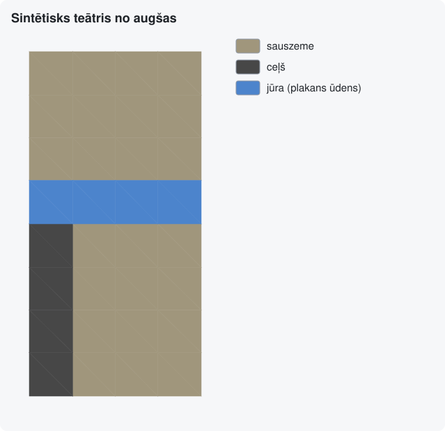
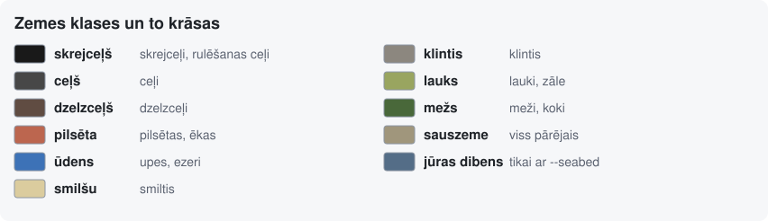

# Līmeņa faili {#the-level-files}

Līmenis ir zemes 3D modelis; teātris ir DCS World vārds kartei.

`<out>/<name>.glb` un blakus `<name>.json`.

| Daļa | Ko tā ir |
|---|---|
| `ground:<Level>` | paša reljefa trijstūri, krāsoti pēc tā, ko spēle zīmē pāri katram |
| `water:<Level>` | katrs trijstūris, ko spēle atzīmē kā zem jūras, izlīdzināts plakani jūras līmenī |
| `structure:<Level>` | teātra ēkas kā kastes, tur, kur tās novieto spēle (zemāk) |

Krāsas ir zemāk redzamās klases:

Krāsas redzamas ar **Captured colour** skatītāja līmeņa panelī. Katrs zemes trijstūris iegūst to
pārklājuma klasi, ar kuru spēle to zīmē:

| Klase | Krāsa | No spēles pārklājuma |
|---|---|---|
| runway | gandrīz melna | `Runway` - skrejceļi, rulēšanas ceļi un peroni |
| road | tumši pelēka | `Road` |
| rail | brūna | `Rail` |
| town | ķieģeļsarkana | `Town`, `Building` |
| water | zila | `River`, `Lake` (iekšzemes ūdens, zīmēts kā zeme) |
| beach | smilšu | `Beach` |
| rock | pelēka | `Rock` |
| field | gaiši zaļa | `Field`, `Grass` |
| forest | tumši zaļa | `Forest`, `Trees` |
| land | haki | nekas no šiem |
| seabed | pelēkzila | tikai ar `--seabed` |

Ja vairāki pārklājumi zīmē to pašu trijstūri, izšķir tabulas kārtība
(ceļš caur mežu ir ceļš). Katrs pārklājuma trijstūris ir viens no paša reljefa - pārbaudīts uz katras izmēģinātā teātra klases, katrs sakrita - tātad klases ir precīzas, nevis minētas pēc tuvākajiem punktiem.

**Koordinātes** ir DCS pašas pasaules metri: x ziemeļi, y augšup, z austrumi, un glTF asis ir tādas pašas (X = x, Y = y, Z = z). Telemetrija DCS metros - 3DHeat Watcher DCS kabatas ieraksta tieši to - uz līmeņa nokrīt ar skatītāja noklusējumiem (Y augšup, mērogs 1) un bez novietošanas soļa.

**Platums un garums:** katrs teātris ir Transversālā Merkatora projekcija ar savām konstantēm; `<name>.json` tās satur, līmeņa stūrus platuma un garuma koordinātēs, un katru pilsētu gan ar tās platuma/garuma koordinātēm, gan ar DCS x/z. Ja teātra konstantes nav publicētas, tās tiek pieskaņotas tā paša `beacons.lua` bākām abos rāmjos (dažu cm vidējā kvadrātiskā kļūda; tas pats pieskaņojums atdod citu teātru publicētās konstantes līdz milimetram). Teātrim bez konstantēm [`fit`](fit.md) tās atrod no jebkura ieraksta, kurā ir abi, piemēram, Watcher sesija vienam lidojumam.

**Jūras dibens** tiek izlaists (lidojumu simulatora siltumkartei jūras dibens nav vajadzīgs); `--seabed` to paglabā kā zemi. `--no-water` izlaiž plakano jūru.

**Izmērs.** Skatiet [Līmeņa veidošana: Izmērs](level.md#size).

**Lidlauki.** Katrs `AirfieldsTaxiways/<name>.rn4` satur viena lidlauka rulēšanas tīklu, nosauktu pēc tā; tā punkti ir (x, y, z) dubultā precizitāte DCS metros. Līmeņa `.json` uzskaita katru lidlauku reģionā ar tā nosaukumu (faila), tā punktu kastes vidu, kasti un zemi tur. Izmēģinātajā teātrī katrs lidlauka fails tika nolasīts, katrs novietots uz sava lauka (dažu simtu metru robežās no uzmērītā lidostas atsauces punkta: rulēšanas ceļu vidus, nevis skrejceļa).

**Ēkas.** `Scenes/<theatre>.scn5` novieto katru teātra objektu (miljoniem - koki, lampas, žogi, vadi, mājas). Tās, kas pēc nosaukuma un izmēra ir ēkas (mājas, dzīvokļi, šķūņi, angāri, rūpnīcas, torņi, termināļi: daļa modeļu, simtiem tūkstošu novietojumu), tiek zīmētas kā kastes: katra modeļa pašas ģeometrijas ietvars no faila, pagriezts pēc virziena un novietots tur, kur to novieto spēle, no līdz 3 m zem tā izcelsmes (tā pamats nogāzē) līdz tā augšai. Koki, krūmi, gaismas, stabi, vadi, žogi, sienas, zīmes, transportlīdzekļi, vagoni, laivas, celtņi, masti, piloni un tilti netiek ņemti vērā. Spēles modeļu formas vai tekstūras netiek kopētas: kaste katrai ēkai, krāsota pēc veida (māja, bloks, rūpnieciska, lidlauks, tornis, cita). `<name>.json` tās uzskaita arī (`buildings.rows`: x, z, base, height, half lengths, heading, kind) skatītāja hibrīdajam fonam, kas tās zīmē spēles pilsētās, nevis kartētās ēkas vietā. `--no-buildings` tās izlaiž.

`<name>.json` ieraksta arī avota failu, tā izmēru un datumu, nolasītās flīzes, trijstūru skaitu pa klasēm un to, cik no teātra pilsētām nokrīt uz zemes - projekcijas pārbaude, kurai vajadzētu rādīt "N no N".

Līmenis ir glTF binārs fails ar nosauktām daļām, kā visi 3DHeat līmeņi; skatītāja lapa [Līmeņi](https://holdi601.github.io/3DHeat/levels.html) apraksta, kā tie tiek ielādēti.
