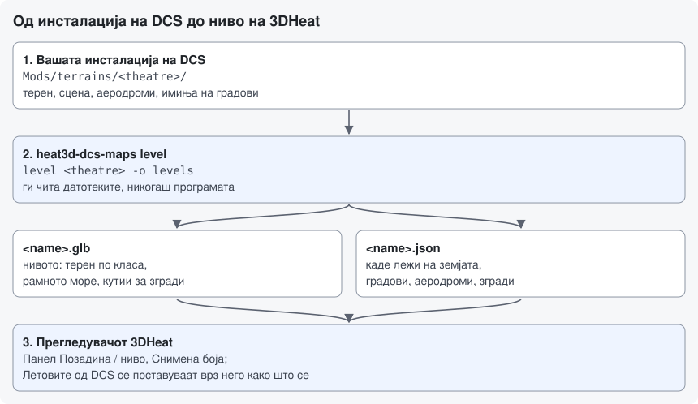

# 3DHeat DCS {#dheat-dcs}

**Што е тоа?** Театар е зборот на DCS World за мапа: регион од
светот над кој летате. Оваа алатка го претвора теренот на еден театар, прочитан од
**вашата сопствена инсталација**, во 3D ниво - модел над кој може да летате - за
прегледувачот [3DHeat](https://github.com/Holdi601/3DHeat)
([документација](https://holdi601.github.io/3DHeat/)).

**Зошто би ја користел?** За да ги видите вашите летови во DCS над сопствената мапа на играта: нејзините
ридови, брег, аеродроми, патишта, железници, градови и згради.

**Пример:** `heat3d-dcs-maps level <theatre> -o levels` ->
`levels/<theatre>.glb` (нивото) + `levels/<theatre>.json` (каде лежи на
земјата, неговите градови и аеродроми).

За што е корисна:

- **Летови на сопствената мапа на играта.** Позадината на светот во 3DHeat ја црта денешната
  земја од отворени податоци; ова го црта театарот како што го црта DCS.
- **Без чекор за поставување.** Нивото е во сопствените метри на светот на DCS, па телеметријата
  во метри од DCS (токму тоа го пишува DCS куката на 3DHeat Watcher) се поставува
  на него со стандардните поставки на прегледувачот.
- **Географска ширина и должина.** Секое ниво ја носи својата проекција, своите агли
  и своите градови во двата координатни системи.



## Брз почеток {#quick-start}

Нови сте со командната линија? Прво прочитајте [Пред да започнете](before-you-start.md).
Пуштете ги овие во папката што сте ја клонирале или распакувале:

```bash
python -m pip install -e .                         # installs the heat3d-dcs-maps command
heat3d-dcs-maps list                               # the theatres installed, and whether each can be read
heat3d-dcs-maps level <theatre> -o levels          # a whole (small) theatre
heat3d-dcs-maps level <theatre> --around <lat> <lon> 12 -o levels --name <name>   # 12 km either side of a point
```

Од `list` треба да видите по една линија за театар, што завршува со `readable`.
Потоа вчитајте `levels/<name>.glb` во панелот Позадина / ниво на прегледувачот
([Нивоа](https://holdi601.github.io/3DHeat/levels.html)).

Нивоата што ги пишува се изградени од податоците на играта: остануваат **на вашата
машина**, за гледање, не за споделување или објавување ([Услови](terms.md)).

## Страници {#pages}

| Страница | Што опфаќа |
|---|---|
| [Пред да започнете](before-you-start.md) | Python, терминал, прво извршување |
| [Наоѓање театри: list](list.md) | каде се наоѓа инсталацијата, што печати `list` |
| [Градење ниво: level](level.md) | секоја опција, региони, големина, чекор по чекор |
| [Датотеките на нивото](output.md) | деловите на `.glb`, класите на терен и нивните бои, `.json`, координатите |
| [Имиња на места: towns](towns.md) | градовите на еден театар со координати од DCS |
| [Проекции: fit](fit.md) | наоѓање на проекцијата на театар од снимка |
| [Како се читаат датотеките](reading.md) | форматите, што е проверено, што не се чита |
| [Услови и лиценца](terms.md) | лиценцата на Eagle Dynamics и зошто ова е посебен пакет |
| [Упатство за команди](../cli-reference.md) | секоја опција, генерирано од кодот |
| [Одржување на оваа документација](maintaining.md) | списокот за проверка при издание |

## Поврзано {#related}

- Прегледувачот 3DHeat: [github.com/Holdi601/3DHeat](https://github.com/Holdi601/3DHeat),
  документација на [holdi601.github.io/3DHeat](https://holdi601.github.io/3DHeat/).
- Телеметрија за овие нивоа: [3DHeat Watcher](https://holdi601.github.io/3DHeat-Watcher/)
  ги снима летовите во DCS; форматите на датотеки на прегледувачот, вклучително и неговиот
  контејнер со една датотека по меч, се опишани во
  [Една датотека по меч (.3dheat)](https://holdi601.github.io/3DHeat/container.html).

## Алатките на 3DHeat {#the-3dheat-tools}

| Алатка | Што прави | Код | Документација |
|---|---|---|---|
| 3DHeat viewer | ги прикажува податоците: топлински мапи, анализа на трки, преглед на мечеви | [3DHeat](https://github.com/Holdi601/3DHeat) | [docs](https://holdi601.github.io/3DHeat/) |
| GameFiles | нивоа и патеки од сопствените датотеки на играта | [3DHeat-GameFiles](https://github.com/Holdi601/3DHeat-GameFiles) | [docs](https://holdi601.github.io/3DHeat-GameFiles/) |
| GameCapture | телеметрија на кругови, и нивоа обновени од видео од игра | [3DHeat-GameCapture](https://github.com/Holdi601/3DHeat-GameCapture) | [docs](https://holdi601.github.io/3DHeat-GameCapture/) |
| Unreal Exporter | приклучок за Unreal Editor: ниво како една `.glb` | [3DHeat-UnrealExporter](https://github.com/Holdi601/3DHeat-UnrealExporter) | [docs](https://holdi601.github.io/3DHeat-UnrealExporter/) |
| CS2 | демоа и мапи од Counter-Strike 2 | [3DHeat-CS2](https://github.com/Holdi601/3DHeat-CS2) | [docs](https://holdi601.github.io/3DHeat-CS2/) |
| Watcher | снима што играта објавува додека играте | [3DHeat-Watcher](https://github.com/Holdi601/3DHeat-Watcher) | [docs](https://holdi601.github.io/3DHeat-Watcher/) |
| Ext-WarThunder | снимки од War Thunder | [3DHeat-Ext-WarThunder](https://github.com/Holdi601/3DHeat-Ext-WarThunder) | [docs](https://holdi601.github.io/3DHeat-Ext-WarThunder/) |
| Ext-WoT | снимки од World of Tanks | [3DHeat-Ext-WoT](https://github.com/Holdi601/3DHeat-Ext-WoT) | [docs](https://holdi601.github.io/3DHeat-Ext-WoT/) |
| Ext-WoWs | снимки од World of Warships | [3DHeat-Ext-WoWs](https://github.com/Holdi601/3DHeat-Ext-WoWs) | [docs](https://holdi601.github.io/3DHeat-Ext-WoWs/) |
| Ext-Squad | демоа од Squad сервери | [3DHeat-Ext-Squad](https://github.com/Holdi601/3DHeat-Ext-Squad) | [docs](https://holdi601.github.io/3DHeat-Ext-Squad/) |
| Ext-DCS | мапи од DCS World како 3D нивоа | [3DHeat-Ext-DCS](https://github.com/Holdi601/3DHeat-Ext-DCS) | [docs](https://holdi601.github.io/3DHeat-Ext-DCS/) |
| Ext-IL2 | мапи од IL-2 Sturmovik како 3D нивоа | [3DHeat-Ext-IL2](https://github.com/Holdi601/3DHeat-Ext-IL2) | [docs](https://holdi601.github.io/3DHeat-Ext-IL2/) |
