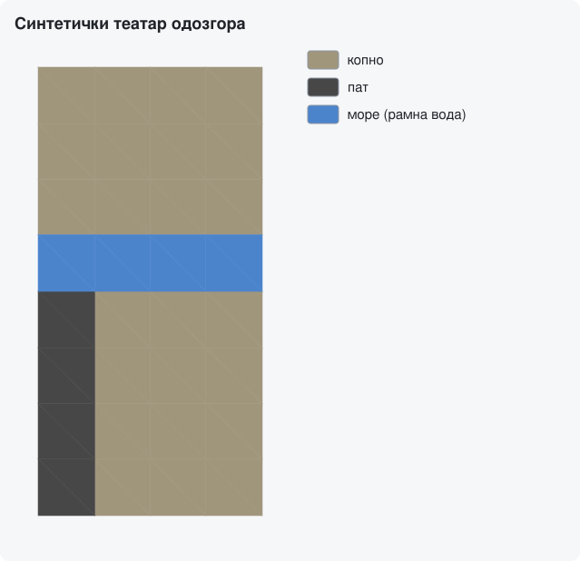
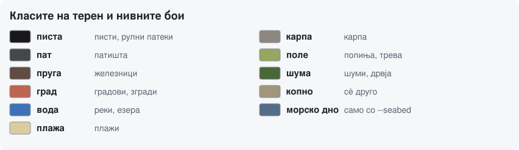

# Датотеките на нивото {#the-level-files}

Нивото е 3D модел на теренот; театар е зборот на DCS World за мапа.

`<out>/<name>.glb` и `<name>.json` покрај него.

| Дел | Што е |
|---|---|
| `ground:<Level>` | сопствените триаголници на теренот, обоени според тоа што играта црта врз секој |
| `water:<Level>` | секој триаголник што играта го означува како под морето, положен рамно на морското ниво |
| `structure:<Level>` | зградите на театарот како кутии, таму каде што ги става играта (подолу) |

Боите се класите подолу:

Боите се гледаат со **Снимена боја** во панелот на нивото на прегледувачот. Секој
триаголник на терен ја зема класата на преклопот со кој играта го црта:

| Класа | Боја | Од преклопот на играта |
|---|---|---|
| runway | речиси црна | `Runway` - писти, рулни патеки и платформи |
| road | темно сива | `Road` |
| rail | кафеава | `Rail` |
| town | тула црвена | `Town`, `Building` |
| water | сина | `River`, `Lake` (внатрешни води, цртани како терен) |
| beach | песочна | `Beach` |
| rock | сива | `Rock` |
| field | светло зелена | `Field`, `Grass` |
| forest | темно зелена | `Forest`, `Trees` |
| land | каки | ништо од овие |
| seabed | сино-сива | само со `--seabed` |

Таму каде што неколку преклопи го цртаат истиот триаголник, редоследот во табелата одлучува
(пат низ шума е пат). Секој триаголник на преклоп е еден од сопствените на теренот -
проверено на секоја класа на испробаните театри, секој се совпадна - па
класите се точни, не погодени од блиски точки.

**Координатите** се сопствените метри на светот на DCS: x север, y нагоре, z исток, а
оските на glTF се исти (X = x, Y = y, Z = z). Телеметријата во метри од DCS - токму
тоа го пишува DCS куката на 3DHeat Watcher - се поставува на нивото со
стандардните поставки на прегледувачот (Y нагоре, скала 1) и без чекор за поставување.

**Географска ширина и должина:** секој театар е Трансверзална Меркаторова проекција
со свои константи; `<name>.json` ги носи тие, аглите на нивото во
географска ширина и должина, и секој град и со неговата географска ширина/должина и
со неговите DCS x/z. Таму каде што константите на театарот не се објавени, тие се прилагодуваат
според светилниците (beacons) што ги дава неговата `beacons.lua` во двата координатни системи (неколку cm средна квадратна
грешка; истото прилагодување ги враќа објавените константи на други театри
до милиметар).
За театар без константи, [`fit`](fit.md) ги наоѓа од која било
снимка што ги содржи и двете, како сесија на Watcher од еден лет.

**Морското дно** е изоставено (топлинска мапа за летачки симулатор не го бара морското
дно); `--seabed` го задржува како терен. `--no-water` го изоставува
рамното море.

**Големина.** Видете [Градење ниво: Големина](level.md#size).

**Аеродроми.** Секоја `AirfieldsTaxiways/<name>.rn4` ја содржи мрежата од рулни патеки на
еден аеродром, именувана по него; нејзините точки се (x, y, z) double во метри од DCS. `.json` на
нивото го наведува секој аеродром во регионот со неговото име (она на датотеката), средината на кутијата на неговите точки,
кутијата, и теренот таму. На испробаниот театар, секоја датотека за аеродром се прочита, секоја поставена на своето поле
(во рамките на неколку стотини метри од испитаната референтна точка на аеродромот: средината
на рулните патеки, не на пистата).

**Згради.** `Scenes/<theatre>.scn5` ги поставува сите објекти на театарот
(милиони - дрвја, ламби, огради, жици, куќи). Оние
што се згради по име и големина (куќи, станови, шупи, хангари,
фабрики, кули, терминали: дел од моделите, стотици
илјади поставувања) се цртаат како кутии: сопствената гранична кутија на секој модел од
датотеката, свртена кон својот правец и поставена таму каде што ја става играта, од најмногу
3 m под својот почеток (неговото потпирање на наклон) до неговиот врв. Дрвјата, грмушките,
светилките, столбовите, жиците, оградите, ѕидовите, знаците, возилата, вагоните, бродовите, кранови,
јарболи, пилони и мостови се изоставени. Ниту еден модел или текстура
на играта не е копиран: една кутија по зграда, обоена по вид (куќа, блок,
индустриска, аеродром, кула, друго). `<name>.json` ги наведува и нив
(`buildings.rows`: x, z, база, висина, половини должини, правец, вид) за
хибридната позадина на прегледувачот, која ги црта во градовите на играта наместо
мапираните згради. `--no-buildings` ги изоставува.

`<name>.json` ги запишува и изворната датотека, нејзината големина и датум, прочитаните плочки (tiles),
бројот на триаголници по класа, и колку од градовите на театарот лежат
на теренот - проверка на проекцијата што треба да гласи „N of N“.

Нивото е glTF бинарна датотека со именувани делови, како и секое ниво на 3DHeat; страницата
[Нивоа](https://holdi601.github.io/3DHeat/levels.html) на прегледувачот објаснува како ги вчитува.
